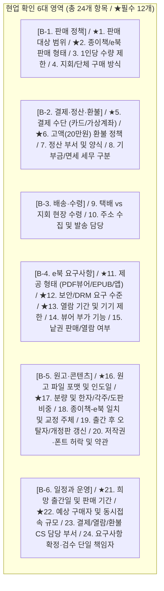

# 01. 요구사항 파악 및 현업·법무·회계 협의 기준서

- **상위 문서**: [README.md (마스터 허브)](file:///Users/jeongseongchae/dev/jts/정토대전/docs/README.md)
- **연관 게이트**: `G0 (요구사항 확정)`, `G1 (권리와 원고 인수)`, `G2 (기술 검증)`
- **주요 대상**: 사료편찬위원회(사업 책임자), 편집 담당자, 권리·법무 담당자, 회계·행정 담당자, 시스템국 분석 담당자

---

> [!IMPORTANT]
> **[v2.2 확정 아키텍처 및 정책 기준 안내 (2026-10-24)]**
> 본 문서의 초기 검토 항목 중 발행 형태 및 결제 수단은 최종 의사결정에 따라 다음과 같이 확정되었습니다.
> 1. **100% 전자책(eBook) 단독 발행 (종이책 미발행)**: 실물 배송지 수집·물류 발송 절차를 전면 배제하며, 국립중앙도서관 **전자출판물 단독 E-ISBN 발급(부가세 0% 면세)**을 적용합니다.
> 2. **PG 1회용 가상계좌(무통장 송금) 단일 결제 (+72h TTL)**: 신용카드/간편결제 없이 6대 은행 가상계좌 송금으로만 결제하며, 미열람 청약철회 대비 환불 반환계좌(`AES-256-GCM`)를 사전 수집합니다.
> 3. **프로덕션 엔지니어링 명세 및 도면**: [PostgreSQL 16 6-Table DDL](file:///Users/jeongseongchae/dev/jts/정토대전/docs/specs/schema_v1_jungto_ebook.sql) · [OpenAPI 3.1 계약서](file:///Users/jeongseongchae/dev/jts/정토대전/docs/specs/openapi_v1_jungto_ebook.yaml) · [4-Layer 시스템 도면](file:///Users/jeongseongchae/dev/jts/정토대전/docs/jungto_ebook_architecture_diagram.html) · [Excalidraw 구성도](file:///Users/jeongseongchae/dev/jts/정토대전/docs/jungto_ebook_system_architecture.png)를 최우선 기준으로 적용합니다.


## 1. 사료편찬위원회 최초 요청사항 및 핵심 쟁점

### 1.1 현업 요청 배경 요약
- **대상 도서**: 『정토대전』 총 4권 세트
- **책정 판매가**: 20만 원 (고액 상품)
- **유통 방침**: 외부 일반 서점 판매 미진행, **정토회원에게만 한정 판매**
- **시스템국 검토 의뢰 2대 항목**:
  1. **[검토 1] 회원인증 판매 루트**: 구매 과정에서 정토회원 인증을 거치도록 구현 가능한지 여부
  2. **[검토 2] 자체 e북 제작 및 개발**: 일반 서점 유통을 하지 않으므로 자체적으로 e북을 만들어야 하는데, 시스템국에서 개발 프로젝트로 진행 가능한지 여부 (① 기술적 자체 개발 가능성, ② 일의 범위와 규모·필요 인력·소요 기간, ③ 현 시스템국 인력 및 프로젝트 상황상 수용 가능 여부)

### 1.2 초기 요청 및 통념에서 바로잡아야 할 9대 실무 기준 (Reality Check)
현업이나 초기 논의에서 쉽게 오해하기 쉬운 기술·법무적 통념을 실제 프로덕션 기준으로 보완한 원칙입니다.

| 초기 통념 / 표현 | 실제 엔지니어링 및 법무 실행 기준 |
| :--- | :--- |
| **"PDF 단순 다운로드는 개발 공수가 거의 없다"** | 파일 배포 자체 외에도 권리 확인, 회원 자격 검증, 결제/환불 연동, 정오표 파일 교체, CS 대응 도구가 필수 수반됨 |
| **"웹 뷰어로 만들면 파일 유출/취득이 완전히 차단된다"** | 로그인과 서명 URL은 '무권한 외부인의 접근'을 차단할 뿐, **열람 권한을 가진 브라우저로 전송된 PDF/이미지/텍스트의 추출이나 화면 촬영까지 100% 막을 수는 없음** (완전 차단이 목적이면 상용 DRM P4 또는 전용 앱 P5 필수) |
| **"본문 검색이 필수면 무조건 EPUB(P3)으로 가야 한다"** | 텍스트 레이어가 살아 있는 인쇄용 PDF와 `PDF.js` 조합(P2)만으로도 권 내 본문 검색이 완벽히 가능함. 글자 크기 변경에 따른 **줄바꿈 재배치(Reflow)**가 필수일 때만 EPUB(P3)의 필요성이 커짐 |
| **"우클릭·복사·인쇄 차단을 걸면 보안(DRM)이 해결된다"** | 이는 선량한 사용자의 실수를 막는 **UI 제약(억제책)**일 뿐 서버 권한 검사나 암호화 DRM을 대체하지 못함. 키보드·스크린리더 접근성 훼손 여부도 함께 점검해야 함 |
| **"인디자인(InDesign) 원고가 있으니 EPUB이 바로 나온다"** | 인디자인의 EPUB 내보내기 기능이 있으나, 스타일·읽기 순서·복잡한 표·각주·한자 이체자가 깨지므로 별도의 XHTML 구조화 및 전수 편집 검수 비용이 발생함 |
| **"오프라인 열람이 필요하면 PWA로 만들면 된다"** | 브라우저 PWA 캐시는 환불 시 파일 강제 회수, 암호화, 기기 인증을 보장하지 않으며 브라우저 용량 부족 시 임의 삭제됨 |
| **"저작권/권리가 정리 안 되면 아무 개발도 못 한다"** | 실제 원고의 서버 반입·변환·공개는 권리 확보 전 금지하지만, **허가된 더미(샘플) 원고로 마이정토 인증·결제·뷰어 시제품(PoC)을 먼저 개발하는 것은 별도로 가능**함 |
| **"e북은 구매 후 환불 불가가 원칙이다"** | 전자상거래법상 청약철회 제한을 적용하려면 **구매 전 명확한 고지, 샘플(미리보기) 등 시험 사용 조치, 실제 '첫 열람 개시(ReadingStart)' 서버 증빙 로그**가 법정 요건을 충족해야 함 |
| **"한 번 사면 영구 열람을 보장한다"** | '이용권의 유효기간'과 '서버 서비스의 영구 지속 의무'를 구분하여 약관에 명시하고, 서비스 종료 시 사전 고지·대체 제공·보상 원칙을 사전에 정의해야 함 |

---

## 2. 현업 부서(사료편찬위원회·행정·회계) 확인 필요 사항 24선 (B항목)

> [!WARNING]
> 아래 항목 중 **★ 표시된 12개 항목**은 시스템국이 개발 범위·인력·소요 기간을 산정하고 프로젝트 수용 여부를 판단하기 위해 **반드시 사전에 답변받아야 하는 필수 정보**입니다.



### 상세 질의 및 시스템 영향도 매트릭스

| 구분 | 번호 | 필수 | 확인 항목 및 세부 질문 | 결정에 따라 달라지는 시스템/운영 작업 |
| :--- | :---: | :---: | :--- | :--- |
| **B-1. / 판매 정책** | 1 | **★** | **판매 대상**: 전체 마이정토 가입 회원인지, 특정 회원 구분(정토행자, 모둠원 등)만 가능한지? 비회원 구매 요청 시 처리 방침은? | 마이정토 회원 등급/자격 조회 API 필터링 조건 및 예외 권한 부여 기능 |
| | 2 | **★** | **판매 형태**: 종이책 4권 세트 구매 시 e북을 무료 부속으로 주는지, 종이책과 e북을 별도 상품으로 병행 판매하는지, e북 단독 판매인지? | 상품 테이블 구성, 과세/면세 금액 배분, 종이책 구매자 e북 열람권 자동 연동 |
| | 3 | - | **수량 제한**: 1인 1세트 제한인지, 복수 구매(선물용, 지회 비치용)를 허용하는지? | 주문 시 회원ID별 기구매 여부 중복 체크(DB Unique 제약) 및 선물하기 코드 발급 여부 |
| | 4 | - | **단체 구매**: 지회·법당 단위 단체 구매 허용 여부와 그 경우의 결제·수령 방식은? | 단체 주문 전용 입력 폼 및 다량 배송 처리 프로세스 |
| **B-2. / 결제·정산·환불** | 5 | **★** | **결제 방식**: 온라인 카드결제 외에 계좌이체를 지원하는지? **(※ 시스템국은 수기 무통장 입금 불가, PG 가상계좌 도입 필수 권고)** | PG사 가맹 계약(카드 + 가상계좌 웹훅 연동), 입금 기한(예: 3일) 만료 자동 취소 워커 |
| | 6 | **★** | **환불·취소 정책**: 20만 원 고액 상품의 환불 가능 기간, 조건(래핑 개봉, e북 첫 열람 후 제한 등), 반품 배송비 부담, 환불 처리 전담 부서는? | 청약철회 고지 UI, 첫 열람(`ReadingStart`) 로그 기록, 환불 계좌 수집 폼, 열람권 즉시 회수 로직 |
| | 7 | - | **매출 정산**: 회계 처리 담당 부서와 일일/월간 필요한 정산 대사 자료 형태는? | 관리자 정산 엑셀 다운로드 양식 및 PG 원장 대사 항목 |
| | 8 | - | **세무·영수증**: 도서 판매(면세 재화)로만 처리하는지, 기부·후원금 성격이 섞이는지? 현금영수증 발행 기준은? | 기존 마이정토 기부금(보시/기도비) PG 코드와 **물품 판매용 PG 상점아이디(MID) 분리** 여부 |
| **B-3. / 배송·수령** | 9 | - | **배송 방식**: 종이책 배송이 있는지, 개별 택배 발송인지 지회 일괄 수령인지? | 주문 화면 내 배송 방법 선택 옵션 |
| | 10 | - | **배송지 및 물류**: 배송지 주소 수집 필요 여부와 실제 포장·발송·송장 입력을 맡을 담당 부서는? | 도로명 우편번호 검색 API 연동, 배송팀용 주문/주소록 엑셀 다운로드 기능 |
| **B-4. / e북 요구사항** | 11 | **★** | **e북 제공 형태**: 파일 다운로드(PDF/EPUB)인지, 로그인 후 보는 **웹 뷰어(P2/P3)**인지, 전용 모바일 앱(P5)이 필요한지? | 프로젝트 전체 아키텍처(P1~P5) 및 개발 공수(2주 vs 10주 vs 외주) 결정 |
| | 12 | **★** | **보안 수준**: 유출·복제 방지가 어느 수준이어야 하는지? (단순 안내 / 다운로드·인쇄 버튼 제거 + 화면 워터마크 / 상용 DRM 암호화·캡처 차단) | 오픈소스 `PDF.js` 자체 구축(P2) 가능 여부 vs 상용 DRM 솔루션 구매(P4) 판별 |
| | 13 | **★** | **열람 범위**: 열람 기간(영구 vs 1년/3년 기한제), 동시 접속/기기 수 제한 여부, PC·태블릿·스마트폰 지원 범위는? | `Entitlement` 만료일 스케줄러, 세션 동시성 제어, 모바일 반응형 UI 범위 |
| | 14 | - | **뷰어 세부 기능**: 목차, 본문 검색, 책갈피(북마크), 이어보기 외에 형광펜(하이라이트)·메모·글자 크기 재배치·다크모드가 필수인지? | 기본 필수 기능(P2 포함) 외 고급 기능 추가 시 공수 대폭 증가 여부 판단 |
| | 15 | - | **권별 분할**: 4권 전체 일괄 열람인지, 4권 중 일부만 열람하거나 낱권 판매를 하는지? | 권별(`volumeId`) 개별 권한 매핑 및 부분 환불 계산식 |
| **B-5. / 원고·콘텐츠** | 16 | **★** | **원고 파일 형태 및 시기**: 원본 포맷(인디자인, 텍스트 PDF, 스캔 PDF, HWP, Word)은 무엇이며 최종본 전달 시기는 언제인지? | 텍스트 추출 가능 여부 검증, OCR 추가 작업 필요 여부, 콘텐츠 변환 일정 산정 |
| | 17 | **★** | **원고 분량 및 특수 요소**: 권별 쪽수·용량, 도판(사진/지도)·복잡한 표·각주·한자(이체자/고어/산스크리트어) 비중은? | 폰트 임베딩 검증, 모바일 확대 배율, 한자 검색 정규화 사전 구축 범위 |
| | 18 | - | **편집 및 교정 주체**: 종이책과 e북 내용이 100% 동일한지, 디지털 변환 후 전수 검수·교정은 누가 맡는지? | 편집 책임자 지정 및 출시 전 G5 콘텐츠 검수 승인 절차 |
| | 19 | - | **사후 개정 운영**: 출간 이후 오탈자 수정·개정판 발생 시 업데이트 방식과 담당자는? | 불변 버전 매니페스트(`v1.0.1`) 배포 파이프라인 및 정오표 화면 |
| | 20 | - | **저작권·이용 허락**: 편찬·번역·도판·폰트의 **전자출판 배포 권리**가 확보되었는지, 별도 이용약관이 필요한지? | 자산별 권리대장 작성 (미확보 도판/폰트 존재 시 출시 차단) |
| **B-6. / 일정과 운영** | 21 | **★** | **희망 일정**: 희망 출간일, 판매 개시일, 판매 기간(상시 판매 vs 사전예약/한정기간 판매)은? | **Phase 1(종이책 선출간) 및 Phase 2(e북 순차 오픈)** 일정 분리 확정 |
| | 22 | **★** | **예상 규모**: 전체 회원 중 예상 구매자 수와 오픈 당일 최대 동시 접속 예상치는? | CDN 대역폭, DB 커넥션 풀, 부하 시험 기준치 및 월 클라우드 예산 산정 |
| | 23 | - | **CS 대응 부서**: 판매 후 결제 오류, 입금 확인, 배송 문의, e북 열람 장애, 환불을 전담할 부서와 인력은? | 운영자 권한 조회/조정 화면 설계 및 CS 매뉴얼 교육 대상 지정 |
| | 24 | - | **운영 책임자**: 요구사항 최종 확정과 단계별(G0~G7) 검수 승인을 책임질 현업 단일 창구는 누구인지? | 의사결정권자 지정 및 변경 관리(Change Request) 승인 체계 |

---

## 3. 프로젝트 수용 판단을 위한 '최소 필수 5대 질문' (Quick Checklist)

10/15 개발담당 회의 등 초기 의사결정 자리에서 현업으로부터 **즉시 확답을 받아야 할 5대 핵심 질문**입니다.

1. **[판매 채널 및 대상]** 별도 사이트 구축 대신 **'마이정토' 로그인 회원 전용 임시 구매 메뉴**로 오픈하는 것에 동의하는가? (1인 1세트 제한 여부 포함)
2. **[결제 수단]** 카드결제 외 계좌이체 지원 시, 수기 통장 대조 대란을 막기 위해 **'PG사 가상계좌(입금 기한 3일 자동 확인)' 도입**에 동의하는가?
3. **[출시 단계 분리]** 종이책 판매(2~3주 소요)를 출간일에 맞춰 먼저 오픈하고, **e북(최소 10주 소요)은 2단계로 순차 오픈**하는 로드맵에 동의하는가?
4. **[e북 보안과 예산의 선택]**
   - **선택 A (비용 0원, 자체 개발)**: 오픈소스 `PDF.js` 웹 뷰어로 다운로드/인쇄 버튼을 제거하고 회원 워터마크를 찍되, **기술적 100% 복제 차단은 불가능하다는 한계**를 수용하는가?
   - **선택 B (유료 솔루션 도입)**: 100%에 가까운 DRM 암호화와 캡처 차단이 필수여서 **수천만 원 수준의 외부 상용 솔루션(유니닥스 등) 도입 예산**을 책정할 것인가?
5. **[원고 및 운영 주체]** 4권의 **텍스트가 살아있는 최종 PDF(저작권·폰트 권리 해결 완료본)**를 언제 인계할 수 있으며, 택배 발송과 CS/환불을 전담할 현업 부서는 어디인가?

---

## 4. 원고 인수 및 사전 기술 검증 절차 (G1 ~ G2)

원고 파일을 전달받았다고 해서 즉시 개발에 넣지 않으며, 반드시 아래의 기술 검증(W04~W06)을 통과해야 합니다.

### 4.1 인수할 파일 묶음 및 디렉토리 버전 규칙
- **인수 목록**: 권별 최종 PDF 4권, 인디자인(InDesign) 등 편집 원본 및 연결 도판, 사용 폰트 파일 및 라이선스 목록, 인쇄본 목차·색인, 정오표, 권리 증빙서, 인쇄 쪽번호 체계표
- **불변 경로 원칙**: 원본 파일은 절대 덮어쓰지 않으며, SHA-256 해시를 기록하여 버전별로 관리합니다.
  - 원본 보관 경로 예시: `source/volume-01/rev-003/volume-01-final.pdf`
  - 배포 승인 경로 예시: `release/volume-01/v1.0.0/book.pdf`

### 4.2 원고 구조 및 텍스트 추출 CLI 사전 검증
기술 담당자는 승인된 로컬/검증 환경에서 아래 명령으로 4권의 PDF 상태를 전수 조사합니다.

```bash
# 1. 파일 무결성 해시 산출 (macOS는 shasum -a 256)
sha256sum volume-01-final.pdf

# 2. 페이지 수, 문서 크기, 암호화 여부, PDF 버전 확인
pdfinfo volume-01-final.pdf

# 3. 폰트 임베딩 여부(emb=yes), 서브셋(sub), 유니코드 문자 매핑(uni=yes) 확인
pdffonts volume-01-final.pdf

# 4. 실제 텍스트 레이어 추출 및 한자/이체자 깨짐 여부 확인
pdftotext -layout volume-01-final.pdf extracted_vol01.txt

# 5. PDF 내부 교차참조 테이블 및 스트림 구조 손상 점검
qpdf --check volume-01-final.pdf
```

> [!CAUTION]
> **검증 주의사항**
> - 마우스로 텍스트가 드래그 선택된다고 해서 검색이 정상 작동하는 것이 아닙니다. `pdffonts`에서 `uni(ToUnicode)` 매핑이 없거나 깨진 한자 폰트는 화면에 정상 출력되어도 `pdftotext` 추출 시 외계어로 깨져 **본문 검색이 완전히 불가능**합니다.
> - 만약 스캔 이미지 PDF이거나 텍스트 매핑이 깨진 원고라면 개발자가 임의로 OCR을 돌려 최종본으로 삼지 않으며, 편집 부서에 인디자인 재출력을 요청하거나 별도의 OCR·교정 일정/예산을 산정해야 합니다.

### 4.3 대표 페이지(30~50쪽) 및 검색어(50~100개) 실증 테스트
1. **대표 표본 선정 (30~50쪽)**: 4권 전체에서 일반 본문, 한자 밀집 구간, 희귀 이체자·고어·산스크리트어, 다단 각주, 연표, 가로로 넓은 표, 고해상도 사진/지도, 세로쓰기, 색인, 로마자/숫자 쪽번호 전환 구간을 모두 포함하여 선별합니다.
2. **검색어 대조 (50~100개)**: 편집 담당자와 함께 핵심 법어·인명·지명·경전명 50~100개를 정해 ① 인쇄본 표시 문자열, ② `pdftotext` 추출 결과, ③ `PDF.js` 웹 뷰어 내 실제 검색 결과를 3자 대조합니다.

---

## 5. 권리·법무·회계·개인정보·서지 필수 준수 기준

### 5.1 저작권 및 폰트 라이선스 (권리대장)
- **자산별 권리대장화**: 본문, 편찬·번역·감수문, 도판(사진·삽화), 지도, 표, 폰트 각각에 대해 **전자적 복제·변환·전송(웹 스트리밍/다운로드)** 권리가 확보되었는지 확인합니다.
- **폰트 EULA 별도 확인**: 인쇄용 폰트 설치 라이선스와 **PDF 임베딩 배포, 웹폰트(WOFF2) 서버 전송, 전자책 파일 내장 라이선스는 법적으로 별개**입니다. 한자 이체자 폰트 등의 EULA 원문과 전자출판 허용 증빙을 확보해야 합니다.
- **원고 유출 금지**: 법무 승인 전 실제 원고를 공개 GitHub 저장소나 외부 무료 AI/OCR 웹 서비스에 업로드하는 것을 엄격히 금지합니다.

### 5.2 전자상거래법 기반 디지털 콘텐츠 환불(청약철회) 설계
- **법적 근거**: [전자상거래 등에서의 소비자보호에 관한 법률 제17조(청약철회등)](https://law.go.kr/LSW/lsLinkCommonInfo.do?chrClsCd=010202&lsJoLnkSeq=1024961473) 및 [제18조(청약철회등의 효과)](https://www.law.go.kr/LSW/lsLinkCommonInfo.do?chrClsCd=010202&lsJoLnkSeq=1022341921), 동법 시행령 제21조의2.
- **청약철회 제한의 성립 요건**:
  1. 구매 전 상품 안내 화면에 *"디지털 콘텐츠의 열람(제공)이 개시된 경우 청약철회가 제한된다"*는 사실을 눈에 띄게 고지하고 회원의 명확한 확인을 받을 것
  2. 권리가 확인된 **샘플 원고(미리보기)** 등 시험 사용 조치를 구매 전에 제공할 것
  3. **'제공 개시(ReadingStart)'의 엄밀한 서버 증빙**: 단순히 서재 목록을 조회했거나, 서버가 서명 URL을 발급했거나, 브라우저가 백그라운드로 선읽기(Prefetch)한 것만으로는 열람 개시로 간주하지 않습니다. **회원이 특정 권의 열람을 명시적으로 요청하여 첫 페이지 콘텐츠가 정상 전달된 시각(`ReadingStart`)을 주문·버전·고지문안 버전과 함께 DB에 불변 로그로 기록**해야 합니다.
  4. 4권 세트 상품에서 1권만 열람 개시했을 때 나머지 미열람 권(2~4권)을 가분적 콘텐츠로 보아 부분 환불을 허용할지, 세트 전체 개시로 볼지 법무·사업 책임자가 정책을 확정하고 구매 전 고지해야 합니다.

### 5.3 과세(면세)·도서정가제·판매자 표시 의무
- **부가가치세 면세 판단**: [부가가치세법 제26조](https://www.law.go.kr/법령/부가가치세법) 및 시행령 제38조, 시행규칙 제26조에 따라 ISBN 발급 등 전자출판물 면세 요건을 회계팀이 최종 확인합니다. 종이책+e북 번들 판매 시 과세/면세 구분과 PG 가맹점 세팅이 일치해야 하며, **물품 판매 대금을 기부금(보시금) 영수증 처리 대상과 절대 섞지 않습니다.**
- **도서정가제 검토**: [출판문화산업 진흥법 제22조](https://www.law.go.kr/lsLinkCommonInfo.do?chrClsCd=010202&lsJoLnkSeq=1029330979)에 따라 전자출판물 정가 표시, 할인율(10% 이내, 경제상 이익 포함 15% 이내) 및 종이책 구매자 무료 제공 시의 법적 해당 여부를 출판·법무 담당자가 확인합니다.
- **판매자 신원 표시 및 계약서면 교부**: [전자상거래법 제10조·제12조·제13조](https://www.law.go.kr/lsLinkCommonInfo.do?chrClsCd=010202&lsJoLnkSeq=1027062757)에 의거, 구매 페이지 하단에 발행·판매 법인명, 대표자, 주소, 연락처, 사업자등록번호, 통신판매업 신고번호를 명시하고 구매 완료 시 계약 내용(상품·가격·열람기간·환불조건)을 전자문서(이메일/알림톡/마이페이지 계약서)로 교부합니다.

### 5.4 개인정보 보호 및 종교단체 민감정보 처리
- **민감정보 해당성 검토**: 종교단체의 회원 상태·법명·활동 이력은 개인의 사상·신념을 드러내는 **민감정보([개인정보 보호법 제23조](https://www.law.go.kr/lsLinkCommonInfo.do?chrClsCd=010202&lsJoLnkSeq=1020398539))**에 해당할 소지가 있습니다.
- **최소 수집 및 불투명 식별자 원칙**:
  - e북 서비스 DB에는 전체 회원 명부나 실명·전화번호를 중복 저장하지 않고, 마이정토에서 넘어온 **내부 불투명 회원키(UUID), 판매 자격 여부, 열람권(Entitlement)**만 최소한으로 저장합니다.
  - 화면 워터마크 역시 실명·전화번호 직접 노출 대신 서버에서만 역추적 가능한 **`회원용 열람코드 JT-7K4M`** 형태를 기본으로 채택하여 캡처 유출 시 2차 개인정보 노출을 방지합니다.

### 5.5 전자책 ISBN 발급 및 국립중앙도서관 납본
- **별도 ISBN 부여**: 종이책 ISBN을 e북에 그대로 쓸 수 없습니다. [국립중앙도서관 ISBN·ISSN·납본 시스템](https://www.nl.go.kr/seoji/) 기준에 따라 전자책(PDF/EPUB) 세트 및 권별 ISBN 발급 대상을 확인합니다.
- **온라인 자료 납본 의무**: ISBN을 부여받은 온라인 자료는 [도서관법 제21조](https://www.law.go.kr/lsLinkCommonInfo.do?chrClsCd=010202&lsJoLnkSeq=1030490263)에 따라 **발행·제작일로부터 30일 이내**에 국립중앙도서관에 납본해야 하며, 납본 접수증을 프로젝트 산출물(`W35`)에 보관합니다.

---

## 6. [실무 양식] 요구사항 확정서 (D1~D9) 및 권리대장 템플릿

복사하여 회의록 또는 결재 문서로 바로 사용할 수 있는 공식 확정 양식입니다.

### 6.1 요구사항 확정서 (G0 통과 증빙)

```markdown
# [확정서] 정토대전 판매 및 e북 서비스 요구사항 결정서

- **문서번호 / 버전**: JT-EBOOK-REQ-v1.0
- **확정 일자**: 2026년 __월 __일
- **사업 책임자**: __________ (서명)

| 결정 코드 | 항목 | 확정된 정책 및 기준값 | 비고 / 제약사항 |
| :---: | :--- | :--- | :--- |
| **D1** | **제공 방식** | [ ] P2 (PDF.js 웹뷰어) / [ ] P4 (상용 솔루션) / [ ] 기타: | Phase 1(종이책) 선출시 포함 |
| **D2** | **보안 수준 및 한계** | 다운로드/인쇄 UI 제거 + 동적 워터마크 (코드: JT-xxxx) / ※ 브라우저 메모리/화면 촬영 등 기술적 100% 차단 불가 수용 | 현업 공식 합의 필수 |
| **D3** | **판매 대상·가격·기간** | • 대상: 마이정토 로그인 회원 전체 (또는 ________) / • 세트 가격: 200,000원 (종이책 __원 / e북 __원) / • 열람 기간: ______ / 회원 탈퇴 시 정책: ______ | |
| **D4** | **필수·선택 기능 범위** | • 필수: 서재, 4권 열람, 목차, 확대, 권내 검색, 이어보기, 북마크, 워터마크 / • 제외(또는 추후): 형광펜, 메모, 오프라인, 전용 앱, TTS | |
| **D5** | **세트·낱권·결제 정책** | • 4권 세트 일괄 판매 (1인 __세트 제한) / • 결제 수단: 신용카드 + PG 가상계좌 (입금기한 __일) / • 환불 기준: 첫 열람(ReadingStart) 전 7일 이내 가능, 열람 개시 후 제한 | 수기 무통장 입금 미운영 |
| **D6** | **원고 형식 및 인도일** | • 포맷: 텍스트 추출 가능 최종 인쇄용 PDF 4권 / • 최종본 동결 및 인도일: 2026년 __월 __일 | SHA-256 해시 고정 |
| **D7** | **특수문자·도판 기준** | 한자 이체자 유니코드 매핑 확인, 고해상도 도판 적정 압축 | 대표 30~50쪽 검증 통과 |
| **D8** | **권리·폰트·서지 증빙** | 본문·도판·폰트 전자배포 허락 완비, 전자책 ISBN 별도 발급 여부: [ ]예 [ ]아니오 | 권리대장 첨부 필수 |
| **D9** | **검수·개정·운영 체계** | • 편집 검수 책임자: ______ / • CS 및 환불 담당 부서: ______ (운영시간: ______) / • 월 클라우드/운영 예산 한도: 월 ______원 | |

### 부문별 최종 승인자 서명
- **사업(사료편찬위)**: __________ (일시: ________)
- **편집 책임자**: __________ (일시: ________)
- **기술 책임자(시스템국)**: __________ (일시: ________)
- **법무 / 개인정보**: __________ (일시: ________)
- **회계 / 정산**: __________ (일시: ________)
- **운영 / CS**: __________ (일시: ________)
```

### 6.2 자산별 권리대장 템플릿 (G1 통과 증빙)

| 자산 ID | 권·쪽수 | 자산 종류 | 저작권자 / 공급처 | 계약서·증빙 위치 | 전자배포 허용 범위 (웹열람/다운로드) | 허용 기간·지역 | 출처 표시 조건 | 제한 사항 | 확인 담당자 | 승인일 |
| :---: | :---: | :---: | :--- | :--- | :--- | :--- | :--- | :--- | :---: | :---: |
| `AST-001` | 1~4권 전체 | 본문 및 해제 | 정토회 사료편찬위 | 내부 편찬 결의서 #12 | 웹 스트리밍 및 전자출판 일체 | 영구 / 전세계 | 저작권자 명시 | 회원 한정 | 홍길동 | 2026-10-__ |
| `AST-002` | 1~4권 공통 | 본문 한자 폰트 (OO명조) | (주)OO폰트 | 라이선스 증서 #2026-88 | PDF 서브셋 임베딩 및 웹 뷰어 표시 허용 | 영구 | 판권면 표기 | 원본 폰트 파일 단독 추출·배포 금지 | 홍길동 | 2026-10-__ |
| `AST-003` | 2권 145쪽 | 고지도 도판 #12 | 국립중앙박물관 | 공공누리 제1유형 증빙 | 웹 열람 및 전자책 수록 허용 | 제한 없음 | 출처 필수 표기 | 상업적 단독 재판매 금지 | 이몽룡 | 2026-10-__ |
