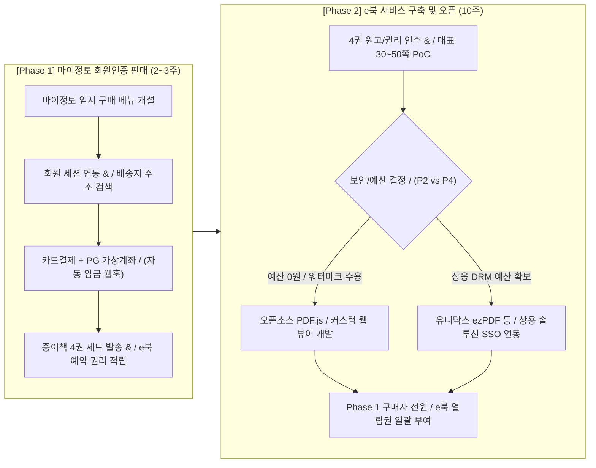
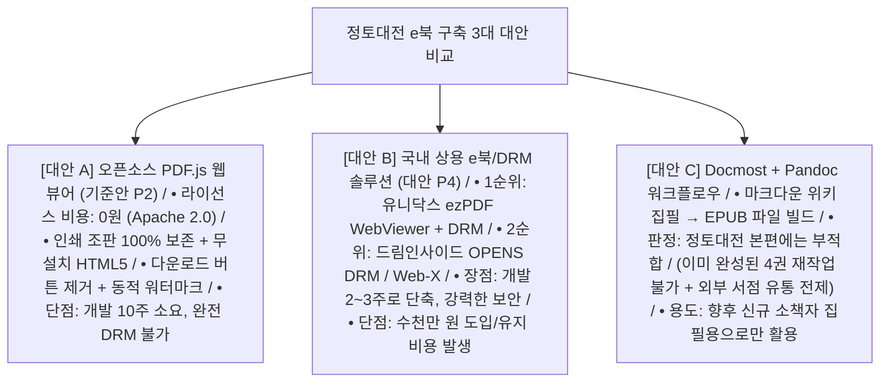

# 02. 서비스 기획, 결제 아키텍처 및 솔루션·오픈소스 비교

- **상위 문서**: [README.md (마스터 허브)](file:///Users/jeongseongchae/dev/jts/정토대전/docs/README.md)
- **연관 게이트**: `G0 (요구사항 확정)`, `G2 (기술 검증 및 제공 방식 결정)`, `G3 (설계)`
- **주요 대상**: 서비스 기획자, 사업 책임자(사료편찬위원회), 시스템국 리더, 프론트엔드/백엔드 설계자

---

> [!IMPORTANT]
> **[v2.2 확정 아키텍처 및 정책 기준 안내 (2026-10-24)]**
> 본 문서의 초기 검토 항목 중 발행 형태 및 결제 수단은 최종 의사결정에 따라 다음과 같이 확정되었습니다.
> 1. **100% 전자책(eBook) 단독 발행 (종이책 미발행)**: 실물 배송지 수집·물류 발송 절차를 전면 배제하며, 국립중앙도서관 **전자출판물 단독 E-ISBN 발급(부가세 0% 면세)**을 적용합니다.
> 2. **PG 1회용 가상계좌(무통장 송금) 단일 결제 (+72h TTL)**: 신용카드/간편결제 없이 6대 은행 가상계좌 송금으로만 결제하며, 미열람 청약철회 대비 환불 반환계좌(`AES-256-GCM`)를 사전 수집합니다.
> 3. **프로덕션 엔지니어링 명세 및 도면**: [PostgreSQL 16 6-Table DDL](file:///Users/jeongseongchae/dev/jts/정토대전/docs/specs/schema_v1_jungto_ebook.sql) · [OpenAPI 3.1 계약서](file:///Users/jeongseongchae/dev/jts/정토대전/docs/specs/openapi_v1_jungto_ebook.yaml) · [4-Layer 시스템 도면](file:///Users/jeongseongchae/dev/jts/정토대전/docs/jungto_ebook_architecture_diagram.html) · [Excalidraw 구성도](file:///Users/jeongseongchae/dev/jts/정토대전/docs/jungto_ebook_system_architecture.png)를 최우선 기준으로 적용합니다.


## 1. 출시 로드맵 기획 : 2단계 분할 접근 (Phase Strategy)

### 1.1 왜 종이책 판매와 e북 오픈을 분리해야 하는가?
- **일정 및 공수의 비대칭성**:
  - **[검토 1] 회원인증 기반 판매 시스템**: 기존 『마이정토』 인프라를 재활용하면 **약 2~3주(10~18인일)** 내에 안정적으로 구축 및 오픈이 가능합니다.
  - **[검토 2] 자체 e북 뷰어 및 유통 플랫폼**: 원고 해시 검수, 저작권/폰트 권리 확인, 비공개 CDN 서명 연동, 모바일/태블릿 최적화, 부하/보안 시험까지 **최소 10주(66~121인일)**가 소요되는 중대형 프로젝트입니다.
- **분할 출시의 실익**: 두 과제를 한 번에 묶어 출시하려고 하면 e북 개발 일정 때문에 종이책 출간 및 판매 개시일까지 2개월 이상 지연됩니다. 따라서 **Phase 1(종이책 선출간 판매)과 Phase 2(e북 순차 오픈 및 권한 부여)로 분리하는 것이 일정 지연 리스크를 원천 차단하는 유일한 전략**입니다.



---

## 2. 마이정토 기반 회원인증 판매 및 결제 기획

### 2.1 『마이정토』 임시 메뉴 활용의 3대 기획 이점
1. **회원 인증 개발 공수 '0원'**:
   - 이미 정토회원만 로그인할 수 있는 『마이정토』 내부에 메뉴를 신설하므로, 별도의 회원가입·본인인증(SMS)·정토회원 자격 검증 시스템을 새로 구축할 필요가 없습니다.
2. **기존 신청 모듈 템플릿 재활용**:
   - 마이정토 내 기존 '기도 접수' 또는 '수련/행사 신청'의 표준 흐름(`신청서 작성 → 결제창 호출 → 완료 및 내역 조회`)을 그대로 차용하여 개발 기간을 대폭 단축합니다.
3. **시니어 친화적 자동 입력 (UX)**:
   - 로그인된 세션 정보를 바탕으로 주문자 성명(법명), 휴대전화번호, 소속 지회/법당이 자동으로 채워져 고령 회원의 입력 실수와 이탈률을 최소화합니다.

### 2.2 판매 시스템 구축 시 사전 해결해야 할 3대 과제
1. **PG 가맹점(MID) 및 회계 계정 분리**:
   - 기존 마이정토 결제(보시금, 기도비)는 '비영리 고유목적사업/기부금' 성격입니다.
   - 반면 20만 원 상당의 『정토대전』 판매는 **전자상거래(면세 도서 재화 판매)**이므로, 세무상 기존 PG 코드를 그대로 쓸 수 있는지, 아니면 **도서 판매 전용 PG 상점아이디(MID)를 분리**해야 하는지 행정/회계팀과 최우선으로 확정해야 합니다.
2. **고중량 도서 배송 주소 수집 및 물류 연동**:
   - 4권 묶음 세트는 무게와 부피가 크므로 정확한 택배 발송을 위해 **도로명 우편번호 검색 API**를 탑재하고, 물류 담당 부서가 송장 출력 시스템에 바로 넣을 수 있는 **주문/배송지 엑셀 다운로드 기능**을 관리자 페이지에 제공합니다.
3. **구매 수량 제한 로직**:
   - 회원 한정 판매 취지에 따라 1인 1세트 제한 시 DB 레벨에서 회원ID 기준 기결제 건 존재 여부를 검증합니다. (지회/선물용 복수 구매 허용 시 수량 상한 설정)

---

### 2.3 [핵심 기획] 계좌 이체 3대 방식 심층 비교 및 가상계좌 필수 도입안

정토회 회원층의 연령대 특성(시니어 비중)과 20만 원이라는 고액 상품 특성상, 신용카드 한도나 앱카드 인증의 어려움으로 **계좌 이체 결제 수요가 매우 높을 것**으로 예상됩니다. 계좌 이체는 구현 방식에 따라 행정팀과 CS팀의 업무 생사를 가릅니다.

| 비교 항목 | 1안) PG사 가상계좌 (★필수 권고) | 2안) 일반 무통장 입금 (법인 고정계좌) | 3안) 실시간 계좌이체 (PG) |
| :--- | :--- | :--- | :--- |
| **동작 방식** | 주문 건마다 **1회용 고유 입금 계좌번호** 자동 발급 | 정토회 **단일 법인 통장으로 회원이 직접 송금** | 결제창에서 은행 인증서/앱으로 즉시 출금 |
| **입금 확인** | **100% 자동** (입금 즉시 PG 웹훅으로 결제 완료) | **100% 수동** (행정 담당자가 통장 내역 눈으로 대조) | **100% 자동** (주문과 동시에 출금 완료) |
| **핵심 장점** | • **입금자명이 달라도(법명/가족명의) 1:1 자동 매칭** / • **정확히 20만 원만 입금 가능 (오입금 원천 차단)** / • 입금 기한(예: 3일) 경과 시 **자동 주문 취소** | • PG 건당 수수료(약 200~300원) 없음 / • 개발 공수 가장 적음 | • 별도 송금 절차 없이 즉시 결제 확정 / • 미입금 대기 관리 불필요 |
| **치명적 단점 및 리스크** | • 건당 소액의 가상계좌 수수료 발생 / • 백엔드 웹훅(Webhook) 수신 개발 필요 | • **동명이인("김영희" 수십 명), 법명 송금, 배우자/자녀 명의 송금으로 주문서-입금내역 매칭 불가** / • 미입금/분할입금 확인 전화로 **행정·CS 완전 마비** | • 은행 보안매체·공동인증서 필요 / • 고령 회원이 결제창 단계에서 포기 확률 높음 |
| **시스템국 판정** | **[최적 필수안]** 카드결제와 함께 기본 수단으로 채택 | **[절대 도입 금지]** 수백 건 수기 대조 시 운영 붕괴 | **[보조 수단]** 카드·가상계좌와 함께 제공 |

> [!CAUTION]
> **일반 무통장 입금(2안)을 절대 도입하면 안 되는 이유**
> 정토회에서는 본명 대신 **법명**을 쓰거나, 가족에게 부탁해 **자녀/배우자 명의**로 송금하는 사례가 매우 흔합니다. 20만 원 도서 주문이 수백~수천 건 몰릴 때 단일 통장으로 입금을 받으면, 행정 담당자가 매일 통장 엑셀을 뽑아 누구 돈인지 전화를 돌려야 하며 배송 사고와 민원이 폭발합니다. **반드시 주문 건마다 고유 번호가 부여되는 1안(PG 가상계좌)으로 기획해야 합니다.**

#### 가상계좌 도입 시 필수 기획 디테일 3가지
1. **입금 기한 설정 및 안내 알림톡**: 주문 후 **3일(72시간) 이내** 미입금 시 계좌가 자동 만료되고 주문이 자동 취소되도록 설정하며, 주문 직후 발급된 은행명·가상계좌번호·정확한 입금금액(200,000원)·만료일시를 화면과 알림톡(문자)으로 발송합니다.
2. **환불 계좌 수집 폼**: 가상계좌로 현금 입금된 주문을 취소/환불할 때는 카드처럼 자동 승인 취소가 되지 않으므로, 취소 신청 화면에서 **환불받을 은행명·계좌번호·예금주명을 입력받는 폼**을 필수로 기획합니다 (또는 PG사 가상계좌 환불 대행 API 사용).
3. **현금영수증 자동 발행**: 가상계좌 결제 신청 시 소득공제용(휴대전화번호) 또는 지출증빙용(사업자번호) 현금영수증 발행 정보를 PG사로 함께 넘기도록 기획합니다.

---

## 3. e북 제공 방식(P0~P5) 및 구축 대안 종합 비교

### 3.1 제공 경로(P0 ~ P5) 선택 매트릭스

| 경로 코드 | 제공 방식 | 핵심 특징 및 선택 조건 | 선택 전 필수 검증 항목 |
| :---: | :--- | :--- | :--- |
| **P1** | **개인별 워터마크 PDF 다운로드** | 가장 짧은 일정, 회원 소장 허용, 유출 시 사후 추적 중심 | 서버에서 구매자별 PDF 워터마크 실시간 스탬핑 속도, 대용량 스토리지 비용, 환불 후 파일 회수 불가 수용 여부 |
| **P2** / *(기준안)* | **PDF 웹 뷰어 (`PDF.js`)** | **인쇄본 조판 100% 유지**, 무설치 온라인 열람, 마이정토 연동, 가성비 최고 | 스마트폰 작은 화면에서의 확대 가독성, 한자 텍스트 추출 검색 품질, 브라우저 메모리 추출 한계 수용 여부 |
| **P3** | **EPUB 리플로우 웹 뷰어** | 스마트폰 글자 크기 조절 및 줄바꿈 자동 재배치(Reflow), 접근성 최우선 | 복잡한 표·다단 각주·한자 이체자 XHTML 변환 비용 및 전권 재교정 기간(수개월 추가) |
| **P4** | **외부 상용 DRM 솔루션 도입** | 검증된 보안 통제(다운로드/캡처 차단, 기기 제한) 및 기술 지원 필요 시 | 솔루션 도입 예산(수천만 원), 마이정토 SSO 연동 어댑터, 전용 뷰어 설치에 따른 시니어 CS 부담 |
| **P5** | **전용 모바일 앱 (iOS/Android)** | 안전한 암호화 오프라인 열람 및 OS 레벨 캡처 방지(`FLAG_SECURE`) 필수 시 | 양대 앱스토어 심사, 인앱결제(30% 수수료) 또는 리더 앱 예외 심사, 앱 영구 유지보수 인력 |
| **P0** | **e북 미제공 (종이책 단독)** | 전자출판 저작권 미확보 또는 개발/운영 리소스 확보 불가 시 | 종이책 판매 공지에 e북 제공 약속 문구가 들어가지 않도록 사전 차단 |

---

### 3.2 3대 구축 대안 정밀 비교 분석

시스템국 내에서 논의된 **① 오픈소스 자체 구축(`PDF.js`)**, **② 국내 상용 솔루션 구매**, **③ `Docmost + Pandoc` 제작 파이프라인** 3가지 대안을 정밀 비교합니다.



#### ① [대안 A] 오픈소스 `PDF.js` 기반 자체 구축 (기준안 P2 — 가성비·유연성 1위)
- **핵심 평가**: 수천만 원의 솔루션 비용 없이 **비용 0원**으로 상용 무설치 웹 뷰어와 99% 동일한 열람 품질을 구현할 수 있는 글로벌 표준(Mozilla 재단 개발, Apache 2.0 라이선스)입니다.
- **적합 사유**: 『정토대전』은 이미 4권의 인쇄용 PDF 조판이 완성되어 있으므로, 별도의 원고 재편집 없이 한자 이체자·각주·표를 100% 원본 그대로 웹에 띄울 수 있습니다.

#### ② [대안 B] 국내 상용 e북/DRM 솔루션 구매 (P4 — 보안·일정 단축 우선 시)
사료편찬위원회가 "웹 뷰어의 복제 한계를 절대 수용할 수 없다"거나 "10주 개발 기간을 기다릴 수 없고 예산이 있다"고 판단할 경우 도입할 수 있는 국내 검증 솔루션 조사 결과입니다.

| 순위 | 업체명 | 대표 제품 | 뷰어 방식 | 보안 및 핵심 특징 | 시니어 편의성 | 정토대전 적합도 |
| :---: | :--- | :--- | :--- | :--- | :---: | :---: |
| **1순위** | **유니닥스** / (Unidocs) | `ezPDF WebViewer 2.0` / + `ezPDF DRM` | **HTML5 무설치 웹뷰어** / (플러그인/앱 불필요) | • 국내 공공·대학·출판 PDF 솔루션 1위 (GS인증 1등급) / • PDF 원본 스트리밍, 다운로드/인쇄/추출 원천 제어, 동적 워터마크 / • 마이정토 웹 내 `iframe`/컴포넌트 임베딩 최적 | **최상** / (별도 설치 없음) | **★★★★★** / *(상용 도입 시 최우선 추천)* |
| **2순위** | **드림인사이드** / (DRM Inside) | `OPENS DRM` / + `Web-X DRM` | 무설치 웹뷰어(Web-X) / 또는 전용 뷰어 | • 국내 공공·대학 전자도서관 표준(KS/ISO) DRM 공급사 / • EPUB/PDF 스트리밍 암호화, 기기 등록 대수 제한 | **상** | **★★★★☆** |
| **3순위** | **마크애니** / (MarkAny) | `Content SAFER` / for eBook | 전용 뷰어 / 모바일 SDK | • 국내 1세대 콘텐츠 보안 기업 / • 모바일 OS 캡처 차단(`FLAG_SECURE`), 포렌식 워터마킹 강점 | **중** / (전용 앱/뷰어 설치 허들) | **★★★☆☆** |
| **4순위** | **파수 / 부커스** | `Fasoo DRM` / / `부커스 B2B` | 엔터프라이즈 DRM / / 구독형 SaaS | • 파수: 사내 문서보안 특화로 도서 단품 유통엔 고비용/오버스펙 / • 부커스: 기관용 구독 플랫폼으로 단독 비공개 도서 커스텀 협의 필요 | **중** | **★★☆☆☆** |

> [!TIP]
> **상용 솔루션(유니닥스 등) 도입 시 주의할 점**
> 솔루션을 구매하더라도 **마이정토 로그인 세션(SSO)과 구매 권한(Entitlement)을 솔루션 서버와 연결하는 어댑터 개발(약 2~3주)**은 여전히 시스템국이 수행해야 합니다. 계약 전 반드시 **정토대전 한자·각주 밀집 페이지(30~50쪽) 실원고 PoC 테스트**를 요청해야 합니다.

#### ③ [대안 C] `Docmost + Pandoc` 전자책 워크플로우 제안에 대한 검토 결론
내부에서 제안된 *"Docmost(웹 마크다운 위키)로 협업 집필 → Markdown 내보내기 → Pandoc CLI로 EPUB 빌드 → 교보/YES24 등 외부 서점 유통"* 방식이 왜 이번 『정토대전』과 결이 다른지 명확히 정리합니다.

| 비교 기준 | `Docmost + Pandoc` 제안 | 『정토대전』 실제 요구사항 및 환경 | 판정 |
| :--- | :--- | :--- | :---: |
| **문제 영역** | **전자책 파일(EPUB)을 굽는 제작/집필 도구** | **완성된 책을 회원에게만 파는 인증·결제·뷰어 플랫폼** | 영역 불일치 |
| **원고 출발점** | 백지상태에서 마크다운(H1~H3)으로 새로 글을 쓸 때 적합 | **이미 수천 쪽의 4권 인쇄 조판(InDesign/PDF)이 완성됨** (마크다운으로 재작성 시 수개월 역행 노가다 발생) | 적용 불가 |
| **유통 방식** | 교보문고, YES24, 알라딘, KDP 등 **외부 일반 서점 등록** | **외부 판매 전면 금지, 정토회원 한정 비공개 판매** | 요구사항 정면 충돌 |
| **시스템 해결도** | EPUB 파일 1개만 나올 뿐, 로그인·결제·뷰어 시스템은 0% | 마이정토 로그인, 20만 원 결제, 웹 뷰어 스트리밍이 핵심 | 핵심 과제 미해결 |

- **최종 활용 방안**: `Docmost + Pandoc` 파이프라인은 이번 『정토대전』 본편에는 적용하지 않으며, 추후 정토회에서 **신규 소책자, 수련 안내서, 회보 등을 처음부터 협업 집필하여 일반 전자책으로 발간할 때** 표준 제작 도구로 활용합니다.

---

## 4. 기능 범위 확정 및 시니어·디바이스별 UX 상세 기획

### 4.1 기준안(P2) 포함 기능 및 요구사항 ID 체계

모든 기능은 `요구사항 ID → 개발 작업 ID(W01~W35) → 테스트 ID(AUTH-01 등)`로 추적 가능하게 관리합니다.

| 구분 | 요구사항 ID | 기능명 | 상세 기획 내용 | 포함 여부 |
| :--- | :---: | :--- | :--- | :---: |
| **인증/권한** | `REQ-AUTH-01` | 마이정토 회원 인증 | 마이정토 로그인 세션 검증, 비회원/미구매자 접근 시 안내 화면 이동 | **필수** |
| | `REQ-READ-01` | 열람권(Entitlement) 검증 | 유효한 구매/부여 출처가 있는 회원에게만 권별 매니페스트 및 서명 발급 | **필수** |
| | `REQ-CONT-01` | 승인본 불변 제공 | 편집 검수 및 SHA-256 해시가 승인된 `READY` 상태의 4권만 공개 | **필수** |
| **서재/뷰어** | `REQ-VIEW-01` | 내 서재 및 4권 선택 | 보유한 정토대전 1~4권 표지 목록, 열람 기간, 권별 바로가기 제공 | **필수** |
| | `REQ-VIEW-02` | 목차(ToC) 및 쪽 이동 | 계층형 목차 사이드바, 이전/다음 쪽 버튼, 인쇄 쪽번호/인덱스 직접 점프 | **필수** |
| | `REQ-VIEW-03` | 확대/축소 및 너비맞춤 | Retina 고해상도 렌더링, `+`/`-` 버튼 확대(50%~300%), 화면 너비맞춤, 핀치 줌 | **필수** |
| | `REQ-VIEW-04` | 권 내 본문 검색 | 현재 읽고 있는 권 내부 텍스트 검색, 매칭 페이지 이동 및 하이라이트 | **필수** |
| | `REQ-VIEW-05` | 이어보기 및 북마크 | 마지막 읽은 페이지 자동 저장(서버+로컬 동기화), 사용자 북마크 추가/삭제 | **필수** |
| **보안/법무** | `REQ-SEC-01` | UI 제어 및 동적 워터마크 | 다운로드/인쇄 버튼 제거, 우클릭/단축키 차단, 화면 위 `JT-xxxx` 식별코드 오버레이 | **필수** |
| | `REQ-LAW-01` | 첫 열람 개시 로그 | 청약철회 제한 기준선인 첫 본문 전달 시점(`ReadingStart`) 불변 기록 | **필수** |
| **운영/CS** | `REQ-OPS-01` | 정오표 및 운영자 조회 | 권별 정오표 안내, CS/운영자용 회원 열람권 조회·수동 조정·감사 로그 화면 | **필수** |
| **선택/제외** | `REQ-OPT-01` | 고급 독서 부가기능 | 4권 통합 검색, 한자-한글 교차 사전 검색, 본문 형광펜·메모, TTS 낭독, 오프라인 저장 | *별도 확정 / (초기 제외 권고)* |

---

### 4.2 8대 핵심 화면 정의 및 오류 상태 분리 원칙

> [!IMPORTANT]
> **오류 안내 분리 원칙**
> 네트워크 일시 장애나 로그인 세션 만료를 무조건 *"구매하지 않은 회원입니다"*라고 표시하면, 20만 원을 결제한 회원이 크게 당황하여 즉시 CS 민원으로 이어집니다. 모든 실패 화면은 원인을 정확히 분리하여 안내해야 합니다.

| 화면명 | 주요 표시 정보 및 액션 | 실패·예외 상황별 분리 처리 |
| :--- | :--- | :--- |
| **1. 상품 안내 / 구매** | 4권 구성, 제공 형식(웹 뷰어), 지원 기기, 열람 기간, **샘플 미리보기**, 복제 통제 한계, 청약철회(환불) 조건 고지 및 동의 | 비회원 접근 시 마이정토 로그인 페이지로 리다이렉트(돌아올 URL 보존) |
| **2. 내 서재** | 정토대전 1~4권 표지, 권별 읽던 쪽수 표시, `[이어읽기]` 버튼, 이용 가능 기간 표시 | 구매 직후 웹훅 지연 시 `[구매 내역 다시 확인하기]` 새로고침 버튼 및 CS 안내 |
| **3. e북 웹 뷰어** | 상단 권 선택·목차·검색·확대·북마크 툴바, 중앙 고선명 캔버스, 전면 반투명 워터마크 | 페이지 로드 지연 시 스켈레톤/로딩 스피너 및 `[현재 쪽 다시 불러오기]` |
| **4. 세션 만료 안내** | 독서 중 로그인 만료 시 **현재 읽던 권·쪽 위치를 로컬에 안전하게 임시 저장** 후 재로그인 유도 | 재로그인 성공 시 방금 읽던 그 페이지로 즉시 자동 복귀 |
| **5. 열람권 없음 (403)** | 미구매, 환불 완료, 이용기간 만료 등 **원인별 맞춤 안내** 및 주문 내역 확인 링크 | 타 회원의 주문 정보나 내부 파일 경로는 절대 노출 금지 |
| **6. 일시 오류 (5xx)** | 짧은 한글 안내문과 **CS 문의용 고유 오류번호(`requestId`)** 표시 | 서명 URL, 인증 토큰, S3 버킷 경로 등 기술 정보 화면 노출 금지 |
| **7. 정오표 화면** | 권·쪽수·수정 전/후 내용·반영 버전(`v1.0.1`) 목록 및 해당 페이지 바로가기 링크 | - |
| **8. 운영자(CS) 화면** | 회원ID/주문번호 검색, 결제 상태·열람권 출처·첫 열람 시각 조회, 사유 입력 후 권한 수동 조정 | 관리자 권한(RBAC) 없는 접근 시 403 차단 및 모든 조회/수정 행위 감사 로그 기록 |

---

### 4.3 디바이스별 UX 전략 및 시니어(고령층) 접근성 설계

#### 디바이스별 최적 독서 경험 설계
1. **태블릿 / 아이패드 / 갤럭시탭 (10~11인치 — ★최적 디바이스)**:
   - 실제 인쇄본(신국판)과 화면 크기가 거의 1:1로 일치하여 별도 확대 없이도 가장 쾌적하게 읽을 수 있습니다.
   - 가로 회전 시 2페이지를 나란히 보여주는 양면 보기 모드를 선택할 수 있게 합니다.
2. **PC / 노트북 (대화형 사료 연구 환경)**:
   - 왼쪽에 목차(Outline) 사이드바를 고정해 두고, 마우스 휠과 키보드 방향키(`←`, `→`)로 빠르게 탐색할 수 있도록 지원합니다.
3. **스마트폰 (안드로이드 / 아이폰 — 6인치 내외 소형 화면 대응)**:
   - PDF 고정 판형 특성상 한 페이지 전체를 띄우면 글씨가 작게 보입니다.
   - **해결 UX**: ① 모바일 접속 시 기본값을 **`[너비 맞춤]`**으로 자동 세팅하여 좌우 여백을 줄이고, ② 두 손가락 **핀치 줌(Pinch-to-Zoom)**뿐 아니라 시니어 회원이 한 손으로도 쉽게 누를 수 있는 **큼직한 `[글자 크게 ＋]` 버튼**을 하단 고정 툴바에 배치합니다.

#### 시니어 회원 접근성 및 인앱 브라우저 대응 (필수)
- **최소 터치 영역 확보 ([WCAG 2.2](https://www.w3.org/TR/WCAG22/) 참고)**: 어르신들이 작은 아이콘을 잘못 누르지 않도록 모든 주요 조작 버튼(이전/다음 쪽, 확대/축소, 목차)은 **최소 `44 × 44 CSS px` 이상**의 큼직한 클릭 영역과 한글 텍스트 라벨(아이콘 단독 사용 지양)을 함께 제공합니다.
- **카카오톡 / 네이버 '인앱 브라우저' 탈출 유도**:
  - 단체 카톡방 공지 링크를 눌러 카카오톡 인앱 브라우저로 진입할 경우, 상단 주소창과 하단 바가 화면을 가리고 메모리 제한으로 대용량 PDF가 튕길 위험이 있습니다.
  - `User-Agent`에서 `KAKAOTALK`, `NAVER` 등이 감지되면 Android는 `intent://` 스킴으로 크롬 외부 브라우저를 자동 실행하고, iOS는 *"오른쪽 아래 […] 버튼을 눌러 'Safari로 열기'를 선택해 주세요"* 안내 모달을 띄웁니다.

---

## 5. [실무 양식] 상용 솔루션(P4) 업체 견적 및 PoC 요청서 (RFP 요약)

만약 자체 개발(P2) 대신 유니닥스·드림인사이드 등 외부 상용 솔루션(P4)을 검토할 때 업체에 발송할 공식 질의 양식입니다.

```markdown
# [견적 및 기술검증 요청서] 정토대전 회원 전용 e북 뷰어/DRM 솔루션 도입 문의

1. 프로젝트 개요
   - 대상 콘텐츠: 『정토대전』 총 4권 세트 (인쇄용 고해상도 텍스트 PDF 원본, 권당 약 ___쪽 / ___MB)
   - 콘텐츠 특성: 다량의 한자(이체자 포함), 다단 각주, 표, 도판 포함 (조판 유지 필수)
   - 예상 이용자 규모: 정토회원 약 _____명 (오픈 시 동시접속 약 ___명)
   - 서비스 환경: PC 웹 및 모바일 웹 브라우저 무설치 열람 (HTML5 기반 필수)

2. 필수 기술 확인 및 실원고 PoC 요청 사항
   - [콘텐츠 재현] 당사가 제공하는 대표 원고(30~50쪽 샘플 PDF)를 귀사 뷰어에 탑재하여 한자 깨짐, 각주 가독성, 모바일 확대, 본문 검색이 정상 동작하는지 데모 URL 제공 요청
   - [인증/권한 연동] 당사 기존 회원 포털(마이정토, Vue3/REST API 기반)과 SSO 로그인 연동 및 주문/환불 시 실시간 열람권 부여·회수 API 지원 방식
   - [보안 범위] 무설치 웹 브라우저 환경에서 실제 보장되는 보안 수준 (원본 PDF 다운로드 차단, 인쇄 차단, 회원별 동적 워터마크 표시, 모바일 화면 캡처 제한 가능 범위와 기술적 한계 명시)
   - [이관/종료 보장] 향후 계약 종료 시 당사 원고, 메타데이터, 회원별 북마크/독서 데이터의 표준 포맷 Export 지원 여부 및 비용

3. 견적 요청 항목 (부가세 별도/포함 명시)
   - 구축형(On-Premise/당사 AWS 설치) vs 클라우드 임대형(SaaS) 각각의:
     ① 초기 도입 라이선스비 및 SSO 연동 기술지원비
     ② 4권 원고 변환/탑재비 (추후 오탈자 개정판 교체 시 건당 비용 포함)
     ③ 월간 또는 연간 유지보수비 (사용자 수 또는 트래픽 증가에 따른 추가 과금 테이블)
   - 계약 체결 후 기술 검증 및 최종 런칭까지 소요되는 표준 납기 일정
```
