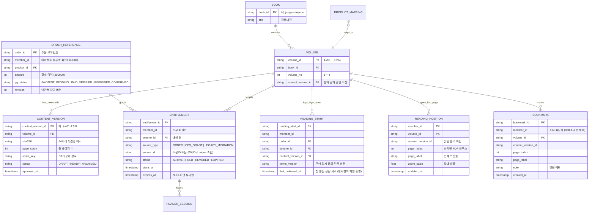

# 03. 개발 설계, 기술 아키텍처 및 작업지시서 (W01~W35)

- **상위 문서**: [README.md (마스터 허브)](file:///Users/jeongseongchae/dev/jts/정토대전/docs/README.md)
- **연관 게이트**: `G2 (기술 검증)`, `G3 (설계)`, `G4 (개발)`, `G5 (출시 검수)`
- **주요 대상**: 시니어 개발 책임자(아키텍트), 프론트엔드/백엔드 개발봉사자, 인프라 엔지니어, QA 담당자

---

> [!IMPORTANT]
> **[v2.2 확정 아키텍처 및 정책 기준 안내 (2026-10-24)]**
> 본 문서의 초기 검토 항목 중 발행 형태 및 결제 수단은 최종 의사결정에 따라 다음과 같이 확정되었습니다.
> 1. **100% 전자책(eBook) 단독 발행 (종이책 미발행)**: 실물 배송지 수집·물류 발송 절차를 전면 배제하며, 국립중앙도서관 **전자출판물 단독 E-ISBN 발급(부가세 0% 면세)**을 적용합니다.
> 2. **PG 1회용 가상계좌(무통장 송금) 단일 결제 (+72h TTL)**: 신용카드/간편결제 없이 6대 은행 가상계좌 송금으로만 결제하며, 미열람 청약철회 대비 환불 반환계좌(`AES-256-GCM`)를 사전 수집합니다.
> 3. **프로덕션 엔지니어링 명세 및 도면**: [PostgreSQL 16 6-Table DDL](file:///Users/jeongseongchae/dev/jts/정토대전/docs/specs/schema_v1_jungto_ebook.sql) · [OpenAPI 3.1 계약서](file:///Users/jeongseongchae/dev/jts/정토대전/docs/specs/openapi_v1_jungto_ebook.yaml) · [4-Layer 시스템 도면](file:///Users/jeongseongchae/dev/jts/정토대전/docs/jungto_ebook_architecture_diagram.html) · [Excalidraw 구성도](file:///Users/jeongseongchae/dev/jts/정토대전/docs/jungto_ebook_system_architecture.png)를 최우선 기준으로 적용합니다.


## 1. 전체 시스템 아키텍처 및 기술 스택

### 1.1 마이정토 연계 및 클라우드 참조 아키텍처
본 시스템은 기존 『마이정토』 프론트엔드([myjungto-frontend](file:///Users/jeongseongchae/dev/jts/myjungto-frontend): Vue 3 + Vite + Vuetify + Pinia) 및 백엔드([myjungto-backend](file:///Users/jeongseongchae/dev/jts/myjungto-backend)) 인프라와 유기적으로 결합되도록 설계합니다.

```mermaid
flowchart TB
    subgraph Client["클라이언트 계층 (PC / 태블릿 / 모바일 웹)"]
        V1["마이정토 프론트엔드 / (Vue 3 + Vite + Vuetify)"]
        V2["PDF.js 커스텀 웹 뷰어 / • Canvas HiDPI 렌더링 / • TextLayer 검색 / • 동적 워터마크 오버레이"]
    end

    subgraph Backend["백엔드 & 워커 계층"]
        API["e북 & 주문 API 서버 / • 마이정토 세션/OIDC 어댑터 / • 열람권(Entitlement) 판별 / • CloudFront 단기 서명 발급"]
        WK["비동기 이벤트 워커 / • PG 가상계좌 웹훅 처리 / • 원장 대사 (Reconciliation) / • 과거 구매자 배치 이관"]
    end

    subgraph Storage["데이터 & 콘텐츠 보호 계층 (AWS)"]
        DB[("RDS PostgreSQL / • 열람권 / 주문참조 / • 첫열람 로그 (ReadingStart) / • 이어보기 / 북마크 / 감사로그")]
        CF["CloudFront CDN (OAC) / • 서명 URL/쿠키 검증 (TTL 5분) / • Range 부분 스트리밍"]
        S3[("비공개 S3 저장소 / • Public Block 활성화 / • 불변 버전 원고 (v1.0.0)")]
    end

    subgraph External["외부 연동 시스템"]
        MJ["마이정토 회원 인증 API"]
        PG["PG사 결제 서버 / (카드 / 가상계좌 웹훅)"]
    end

    V1 --> V2
    V1 <-->|REST API (HTTPS)| API
    V2 <-->|매니페스트 / 이어보기 / 북마크| API
    API <-->|회원 상태 검증| MJ
    PG -->|결제/입금/취소 웹훅| API
    API <--> DB
    WK <--> DB
    WK <-->|결제 상태 재조회| PG
    V2 <-->|서명 기반 PDF Range 요청| CF
    CF -->|OAC 전용 읽기| S3
```

### 1.2 계층별 기술 구성 표준
| 구성 요소 | 채택 기술 / 참조안 | 선정 이유 및 아키텍처 원칙 |
| :--- | :--- | :--- |
| **프론트엔드** | Vue 3, TypeScript, Vite, Vuetify 3 | 현행 `myjungto-frontend` 기술 스택과 100% 통일하여 유지보수성 확보 |
| **e북 뷰어 엔진** | **Mozilla `PDF.js`** (Apache 2.0) | 무설치 HTML5 표준, 인쇄본 조판(한자/각주) 100% 보존, 권 내 검색 기본 지원 |
| **백엔드 API** | 현행 `myjungto-backend` 표준 프레임워크 | 마이정토 인증 세션 연동, 객체 수준 권한 검증(BOLA), 서명 URL 발급 |
| **영속 데이터베이스** | PostgreSQL (AWS RDS 등) | 트랜잭션 무결성, 주문 이벤트 수신함(`EventInbox`), 열람권·독서 위치·감사 기록 |
| **원고 저장소** | AWS S3 (비공개 버킷) | `PublicAccessBlock` 활성화, SHA-256 해시 기반 불변 버전(`release/jt-v01/1.0.0/`) 관리 |
| **콘텐츠 전송망** | AWS CloudFront + OAC | 웹 서버 트래픽 부하 격리, Origin Access Control 및 짧은 만료(5분) 서명 접근 통제 |
| **비동기 워커/큐** | DB 기반 Outbox/Inbox 워커 또는 SQS | PG 웹훅 재시도, 대량 권한 이관 배치, 원장 대사 분리 |

> [!NOTE]
> **오버엔지니어링 방지 원칙**
> 초기부터 Elasticsearch(별도 검색엔진), Redis 클러스터, Kubernetes(EKS)를 무리하게 도입하지 않습니다. 권 내 검색은 `PDF.js` 내장 텍스트 레이어로 충분하며, 트래픽과 세션 규모를 실측한 뒤 필요할 때만 단계적으로 확장합니다.

---

## 2. Mozilla `PDF.js` 웹 뷰어 구현 및 커스터마이징 가이드

### 2.1 `PDF.js` 3-Tier 아키텍처 이해
1. **Core Layer (`pdf.worker.js`)**: 무거운 PDF 바이너리 파싱과 폰트 해독을 메인 UI 쓰레드가 아닌 **Web Worker(백그라운드 쓰레드)**에서 비동기 처리하여 수백 쪽의 정토대전을 열어도 브라우저 프리징이 발생하지 않습니다.
2. **Display Layer (`<canvas>` + `<div class="textLayer">`)**: 그래픽은 캔버스에 고화질 벡터로 렌더링하고, 그 위에 투명 텍스트 DOM 레이어를 1:1 좌표로 겹쳐 놓아 **원본 인쇄 조판을 유지하면서도 텍스트 검색과 하이라이트가 작동**합니다.
3. **Viewer Layer (`viewer.html` / 커스텀 래퍼)**: 툴바, 목차 사이드바, 줌, 페이지 이동, 워터마크 오버레이를 담당하는 UI 계층입니다.

### 2.2 [핵심 구현 1] 고해상도(Retina / HiDPI) 흐림 방지 렌더링 패치
Mac(Retina), 아이패드, 최신 스마트폰은 물리 픽셀 밀도(`window.devicePixelRatio`)가 `2.0~3.0`입니다. 일반 1배율로 캔버스를 그리면 글자가 뿌옇게 뭉개지므로, 반드시 아래의 **HiDPI 스케일링 공식**을 적용해야 인쇄물처럼 칼 같은 선명도가 나옵니다.

```javascript
// PDF.js 고해상도(Retina/HiDPI) 선명도 보장 렌더링 핵심 로직
async function renderPageHiDPI(pdfDoc, pageNum, scale, canvas) {
  const page = await pdfDoc.getPage(pageNum);
  const ctx = canvas.getContext('2d');

  // 1. 디바이스 픽셀 비율 계산 (Retina 모니터/모바일은 2.0 이상)
  const pixelRatio = window.devicePixelRatio || 1;
  const viewport = page.getViewport({ scale });

  // 2. 실제 캔버스 내부 버퍼 해상도를 pixelRatio 배수만큼 고해상도로 확장
  canvas.width = Math.floor(viewport.width * pixelRatio);
  canvas.height = Math.floor(viewport.height * pixelRatio);

  // 3. 화면에 표시되는 CSS 크기는 원래 논리 픽셀 크기로 고정
  canvas.style.width = `${Math.floor(viewport.width)}px`;
  canvas.style.height = `${Math.floor(viewport.height)}px`;

  // 4. 변환 행렬(transform)을 주입하여 2배밀도 벡터 렌더링 수행
  const transform = pixelRatio !== 1 ? [pixelRatio, 0, 0, pixelRatio, 0, 0] : null;

  await page.render({
    canvasContext: ctx,
    transform,
    viewport,
  }).promise;
}
```

### 2.3 [핵심 구현 2] 보안 커스텀 (다운로드/인쇄 차단 및 동적 워터마크)
1. **다운로드·인쇄·파일열기 UI 원천 제거**:
   - 커스텀 뷰어 구성 시 다운로드/인쇄 버튼을 아예 렌더링하지 않거나, 기본 `viewer.html` 활용 시 `#download`, `#print`, `#openFile`, `#secondaryDownload`, `#secondaryPrint` 요소를 DOM에서 제거하고 `viewer.js`의 저장/인쇄 단축키 핸들러를 비활성화합니다.
2. **우클릭 및 저장/인쇄 단축키 차단 스크립트**:
   ```javascript
   // 우클릭 컨텍스트 메뉴 차단
   document.addEventListener('contextmenu', (e) => {
     e.preventDefault();
     showSecurityToast('저작권 보호를 위해 우클릭이 제한됩니다.');
   });

   // Ctrl+S(저장), Ctrl+P(인쇄) 단축키 차단
   document.addEventListener('keydown', (e) => {
     if ((e.ctrlKey || e.metaKey) && ['s', 'p'].includes(e.key.toLowerCase())) {
       e.preventDefault();
       showSecurityToast('저작권 보호를 위해 파일 저장 및 인쇄가 제한됩니다.');
     }
   });
   ```
3. **화면 전면 동적 워터마크 오버레이**:
   - 서버 세션에서 내려받은 회원의 불투명 식별코드(예: `JT-7K4M`)를 뷰어 최상단(`z-index: 9999`)에 반투명(`opacity: 0.08`), 대각선(`rotate(-25deg)`), 클릭 통과(`pointer-events: none`) 속성으로 바둑판 배치합니다.
   - 스크린리더(보조공학기기)가 워터마크 문자열을 본문 중간마다 무한 반복 낭독하지 않도록 반드시 `aria-hidden="true"` 속성을 부여합니다.

### 2.4 로컬 PoC 프로토타입 검증 환경
- **구축된 PoC 파일 경로**: [temp/jungto_ebook_viewer_poc.html](file:///Users/jeongseongchae/dev/jts/temp/jungto_ebook_viewer_poc.html)
- **로컬 실행 명령**:
  ```bash
  python3 -m http.server 8123 --directory /Users/jeongseongchae/dev/jts/temp
  # 브라우저 접속: http://localhost:8123/jungto_ebook_viewer_poc.html
  ```
- **검증 완료 항목**: Retina 고선명 렌더링(125% 기본 배율), 다운로드/인쇄 배제, 동적 워터마크 24개 그리드 오버레이, 우클릭/단축키 차단 토스트, 목차(Outline) 트리 파싱, 권 내 단어 검색 점프, `localStorage` 이어보기 복원.

---

## 3. 콘텐츠 보호 및 CDN 서명 아키텍처

### 3.1 PDF 전달 3대 방식 비교 및 기준안 채택
| 전달 방식 | 동작 원리 | 장단점 및 보안 특성 | 채택 여부 |
| :--- | :--- | :--- | :---: |
| **방식 A (기준안)** / **PDF.js 서명 스트리밍** | CloudFront 서명 URL/쿠키로 승인된 PDF를 `PDF.js`가 Range 요청으로 받아 렌더링 + 화면 워터마크 | • 한자 검색·선명한 벡터 확대·개발 속도 최우수 / • 단점: 브라우저 네트워크 탭을 통한 바이트 취득 가능 (워터마크가 원본 파일 내부엔 없음) | **기본 채택 (P2)** |
| **방식 B** / **구매자별 워터마크 PDF 생성** | 백엔드 워커가 PDF 각 페이지에 회원 고유 번호를 직접 스탬핑한 개별 PDF 생성·저장 | • 파일 자체가 유출되어도 유출자 식별표식이 남음 / • 단점: 1,000명×4권×80MB = 320GB 스토리지 비용 및 생성 대기 시간 발생 | 유출 파일 추적 필수 시 선택 (P1/P2+) |
| **방식 C** / **서버 페이지 이미지 타일링** | PDF 원본을 주지 않고 페이지별 고해상도 이미지 조각(Tile)과 별도 검색 JSON만 전달 | • 단일 PDF 파일 탈취 방지 / • 단점: 확대 화질 저하, 이미지 대량 전송 트래픽 급증, 검색/접근성 별도 구현 공수 큼 | 미채택 |

### 3.2 CloudFront OAC 및 단기 서명(Signed URL/Cookie) 설계
1. **원본 S3 완전 비공개**: S3 버킷의 `BlockPublicAccess`를 모두 활성화하고, 오직 지정된 CloudFront 배포(SourceArn)만 **OAC(Origin Access Control)**를 통해 S3 원본을 읽을 수 있도록 버킷 정책을 잠급니다.
2. **단기 서명 발급 (기준 TTL: 5분)**:
   - 서명 범위는 전체 경로(`/*`)가 아니라 **회원이 열람 요청한 특정 권·특정 승인 버전 경로(`release/jt-v01/1.0.0/*`)**로만 엄격히 제한합니다.
   - 서명 만료 시간(TTL)은 **5분**으로 짧게 부여하며, 독서 중 세션이 유효하면 백그라운드에서 권리 재확인 후 서명을 갱신합니다.
   - `Range` 부분 요청(바이트 스트리밍)이 서명 만료 시 끊기지 않도록 갱신 주기를 테스트하며, 여러 권을 다른 브라우저 탭에 동시에 열었을 때 서명 쿠키가 서로 덮어쓰이지 않도록 경로/파일 단위로 분리합니다.
3. **캐시 오염 및 토큰 유출 방지**:
   - 공용 승인 원고(`release/jt-v01/1.0.0/book.pdf`)는 불변 경로로 CDN 캐시를 태우되, **개인화 데이터 API(열람권, 이어보기, 북마크, 워터마크 식별자)는 반드시 `Cache-Control: private, no-store`로 설정**하여 A 회원의 정보가 B 회원에게 캐시로 노출되는 사고를 원천 차단합니다.
   - 서명 토큰이 포함된 URL이나 쿠키는 애플리케이션 로그, APM, 에러 트래커(Sentry 등)에 평문으로 기록되지 않도록 마스킹(Redaction)합니다.

---

## 4. 데이터베이스 모델(ERD) 및 REST API 계약

### 4.1 핵심 데이터 모델 (11대 테이블 명세)

> [!IMPORTANT]
> **주문(Order)과 열람권(Entitlement)의 분리 원칙**
> 주문 테이블에 `can_read = true` 같은 단순 불리언 컬럼 하나만 두면 안 됩니다. 종이책 세트 구매, e북 단독 구매, 운영자 임시 보상권, 무료 특별 회원권 등 **권한의 출처(Source)가 여러 개일 수 있으므로**, 특정 주문 1건을 환불하더라도 다른 유효한 출처가 남아 있다면 열람권이 유지되도록 설계해야 합니다.



*(추가 운영 테이블: 웹훅 멱등성 보장을 위한 `EVENT_INBOX`, 외부 발신용 `EVENT_OUTBOX`, 관리자 권한 변경 추적용 `AUDIT_EVENT`, 뷰어 세션 관리용 `READER_SESSION`)*

---

### 4.2 REST API 최소 계약 및 객체 수준 권한 검증 (OWASP BOLA)

모든 API는 요청 본문(Body)이나 쿼리에 담긴 `memberId`를 절대 신뢰하지 않으며, **반드시 서버가 검증한 로그인 세션에서 추출한 회원 식별자**를 기준으로 소유권을 확인합니다 ([OWASP API1:2023 BOLA](https://api-security.owasp.org/editions/2023/en/0xa1-broken-object-level-authorization/) 준수).

| 메서드 및 경로 | 목적 | 필수 서버 검증 조건 | 표준 응답 코드 |
| :--- | :--- | :--- | :--- |
| `GET /api/library` | 내 서재 4권 목록 및 열람 가능 상태 조회 | 로그인 세션 유효성, 현재 시각 기준 유효 `Entitlement` 존재 여부 | `200`, `401` |
| `GET /api/volumes/{id}/manifest` | 권별 승인 버전 메타데이터 및 목차(ToC) 조회 | 해당 권 `ACTIVE` 열람권 보유 및 `ContentVersion.status == 'READY'` | `200`, `401`, `403` |
| `POST /api/reader-sessions` | 짧은 만료(5분) CloudFront 서명 발급 및 워터마크 코드 반환 | 회원 상태(정상/탈퇴), 환불 보류 경합 잠금, 해당 권 열람권 재확인 | `200`, `401`, `403`, `409` |
| `POST /api/reading-starts` | 첫 본문 전달 완료 시 개시 증빙(`ReadingStart`) 기록 | 유효한 `ReaderSession` 존재, 중복 기록 방지(Idempotent Upsert) | `200`, `400` |
| `PUT /api/reading-positions/{volId}` | 마지막 읽은 쪽수(`pageIndex`, `pageLabel`) 저장 | 세션 본인 소유, 허용 쪽수 범위(`0 <= pageIndex < pageCount`), 버전 기록 | `200`, `409` |
| `POST /api/bookmarks` | 책갈피(북마크) 생성 | 해당 권 열람권 보유, 입력 문자열 길이/XSS 필터링 | `201`, `403` |
| `DELETE /api/bookmarks/{id}` | 책갈피 삭제 | **`bookmark.member_id == session.member_id` 일치 검증 (타인 북마크 삭제 차단)** | `204`, `403`, `404` |
| `POST /api/order-events` | PG 결제/가상계좌 입금/취소 웹훅 수신 | 발신자 서명/시크릿 검증, `EventInbox` 영속 저장 및 `eventId` 멱등성 체크 | `200`, `400` |
| `GET /ops/entitlements` | [운영자] 회원별 주문·열람권·첫열람 시각 조회 | 운영자/CS 전용 Role 확인, 개인정보 최소 노출, 조회 감사 로그 기록 | `200`, `403` |
| `POST /ops/entitlements/{id}/adjust` | [운영자] 열람권 수동 부여/보류/회수 조정 | 필수 사유 입력, 승인 권한 확인, 변경 전후 상태 `AuditEvent` 트랜잭션 기록 | `200`, `403` |

#### 열람 세션 및 서명 발급 핵심 의사코드 (Pseudocode)
```text
FUNCTION issueReaderSession(request, authSession):
  1. member = verifyMemberStatus(authSession.memberId) // 탈퇴·자격정지 확인
  2. volume = db.findVolume(Whitelist(request.volumeId))
  3. LOCK(member.id, volume.id) // 환불 요청과 새 열람 세션 발급의 동시 경합 직렬화
  4. activeEntitlements = db.findEntitlements(
       memberId = member.id,
       volumeId = volume.id,
       status = 'ACTIVE',
       startsAt <= NOW() AND (expiresAt IS NULL OR expiresAt > NOW())
     )
  5. IF activeEntitlements.isEmpty():
       RETURN Error(403, "ERR_NO_ENTITLEMENT", "열람 권한이 없거나 만료되었습니다.")
  6. contentVer = db.findApprovedContentVersion(volume.currentVersionId, status = 'READY')
  7. session = db.createReaderSession(member.id, volume.id, contentVer.id, ttl = 5m)
  8. signedResource = cloudfront.sign(
       resourcePath = contentVer.assetKey, // 오직 승인된 해당 권 경로만 서명
       expiresAt = NOW() + 5m
     )
  9. RETURN {
       sessionId: session.id,
       contentVersionId: contentVer.id,
       signedUrl: signedResource,
       watermarkCode: generateOpaqueCode(member.id) // 예: "JT-7K4M"
     } // 로그에 signedUrl 평문 기록 절대 금지
```

---

## 5. PG 결제(가상계좌) 연동, 웹훅 멱등성 및 배치 이관

### 5.1 결제 승인 및 금액 위변조 방지 4단계 흐름
프론트엔드(브라우저)에서 넘어온 결제 완료 신호나 금액 파라미터는 사용자가 개발자 도구(F12)로 조작할 수 있으므로 절대 신뢰하지 않습니다.

```text
[회원 브라우저]                 [마이정토 API 서버]                 [PG사 서버 (토스/포트원 등)]
      │                                │                                     │
      ├─ 1. 주문 생성 및 결제창 호출 ──┼────────────────────────────────────>│
      │<─ 2. 카드인증 / 가상계좌 발급 ─┼─────────────────────────────────────┤
      ├─ 3. 승인 요청 (paymentKey) ───>│                                     │
      │                                ├─ 4. 서버 간 결제 조회/승인 API ────>│
      │                                │<─ 5. 실제 결제 금액(200,000원) 응답 ┤
      │                                │   [검증: 응답금액 == DB 주문금액(20만)]
      │                                │   [DB 트랜잭션: 주문 확정 + 열람권 부여]
      │<─ 6. 주문 완료 화면 응답 ──────┤                                     │
```

### 5.2 가상계좌 웹훅 수신함(`EventInbox`)과 상태 경합 처리
가상계좌는 주문 1~2일 뒤 입금이 발생하며, 네트워크 지연으로 PG사 웹훅이 **중복 전송되거나 역순(결제 완료 웹훅이 취소 웹훅보다 늦게 도착)**으로 들어올 수 있습니다.

| 주문/업무 상태 | `Entitlement`(열람권) 처리 | 중복·역순·지연 이벤트 방어 규칙 |
| :--- | :--- | :--- |
| `PAYMENT_PENDING` (가상계좌 발급/입금대기) | 열람권 미부여 | 기한(3일) 내 입금 웹훅 대기, 만료 시 자동 취소 |
| `PAID_VERIFIED` (입금/결제 서버 검증 완료) | 4권 `ACTIVE` 열람권 생성 | `(provider, eventId)` 및 `(orderId, sourceType)` Unique 제약으로 **중복 생성 차단** |
| `REFUND_REQUESTED` (환불 접수/검토 중) | 해당 출처 열람권 `HOLD`(일시 보류) | 보류 중 지연 도착한 과거 `PAID` 웹훅이 권한을 다시 살리지 못하도록 `revision` 비교 |
| `REFUND_UNKNOWN` (PG 취소 통신 타임아웃) | 보류 유지 및 원장 대사 큐 등록 | 타임아웃을 취소 실패로 단정하지 않고 PG 상태 조회 API로 재확인 후 처리 |
| `REFUNDED_CONFIRMED` (환불/취소 최종 확정) | 해당 주문 출처의 열람권 `REVOKED` 회수 | **동일 회원의 다른 유효한 출처(예: 별도 선물권)는 훼손하지 않고 보존** |

### 5.3 Phase 1 종이책 구매자의 Phase 2 e북 권한 일괄 이관(Batch)
Phase 1에서 종이책을 먼저 구매한 회원들에게 Phase 2 e북 오픈 시 열람권을 부여하는 절차입니다.
1. **사전 모의 실행 (Dry-run)**: 실제 DB 반영 전 전체 주문 중 `결제 완료`, `취소/환불 제외`, `유효 회원ID 매핑 성공/실패` 건수를 리포트로 출력하여 회계·사업 책임자 확인을 받습니다. (이름·전화번호 동명이인 추측 자동 매핑 금지)
2. **안전한 소규모 배치 및 대사**: 스냅샷 이후 발생한 최신 환불 건이 누락되지 않도록 실행 시점의 원장 상태를 재확인하며, 중단 후 재실행해도 중복 부여되지 않도록 `Upsert` 방식으로 수행한 뒤 주문 원장과 열람권 수를 1:1 대사합니다.

---

## 6. 기능·보안·성능·부하 검수 계획 (QA Test Suite)

### 6.1 21개 필수 출시 검수 시나리오 (치명 결함 0건 기준)

| 시험 ID | 분류 | 필수 검증 시나리오 | 통과 기준 (Expected Result) |
| :---: | :---: | :--- | :--- |
| `AUTH-01` | 권한 | 비회원 및 미구매 회원이 본문/목차/검색 API 직접 호출 | `401`/`403` 거절, 본문 바이트 및 검색 텍스트 0건 노출 |
| `AUTH-02` | 보안 | **A 회원이 B 회원의 `bookmarkId`로 조회·수정·삭제 요청 (BOLA)** | **`403` 또는 `404` 거절, 타인 데이터 절대 접근 불가** |
| `AUTH-03` | 권한 | 1권 권한만 있는 상태에서 2권 경로 또는 상위 `/*` 요청 | 허용된 권·버전 외 접근 완벽 차단 |
| `CDN-01` | 보안 | CDN 캐시가 채워진 상태에서 무서명 또는 만료된(5분 경과) URL 요청 | CloudFront 레벨에서 `403 Forbidden` 즉시 거절 |
| `CDN-02` | 보안 | S3 원본 URL 직접 호출 및 썸네일·폰트·검색 데이터 우회 호출 | S3 직접 접근 전면 차단, 보호 범위 동일 적용 확인 |
| `CACHE-01` | 개인정보 | **A 회원 열람 직후 같은 브라우저/프록시 환경에서 B 회원 열람** | **A의 워터마크 코드·독서위치·북마크가 B에게 절대 섞이지 않음** |
| `PAY-01` | 결제 | 동일 가상계좌 입금 웹훅을 3회 연속 중복 전송 | `Entitlement`는 정확히 1건만 생성되고 `200 OK` 멱등 응답 |
| `PAY-02` | 환불 | 환불 확정(`REFUNDED_CONFIRMED`) 직후 지연된 과거 `PAID` 웹훅 수신 | 회수된 권한이 절대 부활하지 않고 감사 로그에만 기록됨 |
| `PAY-03` | 복구 | PG 결제는 성공했으나 로컬 DB 반영 직전 서버 강제 종료 | 워커 재시도 및 일일 대사(Reconciliation)가 차이를 발견해 자동 복구 |
| `REF-01` | 법무 | 1권만 첫 열람(`ReadingStart`)한 상태에서 4권 세트 환불 요청 | 확정된 청약철회 정책 및 권별 개시 로그에 따라 정확히 판정 |
| `REF-02` | 동시성 | 환불 처리 요청과 새 뷰어 열람 세션 발급 요청을 동시에 전송 | 직렬화 잠금(Lock)으로 경합 없이 일관된 상태 처리 |
| `REF-03` | 권한 | 2세트 구매자가 1세트만 취소/환불한 경우 | 취소된 주문 출처만 회수되고 남은 1세트 출처로 계속 열람 가능 |
| `MEM-01` | 회원 | 이용기간 만료, 정토회 탈퇴, 마이정토 인증 API 일시 장애 시 | 새 서명 발급 중단 및 원인별 정확한 사용자 안내 화면 표시 |
| `VIEW-01` | 뷰어 | PC·아이패드·안드로이드·아이폰에서 목차·확대(Retina)·첫/끝쪽 이동 | 글자 흐림 없이 선명하게 표시되며 쪽 번호가 정확히 일치 |
| `POS-01` | 동기화 | 스마트폰에서 35쪽까지 읽고 PC에서 로그인 및 두 탭 동시 열람 | 35쪽 이어보기 정상 작동 및 타임스탬프 기준 충돌 안전 처리 |
| `CONT-01` | 콘텐츠 | 4권 전 페이지 누락·순서·한자 이체자·각주·도판·검색어 100개 대조 | 편집 책임자 검수 기준 통과 (중요 본문 누락/오류 0건) |
| `A11Y-01` | 접근성 | 키보드 탭 이동만으로 로그인→권 선택→쪽 이동→검색 수행 및 44px 버튼 확인 | 포커스 가려짐 없음, 시니어 대표 회원(5~8명) 과제 수행 통과 |
| `VER-01` | 개정 | 오탈자 수정판(`v1.0.1`) 배포 후 구판(`v1.0.0`) 저장 북마크 클릭 | 매핑된 위치로 정상 이동하거나 버전 변경 안내 표시 |
| `OPS-01` | 운영 | 일반 회원이 `/ops/entitlements` 호출 및 운영자의 무사유 권한 수정 시도 | 비관리자 차단, 사유 미입력 시 거부, 변경 전후 감사 로그 생성 |
| `DR-01` | 복구 | 실제 백업본으로 격리 DB 시점 복원(PITR) 및 이후 PG 거래 재반영 리허설 | 목표 RPO(15분)/RTO(4시간) 내 복구 및 원장 대사 100% 일치 |
| `PRIV-01` | 개인정보 | 회원 탈퇴 및 보존기간 경과 후 일반 데이터 삭제 vs 법정 거래기록 분리 보관 | 독서메모/위치는 파기되고 5년 법정 계약/결제 기록만 격리 보존됨 |

### 6.2 성능·가용성 목표(SLO) 및 부하 시험 기준
- **성능 목표 제안**:
  - 유효 세션에서 **첫 페이지 가독 표시**: `p95 3초 이내`
  - **다음 페이지 넘김 표시**: `p95 1초 이내`
  - 가상계좌 입금/결제 검증 완료 후 **열람권 활성화**: `p95 60초 이내`
  - 재해 복구 목표: **`RPO 15분` / `RTO 4시간`**
- **부하 시나리오**: 예상 동시 독자(예: 500명)의 1배 지속 열람 및 오픈 직후 2배 단기 집중 접속 상태에서 CDN Range 스트리밍 대역폭, 5분 주기 서명 갱신 API 부하, DB 커넥션 풀 고갈 여부를 스테이징에서 사전 검증합니다.

---

## 7. 개발 공수·일정·비용 산정 및 작업지시서 (W01~W35)

### 7.1 초기 개발 공수 및 10주 달력 일정 산정 (기준안 P2)
- **산정 전제**: 텍스트 PDF 4권 준비 완료, 마이정토 로그인·주문 API 연동 가능, 온라인 웹 뷰어(P2), 형광펜·메모·오프라인·전용앱 제외, 개발자 2명 + 시니어/편집/운영 부분 투입 기준.

| 작업 묶음 | 초기 계획 공수 (인일) | 주요 변동 및 리스크 요인 |
| :--- | :---: | :--- |
| **1. 요구사항 확정·원고 조사·PoC (G0~G2)** | 6 ~ 10 인일 | 저작권/폰트 권리 계약 확인 대기 기간 별도 |
| **2. 상세 설계 (DB·API·CDN·보안, G3)** | 6 ~ 10 인일 | 기존 마이정토 연동 API 문서 부재 시 증가 |
| **3. 웹 뷰어·서재·검색·이어보기·북마크 (G4)** | 10 ~ 16 인일 | 원고 특수문자 품질 및 모바일/태블릿 반응형 최적화 |
| **4. 회원·주문·가상계좌 웹훅·환불·이관 연동** | 10 ~ 18 인일 | PG 원장 대사 및 Phase 1 구매자 매핑 복잡도 |
| **5. 운영자 조회·수동 조정·감사·CS 도구** | 5 ~ 8 인일 | 기존 마이정토 관리자 페이지 재사용 여부 |
| **6. 인프라·S3/CloudFront OAC·CI/CD·백업** | 6 ~ 10 인일 | 기존 AWS 운영 환경 재사용 여부 |
| **7. 통합 QA·보안·실기기·부하 검수 (G5)** | 8 ~ 14 인일 | 지원 기기 범위 및 발견 결함 수정 |
| **8. 복구 리허설·단계 공개·운영 이관 (G6~G7)** | 4 ~ 7 인일 | 실거래 대사 및 CS 교육 |
| **순수 합계 (예비율 20~30% 포함 시)** | **55 ~ 93 인일** / **(예비 포함 66 ~ 121 인일)** | **개발자 2명 기준 약 10주 (2.5개월) 소요** / *(콘텐츠 OCR/EPUB 변환·법무·외주 비용 별도)* |

#### 10주 표준 마일스톤
- **1~2주차 (`G0~G2`)**: 현업 D1~D9 확정, 권리대장·4권 원고 인수, 대표 30~50쪽 PoC 및 모바일/한자 검색 검증
- **3주차 (`G3`)**: DB 스키마, REST API, CloudFront 서명, PG 웹훅 멱등성 설계 승인
- **4~6주차 (`G4`)**: 뷰어 커스텀, 마이정토 인증/결제 연동, 운영자 화면 스테이징 구현 완료
- **7~8주차 (`G5 전반`)**: 4권 전권 콘텐츠 검수(`CONT-01`), 실기기/시니어 사용성 시험, 보안(BOLA/CDN) 검수
- **9주차 (`G5 후반`)**: 부하 시험, 격리 DB 시점 복원(PITR) 훈련, 출시 리허설(D-7~D-1)
- **10주차 (`G6~G7`)**: 단계적 배포, 실거래 검증, Phase 1 구매자 권한 배치 이관, CS 운영 이관

### 7.2 클라우드 월 운영비 산정 공식
월 운영비는 `[API/워커 컴퓨팅] + [RDS DB] + [S3 버전별 원본 저장] + [CloudFront 데이터 전송량(Bytes) 및 요청 수] + [ALB/NAT/로그/백업]`으로 산정합니다.
- **주의**: CDN 캐시 적중률(Hit Ratio)이 높아도 **최종 사용자 브라우저로 나가는 데이터 전송(Data Transfer Out) 요금은 그대로 과금**됩니다. (예: 1,000명이 4권 320MB를 열람 시 약 320GB 전송 발생). 반드시 AWS 예산 경보(월 한도의 50%·80%·100%)를 설정합니다.

---

### 7.3 전체 작업지시 목록 (W01 ~ W35)

코드 작성 전 아래 35개 표준 작업을 이슈 트래커(YouTrack/Jira/GitHub Projects)에 등록하고 선행 조건과 완료 증빙을 연결합니다.

| 작업 ID | 작업명 (선행 조건) | 핵심 제출 산출물 | 완료 통과 기준 |
| :---: | :--- | :--- | :--- |
| **W01** | 부문별 담당자 및 연동 창구 지정 | 역할표·비상연락망 | 사업·편집·기술·법무·회계·CS 승인자 실명 확정 |
| **W02** | 현업 질의(B항목) 수합 및 D1~D9 확정 | 요구사항 확정서 | 5대 필수 질문 및 보안 한계 수용 서명 완료 (`G0`) |
| **W03** | 저작권·도판·폰트 권리 증빙 인수 | 자산별 권리대장 | 모든 공개 자산의 전자배포 허용 범위 법무 승인 |
| **W04** | 정토대전 4권 최종 원고 인수 | 파일·쪽수·용량·SHA-256 목록 | 편집 최종본 일치 확인 및 불변 경로 보관 (`G1`) |
| **W05** | PDF 구조·폰트·특수문자 추출 조사 | `pdfinfo`/`pdffonts`/`pdftotext` 보고서 | 한자 이체자·각주 위험 페이지 목록 도출 |
| **W06** | 대표 원고(30~50쪽) 뷰어 시제품(PoC) | 모바일·속도·검색어(50~100개) 결과 | Retina 선명도 및 검색 기대치 충족 (`G2`) |
| **W07** | 제공 방식(P2 vs P4) 및 기능 범위 확정 | 기술 결정 기록(ADR) | 사업·기술·편집 책임자 공동 승인 |
| **W08** | 환불·과세·정가제·개인정보·ISBN 확인 | 약관·고지문안·세무/서지 확인서 | 법무·회계 승인 및 납본 일정 등록 |
| **W09** | 마이정토 회원 인증 및 주문 API 계약 | API 규격서 및 응답 샘플 | 회원UUID·탈퇴상태·결제/취소 이벤트 규격 확정 |
| **W10** | DB 데이터 모델 및 REST API 상세 설계 | ERD·상태전이표·OpenAPI 명세 | 시니어 기술 책임자 아키텍처 리뷰 통과 (`G3`) |
| **W11** | S3 비공개 저장소 및 CloudFront 서명 설계 | 경로·OAC·서명 TTL·캐시 정책표 | 보호 범위 및 회수 한계 문서화 승인 |
| **W12** | 개발 및 스테이징 환경 분리 구축 | 인프라 설정·환경변수 목록 | 운영 키/원고 분리 및 재현 가능한 빌드 확인 |
| **W13** | 4권 전자책 최종 배포본 및 목차 제작 | 배포용 PDF·목차 JSON·매니페스트 | 편집 검수 승인 및 SHA-256 해시 고정 |
| **W14** | 마이정토 서버 인증 어댑터 구현 | 세션/토큰 검증 미들웨어 | 비회원·만료·위조 토큰 거절 테스트 통과 |
| **W15** | 열람권(`Entitlement`) 판별 및 서명 발급 API | 권한 검사 및 서명 발급 코드 | `AUTH-01`~`AUTH-03` 무권한 접근 100% 차단 |
| **W16** | 내 서재 및 `PDF.js` 커스텀 뷰어 UI 구현 | 서재·권선택·확대·목차·인앱탈출 UI | 4권 전환 및 PC/태블릿/모바일 지원 기기 정상 동작 |
| **W17** | 권 내 본문 검색 기능 구현 | 검색 UI 및 하이라이트 연동 | 편집부 지정 핵심 검색어 정답 기준 통과 |
| **W18** | 이어보기 및 북마크 동기화 구현 | 위치/북마크 API 및 충돌 처리 | 본인 데이터만 조회/삭제(`AUTH-02`) 및 버전 보존 |
| **W19** | PG 가상계좌 웹훅 수신함(`EventInbox`) 및 워커 | 영속 수신·서명검증·재시도 워커 | 중복·유실·지연 웹훅 멱등 처리(`PAY-01`~`03`) |
| **W20** | 환불·기한만료·회원상태 변경 회수 처리 | 출처별 권한 회수 및 첫열람 로그 연동 | 권한 부활 없음 및 타 유효 출처 보존(`REF-01`~`03`) |
| **W21** | Phase 1 종이책 구매자 열람권 배치 이관 | 이관 스크립트·Dry-run·대사 리포트 | 최신 취소분 제외 및 재실행 안전성 검증 |
| **W22** | 운영자(CS) 권한 조회·수동 조정·감사 화면 | `/ops/*` 관리 화면 및 감사 로그 | RBAC 권한 분리 및 사유 기록(`OPS-01`) 통과 |
| **W23** | 동적 워터마크 오버레이 및 캐시 격리 검증 | 워터마크 렌더링 및 `no-store` 설정 | `CACHE-01` A/B 회원 연속 열람 시 혼입 0건 |
| **W24** | 4권 콘텐츠 전권 검수 지원 및 결함 수정 | 전권 검수표 및 정오표 반영 | 편집 책임자 최종 콘텐츠 승인 (`CONT-01`) |
| **W25** | 멀티 디바이스·접근성·시니어 대표 회원 시험 | 5~8명 실사용자 과제 수행 기록 | 시니어 독서 과제 및 44px 터치/키보드 기준 통과 |
| **W26** | 보안·결제·환불 전 시나리오 통합 QA | 21개 테스트 케이스(`AUTH`~`PRIV`) 증빙 | 치명 결함 0건 달성 |
| **W27** | 부하 시험 및 월 클라우드 비용 검증 | 부하 리포트·병목 분석·AWS 견적서 | SLO 목표 달성 및 월 예산 한도/경보 승인 |
| **W28** | CI/CD 파이프라인 및 무중단 DB 마이그레이션 | 컨테이너 이미지 digest·Expand-Contract | 구버전 앱 호환 롤백 가능성 확인 |
| **W29** | 운영 인프라·로그 마스킹·모니터링 알림 설정 | 13개 운영 설정표 증빙 및 테스트 알림 | 서명 토큰 로그 노출 0건 및 당번 알림 수신 확인 |
| **W30** | 격리 DB 백업 복원(PITR)·원장 대사·롤백 훈련 | 실제 복구 소요시간(RPO/RTO) 보고서 | `DR-01` 통과 및 출시 검수 게이트(`G5`) 합격 |
| **W31** | CS 응대 매뉴얼·도움말 작성 및 담당자 교육 | CS 시나리오 실습 기록 | 운영/CS 담당자가 단독으로 조회·응대 가능 |
| **W32** | 출시 승인서 제출 및 최종 런칭 회의 | 부문별 서명된 출시 승인서 | 전 부문 필수 체크리스트 승인 완료 |
| **W33** | 단계적 배포 및 실거래·취소 검증 | 릴리스 기록 및 실결제 대사표 | 내부→대표회원→전체 오픈 및 정상 동작 확인 (`G6`) |
| **W34** | 출시 후 72시간 집중 관찰 및 운영 이관 | 관측 지표·잔여 이슈·이관 서명서 | 운영 당번 체계 정상 가동 (`G7`) |
| **W35** | 국립중앙도서관 납본·정오표·정기 대사 루틴 | 온라인 자료 납본 접수증(30일 내) | 법정 납본 완료 및 일간/주간/월간 운영 정착 |

---

### 7.4 착수 첫 5영업일(Day 1 ~ Day 5) 구체적 행동 지침

신입 담당자나 신규 투입된 개발봉사자는 프로젝트 합류 첫 주에 아래 순서대로 업무를 수행합니다.

- **1일차 (`W01~W02`)**: 부문별 담당자 실명 연락망을 작성하고, 현업 미결정 항목(5대 필수 질문)에 답변 기한을 붙여 요구사항 확정서 초안을 만듭니다.
- **2일차 (`W03~W05`)**: 4권 PDF 원고·폰트·권리 자료를 인수하여 SHA-256 해시를 기록하고, `pdfinfo`/`pdffonts`/`pdftotext`로 텍스트 추출 가능 여부와 한자 위험 페이지를 조사합니다. (실원고 대기 중이면 더미 PDF로 진행)
- **3일차 (`W06, W09`)**: 대표 원고(30~50쪽)를 로컬 `PDF.js` PoC 뷰어에 올려 모바일 가독성·선명도·한자 검색을 테스트하고, 동시에 마이정토 인증/주문 API 샘플 규격을 확인합니다.
- **4일차 (`W07~W11`)**: PoC 측정 결과를 정리하여 DB·API·CloudFront 서명 설계 초안을 작성하고, 법무·회계 확인 질의서(`W08`)를 담당 창구로 전달 준비합니다.
- **5일차 (`G2 게이트 리뷰`)**: 사업·편집·기술 책임자와 함께 PoC 결과를 리뷰하여 **P2(오픈소스 자체 구축) 유지 또는 P4(상용 솔루션) 전환을 최종 결정**하고, `W12~W23` 본 개발 티켓의 일정을 확정합니다.
