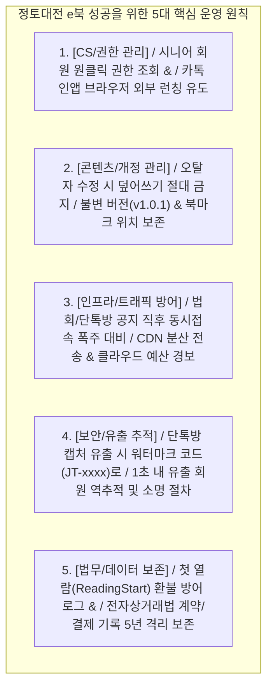

# 04. 출시 배포, 일상 운영, CS 응대 및 장애 복구 매뉴얼

- **상위 문서**: [README.md (마스터 허브)](file:///Users/jeongseongchae/dev/jts/정토대전/docs/README.md)
- **연관 게이트**: `G5 (출시 검수)`, `G6 (단계 공개)`, `G7 (운영 이관 및 상시 운영)`
- **주요 대상**: 운영 책임자, 고객지원(CS) 담당자, 인프라/배포 당번 엔지니어, 편집 담당자, 개인정보/법무 담당자

---

> [!IMPORTANT]
> **[v2.2 확정 아키텍처 및 정책 기준 안내 (2026-10-24)]**
> 본 문서의 초기 검토 항목 중 발행 형태 및 결제 수단은 최종 의사결정에 따라 다음과 같이 확정되었습니다.
> 1. **100% 전자책(eBook) 단독 발행 (종이책 미발행)**: 실물 배송지 수집·물류 발송 절차를 전면 배제하며, 국립중앙도서관 **전자출판물 단독 E-ISBN 발급(부가세 0% 면세)**을 적용합니다.
> 2. **PG 1회용 가상계좌(무통장 송금) 단일 결제 (+72h TTL)**: 신용카드/간편결제 없이 6대 은행 가상계좌 송금으로만 결제하며, 미열람 청약철회 대비 환불 반환계좌(`AES-256-GCM`)를 사전 수집합니다.
> 3. **프로덕션 엔지니어링 명세 및 도면**: [PostgreSQL 16 6-Table DDL](file:///Users/jeongseongchae/dev/jts/정토대전/docs/specs/schema_v1_jungto_ebook.sql) · [OpenAPI 3.1 계약서](file:///Users/jeongseongchae/dev/jts/정토대전/docs/specs/openapi_v1_jungto_ebook.yaml) · [4-Layer 시스템 도면](file:///Users/jeongseongchae/dev/jts/정토대전/docs/jungto_ebook_architecture_diagram.html) · [Excalidraw 구성도](file:///Users/jeongseongchae/dev/jts/정토대전/docs/jungto_ebook_system_architecture.png)를 최우선 기준으로 적용합니다.


## 1. 정토대전 e북 서비스 5대 핵심 운영 포인트 (Core Principles)

개발은 *"책이 화면에 잘 보이는가"*로 끝나지만, 실제 서비스의 성패는 출시 이후 아래 **5가지 운영 포인트**에서 갈립니다.



1. **[CS/회원 관리] 어르신 문의 즉시 해결 도구 및 인앱 브라우저 대응**:
   - *"돈을 냈는데 책이 안 열린다"*는 시니어 회원의 전화가 왔을 때, 개발자를 부르지 않고도 **CS 담당자가 관리자 화면(`/ops/entitlements`)에서 결제 상태와 열람권을 1초 만에 조회하고 임시/수동 부여**할 수 있어야 합니다.
   - 단톡방 링크를 클릭해 **카카오톡/네이버 인앱 브라우저**로 열면 캔버스 메모리 부족으로 튕길 수 있으므로, 사파리(Safari)나 크롬(Chrome) 외부 브라우저로 열도록 자동 안내합니다.
2. **[콘텐츠/개정] 불변 버전(Immutable Version) 배포 원칙**:
   - 출간 후 발견된 오탈자를 고칠 때 S3의 기존 `book.pdf` 파일을 같은 이름으로 덮어쓰기하면, 브라우저/CDN 캐시 꼬임으로 인해 회원마다 서로 다른 본문을 보게 됩니다. 반드시 새 버전(`v1.0.1`) 경로로 업로드하고 매니페스트를 전환해야 합니다.
3. **[인프라/비용] 오픈런 트래픽 분산 및 클라우드 요금 경보**:
   - 정토회 전국 단톡방에 공지가 나가는 순간 수백~수천 명이 동시에 4권 PDF를 열람합니다. 모든 바이트 전송은 CloudFront(CDN)가 전담하게 하여 웹 서버 다운을 막고, AWS 월 예산의 **50%·80%·100% 도달 시 즉시 SMS/이메일 경보**가 울리도록 설정합니다.
4. **[보안/유출 관리] 워터마크 역추적 테이블 상시 가동**:
   - 캡처 화면이 외부나 단톡방에 유출되었을 때, 이미지에 찍힌 열람코드(예: `JT-7K4M`)를 운영자 화면에 입력하면 해당 회원과 발급 세션 시각이 즉시 조회되어야 심리적·실질적 복제 억제가 유지됩니다.
5. **[법무/데이터] 청약철회 증빙 및 법정 5년 분리 보관**:
   - 20만 원 고액 상품의 환불 분쟁 시 법적 효력을 갖는 **`ReadingStart`(첫 본문 전달 시각) 로그**를 보존하고, 회원이 탈퇴하더라도 전자상거래법상 계약·대금결제·환불 기록은 **5년간 별도 격리 보관소**에 안전하게 유지합니다.

---

## 2. 출시 리허설(D-7 ~ D-1) 및 당일 배포(D-Day) 절차

### 2.1 출시 전 카운트다운 체크리스트 (D-7 ~ D-1)

| 시점 | 필수 수행 작업 | 완료 증빙 산출물 | 책임 역할 |
| :---: | :--- | :--- | :--- |
| **D-7** | 저작권·폰트 권리대장, 환불/약관 고지문, 과세/면세, ISBN/납본 일정 최종 확인 | 법무·회계·서지 승인 기록 | 법무·회계·사업 |
| **D-7** | 정토대전 4권 최종 원고 동결(Freeze) 및 전권 콘텐츠 검수 완료 | 버전 매니페스트 및 SHA-256 해시 | 편집 책임자 |
| **D-5** | 21개 필수 QA 시나리오(`AUTH-01`~`PRIV-01`) 및 멀티 디바이스 검수 마감 | QA 테스트 결과 보고서 (치명 결함 0건) | QA / 기술 책임자 |
| **D-3** | 운영 동일 환경 배포·롤백 리허설 및 격리 DB 시점 복원(PITR) 훈련 | 실제 복구 소요시간(RPO/RTO) 및 대사표 | 인프라 / 백엔드 |
| **D-2** | CS 담당자 권한 조회·수동 부여·인앱 브라우저 안내 실습 및 비상연락망 가동 | CS 시나리오 수행 서명 및 연락망 | 운영 / CS 책임자 |
| **D-1** | 소스코드(이미지 digest)·인프라 설정·원고 매니페스트·약관 버전 완전 동결 | 릴리스 후보(`Release ID`) 확정 | 기술 책임자 |
| **D-1** | **출시 최종 결정 회의 (Go / No-Go Decision)** | 부문별 서명된 **출시 승인서** | 사업 책임자 총괄 |

### 2.2 출시 당일(D-Day) 10단계 안전 배포 순서
1. **당번 대기 및 백업 확인**: 배포 실행자와 모니터링 당번이 연락망을 열고, 롤백용 직전 컨테이너 이미지 digest·이전 매니페스트·DB 스냅샷 위치를 확인합니다.
2. **초기 진입 제어**: 일반 회원 판매 및 대량 권한 배치 이관을 아직 닫아둔 상태에서 운영 환경 변수·Secret·S3 OAC·서명 키 설정을 점검합니다.
3. **무중단 DB 마이그레이션 (Expand-Contract)**: 구버전 앱과 호환되는 스키마 변경을 단일 작업으로 먼저 실행하고 결과를 검증합니다 (인스턴스 기동 시 동시 자동 마이그레이션 금지).
4. **애플리케이션 점진 배포**: 승인된 고정 이미지 digest를 배포하고 내부 테스트 계정으로만 먼저 접근을 엽니다.
5. **핵심 기능 스모크 테스트**: 1~4권 열람, Retina 선명도, 목차, 권 내 검색, 이어보기, 북마크, 워터마크 표시, 비구매 계정의 직접 접근(`403`) 차단을 확인합니다.
6. **운영 실거래 검증**: 사전 승인된 소규모 실결제(카드 및 가상계좌)를 진행하여 영수증·열람권 자동 부여·취소 시 즉시 회수까지 전 과정을 확인합니다.
7. **Phase 1 선구매자 권한 배치 이관**: 사전 Dry-run으로 검증된 종이책 구매자 목록에 대해 소규모 배치로 e북 열람권을 부여하고 원장과 1:1 대사합니다.
8. **단계적 공개 확대 (Rollout)**: `내부 담당자 → 대표 시니어 회원(5~8명) → 전체 회원` 순서로 트래픽을 열고 공지를 발송합니다.
9. **실시간 지표 관측**: API 오류율, CDN `403`/`5xx` 비율, 첫 페이지 표시 속도, PG 웹훅 수신 지연을 실시간 모니터링합니다.
10. **집중 관찰 전환 (72시간)**: 배포 완료 시각과 초기 지표를 기록하고, 출시 후 72시간 집중 관찰 당번 체제로 전환합니다.

### 2.3 배포 즉시 중단 및 롤백 임계 기준 (Kill Switch)
- **즉시 중단 사유 (Zero Tolerance)**:
  1. 타 회원의 개인정보·주문내역·북마크·워터마크가 섞여서 노출되는 경우 (`CACHE-01` 위반)
  2. 비공개 S3 원고가 서명 없이 외부에서 직접 다운로드 가능한 경우
  3. 미구매자에게 무료로 열람권이 잘못 부여되거나, 결제 완료자에게 권한이 부여되지 않는 상태가 지속되는 경우
  4. 핵심 API 오류율이 **5분간 2%를 초과**하거나 첫 페이지 로딩(`p95`)이 목표치를 심각하게 이탈하는 경우

---

## 3. 일상 관측 지표 및 고객지원(CS) 실무 매뉴얼

### 3.1 정기 운영 점검 루틴 (일간 / 주간 / 월간 / 분기)

| 주기 | 점검 영역 | 핵심 확인 지표 및 수행 작업 | 담당 역할 |
| :---: | :--- | :--- | :--- |
| **매일 / (Daily)** | **결제·권한 대사 및 백업** | • PG 결제/취소 원장 vs 내부 `OrderReference` vs `Entitlement` 불일치 건수 확인 (0건 유지) / • `EventInbox` 웹훅 처리 실패함(Dead Letter) 확인 및 재처리 / • DB 자동 백업 성공 여부 확인 | 운영 당번 / 백엔드 |
| **매주 / (Weekly)** | **성능·오류 및 클라우드 비용** | • 첫 페이지 표시 속도(`p95`), CDN 전송량(GB) 및 AWS 청구 비용 추이 확인 / • CS 주요 문의 유형(인앱 브라우저, 기기 오류, 입금 지연) 집계 및 도움말 보완 | 인프라 / CS |
| **매월 / (Monthly)** | **보안·권한 감사 및 파기** | • 운영자(`ops`) 접속 기록 및 수동 권한 조정(`AuditEvent`) 사유 적정성 감사 / • 보존기간 경과 로그/데이터 파기 및 패키지 보안 취약점 점검 | 기술 / 개인정보 책임자 |
| **매분기 / (Quarterly)** | **재해 복구(DR) 훈련** | • 격리 DB에 실제 백업 시점 복원(PITR) 훈련 및 비상연락망 현행화 | 전체 TF |

---

### 3.2 4대 빈발 CS 문의 유형별 처리 절차

#### ① "결제(또는 가상계좌 입금)를 했는데 내 서재에 책이 안 나옵니다"
1. **본인 및 주문 확인**: 회원의 이름(법명)/연락처와 주문번호를 확인하고 운영자 화면(`/ops/entitlements`)에서 조회합니다.
2. **원인 판별**:
   - **가상계좌 입금 대기(`PAYMENT_PENDING`)**: 아직 입금 전이거나 입금 기한이 만료된 경우 → 발급된 가상계좌 번호와 정확한 입금액(200,000원)을 안내합니다.
   - **웹훅 수신 지연**: PG사에는 입금 완료되었으나 네트워크 지연으로 권한 생성이 안 된 경우 → `[원장 재조회/동기화]` 버튼을 실행합니다.
   - **다른 계정으로 로그인**: 카카오 로그인 계정과 일반 아이디 계정을 혼동한 경우 → 결제한 계정 ID(마스킹)를 안내합니다.
3. **주의사항**: 결제 사실이 확인되지 않은 상태에서 CS가 화면만 보고 임의로 '영구 열람권'을 수동 부여하지 않습니다. 부득이한 장애 시에는 **만료일(예: 24시간)과 사유가 명시된 임시 열람권**만 부여합니다.

#### ② "화면이 하얗게 나오거나 403 오류가 뜹니다 / 글씨가 안 보여요"
1. **접속 환경 확인**: 스마트폰의 **카카오톡 채팅방 안에서 링크를 바로 눌렀는지(인앱 브라우저)** 먼저 확인합니다.
2. **외부 브라우저 유도**: 카카오톡/네이버 앱 내부 브라우저라면 **크롬(Android) 또는 사파리(iPhone) 앱으로 열도록 안내**합니다 (90% 이상 해결).
3. **세션/서명 만료**: 화면을 켜둔 채 장시간 자리를 비워 서명(5분 TTL)이나 로그인이 만료된 경우 → `[새로고침]` 또는 재로그인 후 이어보기를 안내합니다.

#### ③ "스마트폰에서 글씨가 너무 작아요 / 확대는 어떻게 하나요?"
1. 상단(또는 모바일 하단) 툴바의 **`[너비맞춤]`** 버튼을 누르거나 **`[＋]`** 버튼을 눌러 확대하도록 안내합니다.
2. 스마트폰을 **가로로 회전**하면 글씨가 훨씬 커지며, 두 손가락으로 화면을 벌려(핀치 줌) 원하는 만큼 키울 수 있음을 안내합니다.

#### ④ "책 본문에 오탈자가 있어요 / 특정 한자 검색이 안 돼요"
1. 권 번호, 인쇄 쪽수, 해당 문구, 캡처 화면을 접수하여 **편집 책임자에게 이관**합니다.
2. 개발자가 임의로 사료의 한자나 본문 의미를 추측하여 수정하지 않으며, 편집부 검토 후 **정오표 등록 → 차기 마이너 버전(`v1.0.1`) 배포** 절차로 안내합니다.

---

### 3.3 상황별 CS 표준 응대 문구 템플릿

> **[문구 1] 결제/입금 후 열람권 확인 중일 때**
> "도반님, 불편을 드려 죄송합니다. 현재 결제 내역과 전자책 열람권 반영 상태를 시스템에서 확인하고 있습니다. 주문번호와 입금 시각을 대조한 뒤 빠르게 열람하실 수 있도록 조치하고 결과를 안내해 드리겠습니다. 🙏"

> **[문구 2] 환불(청약철회) 기준 안내 시**
> "도반님, 『정토대전』 전자책은 구매 전 안내해 드린 바와 같이 본문 열람을 아직 시작하지 않으신 경우 결제일로부터 7일 이내에 전액 환불이 가능합니다. 다만 전자책 본문을 이미 열람 개시하신 경우에는 전자상거래법 기준에 따라 단순 변심에 의한 환불이 제한되는 점 너그러운 양해를 부탁드립니다."

> **[문구 3] 일시적 시스템 장애 발생 시**
> "현재 일시적인 접속량 증가(또는 시스템 점검)로 인해 일부 전자책 열람이 지연되고 있습니다. 기술 담당자가 원인을 파악하여 복구 중이며, 도반님의 구매 내역과 읽으시던 책갈피 위치는 안전하게 점검하고 있습니다. 정상화되는 대로 공지사항을 통해 안내드리겠습니다." *(※ 확인 전 근거 없는 복구 완료 시각 확약 금지)*

---

## 4. 오탈자 수정 및 개정판 운영 프로세스

### 4.1 변경 등급별 처리 및 검수 기준

| 변경 등급 | 해당 사례 | 필수 검수 및 배포 절차 |
| :--- | :--- | :--- |
| **1. 기술 패치** | UI 버튼 오류, 메타데이터 오기, 깨진 외부 링크 수정 | 영향 기능 QA 검증 후 앱 배포 (원고 해시 불변) |
| **2. 경미 교정 (오탈자)** | 본문 오탈자 수정, 도판 캡션 교정 (**쪽수 변동 없음**) | 편집 책임자 승인 → 정오표 등록 → 새 PDF 해시 생성(`v1.0.1`) → 매니페스트 전환 |
| **3. 구조 변경** | 페이지 추가/삭제로 인한 **인쇄 쪽수 및 인덱스 밀림** | 전권 재검수 + **기존 회원 북마크/이어보기 쪽수 매핑 테이블(`pageMap`)** 검증 필수 |
| **4. 전면 개정판 (2판)** | 대규모 내용 증보 및 재편집 | 별도 상품/권리/ISBN 재검토, 기존 1판 구매자에게 무료 업그레이드할지 구판 유지할지 사업 결정 |

### 4.2 불변 버전 매니페스트(`manifest.json`) 규격 및 세션 보호
- **덮어쓰기 절대 금지**: 수정된 PDF는 반드시 `release/jt-v01/1.0.1/book.pdf`처럼 새로운 버전 디렉토리에 업로드합니다.
- **독서 중 세션 고정**: 회원이 현재 `v1.0.0`을 열고 읽고 있는 도중에 서버가 `v1.0.1`로 바뀌더라도, 읽던 페이지가 갑자기 바뀌거나 끊기지 않도록 **현재 열람 세션 동안에는 기존 버전을 유지**하고 다음 재접속 시 새 버전으로 자연스럽게 전환합니다.

```json
{
  "volumeId": "jt-v01",
  "contentVersionId": "jt-v01-1.0.1",
  "format": "pdf",
  "pageCount": 640,
  "sha256": "e3b0c44298fc1c149afbf4c8996fb92427ae41e4649b934ca495991b7852b855",
  "assetKey": "release/jt-v01/1.0.1/book.pdf",
  "tocVersion": "1.0.1",
  "pageMapVersion": "1.0.0-to-1.0.1",
  "approvedBy": "사료편찬위_편집책임자",
  "approvedAt": "2026-11-20T10:00:00+09:00",
  "status": "READY"
}
```

---

## 5. 비상 장애 대응 매트릭스 및 백업 복구(DR) 훈련

### 5.1 8대 비상 사건별 초동 조치 및 금지 행위

| 비상 사건 | 즉시 수행할 초동 조치 (First Response) | 절대 하지 말아야 할 금지 행위 (Don'ts) |
| :--- | :--- | :--- |
| **1. 타 회원 정보/워터마크 혼입 노출** | 해당 API/CDN 경로 즉시 차단 → 로그/증거 보존 → 개인정보 책임자 이관 | 원인 은폐를 위한 임의 로그 삭제, 사실 확인 전 성급한 공지 |
| **2. 비공개 S3 원고 외부 노출** | S3 버킷 정책 및 CloudFront OAC 즉시 잠금 → 서명 키 교체 → 노출 범위 파악 | "CDN 캐시만 지웠으니 파일이 회수되었다"고 허위 보고 |
| **3. 결제 완료 후 열람권 미부여 다발** | 신규 결제 일시 보류 검토 → PG 원장 대사 워커 실행 → CS 안내 공지 | 검증 없이 모든 문의자에게 무제한 영구 권한 일괄 지급 |
| **4. PG 취소 API 타임아웃** | 상태를 `REFUND_UNKNOWN`으로 두고 PG 조회 API로 최종 상태 확인 | 새로운 멱등키로 취소 요청을 무한 반복 전송(중복 환불 위험) |
| **5. 신규 배포 직후 오류율 급증** | 배포 서킷 브레이커 작동 또는 직전 안정 이미지 digest로 **앱 즉시 롤백** | 앱 오류인데 DB까지 무조건 과거 시점으로 덮어쓰기 |
| **6. 잘못된 원고 파일 배포** | `Volume.current_version_id`를 직전 승인 버전(`v1.0.0`)으로 즉시 롤백 | 운영 S3 버킷의 기존 파일에 급하게 수동 덮어쓰기 |
| **7. DB 데이터 손상 / 오삭제** | 쓰기(Write) 트래픽 제한 → **격리된 새 DB에 시점 복원(PITR)** → 원장 대사 후 전환 | 정상 결제 기록이 남아 있는 운영 DB를 과거 백업으로 통째 덮어쓰기 |
| **8. 비정상 대량 다운로드/스크래핑** | 해당 계정 세션 및 IP 레이트 리밋(Rate Limit) 차단 → 증거 로그 확보 | 워터마크 코드 하나만 보고 해킹 피해 입은 선량한 회원을 범인으로 단정 |

### 5.2 출시 전 격리 DB 복구(PITR) 6단계 실전 훈련 (`DR-01`)
"백업 설정이 켜져 있다"는 것은 복구 능력의 증거가 아닙니다. 출시 전 반드시 아래 훈련을 1회 이상 통과해야 합니다.
1. 운영과 분리된 **격리 네트워크 환경**에 백업 스냅샷으로 새 PostgreSQL 인스턴스를 시점 복원(PITR)합니다 (외부 알림톡이나 실결제가 나가지 않도록 외부 통신 차단).
2. 복원된 DB의 회원 매핑·주문·열람권·북마크 건수를 확인하고, **백업 시점 이후부터 현재까지 PG사에 기록된 실제 승인/취소 거래 내역**을 추출합니다.
3. PG 원장 대사 스크립트를 돌려 백업 이후의 거래를 복원 DB에 재반영했을 때 권한 중복이나 누락이 없는지 확인합니다.
4. S3 원고 파일 해시와 CloudFront 서명 키 연결이 정상인지 함께 점검합니다.
5. 장애 인지부터 복원·원장 대사·서비스 재개까지 걸린 **실제 소요시간(`RTO` 목표 4시간 이내)과 데이터 손실 범위(`RPO` 목표 15분 이내)**를 측정하여 기록합니다.
6. 복원 시점에 따라 **이미 탈퇴·파기 완료된 회원의 개인정보가 백업에서 되살아난 경우 이를 즉시 재삭제(Re-purge)하는 절차**가 작동하는지 검증한 뒤 훈련 환경을 파기합니다.

---

## 6. 법정 데이터 보존·파기 및 서비스 종료 절차

### 6.1 데이터 유형별 법정 보존 기간 및 파기 원칙 ([전자상거래법 시행령 제6조](https://www.law.go.kr/법령/전자상거래등에서의소비자보호에관한법률시행령))

모든 데이터를 똑같이 영구 보관하거나 똑같이 즉시 삭제하면 법령 위반이 됩니다. 목적별로 분리하여 보관합니다.

| 데이터 구분 | 보존 기간 기준 | 법적 근거 및 실무 실행 방법 |
| :--- | :---: | :--- |
| **계약 또는 청약철회 등에 관한 기록** | **5년** | 전자상거래법 시행령 제6조 — 탈퇴 시에도 일반 DB에서 분리하여 접근 통제된 법정 보존 테이블에 5년간 격리 보관 후 파기 |
| **대금결제 및 재화 등의 공급에 관한 기록** | **5년** | 전자상거래법 시행령 제6조 — 결제 승인·환불·첫 열람(`ReadingStart`) 공급 증빙 5년 보존 |
| **소비자의 불만 또는 분쟁처리에 관한 기록** | **3년** | 전자상거래법 시행령 제6조 — CS 상담·환불 분쟁 처리 이력 3년 보존 후 파기 |
| **표시·광고에 관한 기록** | **6개월** | 전자상거래법 시행령 제6조 — 구매 시점의 상품 안내 문안 및 약관 버전 보존 |
| **개인정보 취급자(운영자/CS) 접속기록** | **1년 이상** / *(특정 조건 시 2년)* | [개인정보의 안전성 확보조치 기준](https://www.law.go.kr/LSW/admRulInfoP.do?admRulSeq=2100000265956) — 관리자 조회/수정 로그 위변조 방지 보관 및 월간 점검 (민감정보 또는 5만 명 이상 시 2년 기준 확인) |
| **일반 상세 열람 이벤트 로그** | **90일 (제안)** | 분쟁 대비 기간 경과 후 통계만 남기고 개인 식별 열람 로그 삭제 |
| **독서 위치(이어보기) 및 북마크** | **회원 탈퇴 시 즉시** | 서비스 이용 목적 달성 시 지체 없이 파기 |

### 6.2 향후 서비스 종료 또는 플랫폼 이관 시 8단계 안전 종료 프로토콜
1. **신규 판매 중지** → 2. **사전 종료 고지 (최소 3~6개월 전)** → 3. **대체 열람 경로 제공 또는 약관에 따른 보상** → 4. **회원 북마크/메모 데이터 반환(Export)** → 5. **법정 5년 보존 기록 격리 이관** → 6. **일반 서비스 DB 및 S3 파생 데이터 영구 삭제** → 7. **백업 스냅샷 잔존 주기 만료 확인 및 외주/클라우드 파기 확인서 수령** → 8. **도메인·인증서·서명 비밀키 폐기**.

---

## 7. [실무 양식] 출시 승인서, 콘텐츠 검수표, 장애 복구 보고서

### 7.1 최종 출시 승인서 (`G5 → G6` 통과 양식)

```markdown
# [승인서] 정토대전 e북 서비스 최종 출시(런칭) 승인서

- **릴리스 ID**: REL-JT-EBOOK-2026-____
- **컨테이너 이미지 Digest**: sha256:________________________________
- **DB 마이그레이션 버전**: __________ / **콘텐츠 매니페스트 버전**: __________

### 필수 통과 체크리스트 (미체크 항목 존재 시 출시 불가)
- [ ] 1. 요구사항 확정서(D1~D9) 및 상품·기간·탈퇴·개정 정책 최종 승인 완료
- [ ] 2. 4권 본문·도판·폰트의 전자배포 권리대장 100% 확인 완료
- [ ] 3. 4권 최종 PDF 원고 SHA-256 해시 고정 및 편집 책임자 전권 검수 승인 완료
- [ ] 4. 구매 전 안내(지원환경, 복제한계, 청약철회 조건, 미리보기) 및 개인정보 처리방침 반영 완료
- [ ] 5. 도서 판매용 PG 분리, 부가세 면세 설정, 현금영수증, 부분취소·정산 대사 검증 완료
- [ ] 6. 도서정가제, 판매자 신원 표시, 전자 계약서면 교부 절차 확인 완료
- [ ] 7. 비회원/미구매자 접근 차단 및 타인 북마크 접근 차단(OWASP BOLA `AUTH-01~03`) 통과
- [ ] 8. PG 가상계좌 웹훅 중복·역순·유실 처리 및 Phase 1 구매자 배치 이관(`PAY-01~03`) 통과
- [ ] 9. PC·태블릿·스마트폰 Retina 선명도 및 시니어 회원 사용성·접근성 시험 통과
- [ ] 10. 실제 격리 DB 시점 복원(PITR), 원장 대사, 앱·콘텐츠 롤백 리허설(`DR-01`) 통과
- [ ] 11. S3 원본 비공개(OAC), 서명 토큰 로그 마스킹, AWS 예산 경보(50/80/100%) 설정 완료
- [ ] 12. CS 운영자 조회/조정 화면 교육, 인앱 브라우저 안내, 비상연락망 준비 완료
- [ ] 13. 전자책 ISBN 발급 및 출간 후 30일 이내 국립중앙도서관 온라인 납본 일정 등록 완료

- **출시 후 72시간 집중 관찰 당번**: ______________ / **롤백 결정권자**: ______________
- **최종 승인 서명**:
  - 사업 책임자: ________ (서명) / 편집 책임자: ________ (서명) / 기술 책임자: ________ (서명)
  - 법무·개인정보: ________ (서명) / 회계 책임자: ________ (서명) / 운영·CS 책임자: ________ (서명)
```

### 7.2 원고 및 콘텐츠 전권 검수표 양식 (`W24`)

```markdown
# [검수표] 정토대전 전자책 콘텐츠 전권 검수 확인서

- **대상 권 / 버전**: 제__권 (`jt-v0_`) / 버전: `v1.0.0`
- **파일명 및 SHA-256**: `____________________.pdf` / `sha256:____________________________`
- **총 페이지 수 / 인쇄 쪽수 범위**: 총 ____쪽 (표지 제외 본문 1쪽 ~ ____쪽)
- **검수 기간 및 검수자**: 2026-__-__ ~ 2026-__-__ / 검수자: __________

| 검수 항목 | 확인 범위 (전수 / 표본) | 결과 (합격/불합격) | 발견 결함 ID 및 조치 내역 |
| :--- | :--- | :---: | :--- |
| 페이지 누락·순서·백지 여부 | 전 페이지 100% 육안 대조 | [ ] 합격 | |
| 한자 이체자·고어·산스크리트 표시 | 위험 페이지 ___쪽 집중 대조 | [ ] 합격 | |
| 다단 각주·넓은 표·도판/지도 해상도 | 도판/표 포함 페이지 전수 | [ ] 합격 | |
| 사이드바 목차(ToC) 클릭 시 쪽 이동 | 목차 항목 전수 클릭 시험 | [ ] 합격 | |
| 핵심 검색어(50~100개) 본문 검색 | 지정 검색어 목록 대조 | [ ] 합격 | |

- **편집 책임자 최종 승인**: ______________ (서명 / 일시: 2026-__-__)
```

### 7.3 비상 장애 기록 및 복구 결과 보고서 양식 (`W30`)

```markdown
# [보고서] 장애 대응 및 데이터/서비스 복구 결과 보고

- **발생 및 인지 시각**: 2026-__-__ __:__ (최초 `requestId`: ____________)
- **영향 범위**: 영향 회원 약 ___명 / 대상 권: ______ / 결제·환불 영향 건수: ___건
- **초동 조치 시각 및 내용**: __:__ (조치자: ______ / 신규 판매 보류·앱 롤백·경로 차단 등)
- **근본 원인 (Root Cause)**: ____________________________________________________
- **수행한 복구 유형**: [ ] 앱 이미지 롤백 / [ ] 콘텐츠 매니페스트 롤백 / [ ] 격리 DB PITR 복원
- **복구 후 원장 대사 결과**:
  - 백업 시점 이후 재반영 거래: ___건 / 최종 주문-열람권 불일치: 0건 확인
  - 실측 RPO(데이터 손실): ___분 / 실측 RTO(복구 소요시간): ___시간 ___분
- **재발 방지 대책 (작업 ID 및 기한)**: `W__` (담당: ______, 완료기한: 2026-__-__)
- **상황 종료 승인자**: 기술 책임자 ________ / 운영 책임자 ________ (일시: ________)
```
