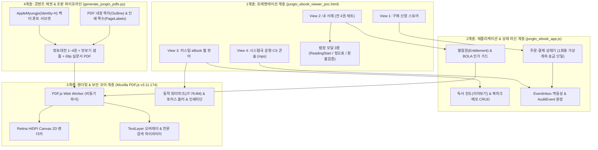
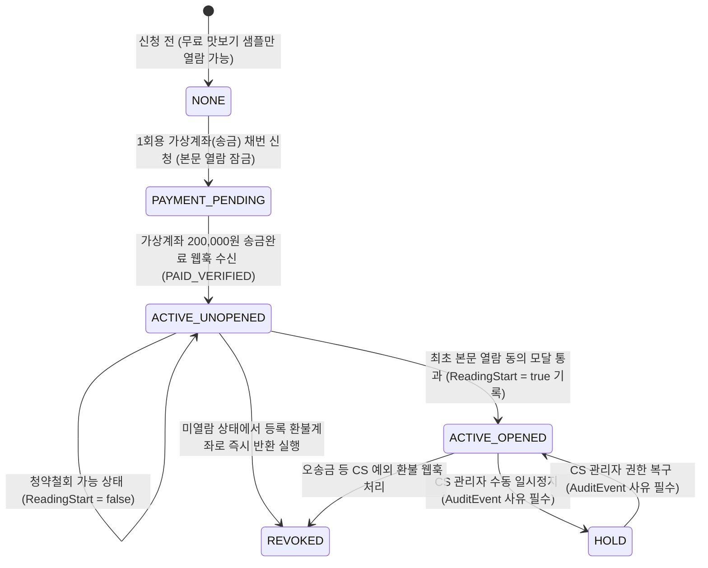

# 『정토대전(淨土大典)』 프로덕션 PoC 시스템 아키텍처 및 직군별(기획·운영·개발) 종합 해설서

> **문서 버전**: v1.0.0
> **작성일**: 2026-10-23
> **대상 독자**: 서비스 기획자(사료편찬위원회·기획팀), 운영·CS 담당자(출판국·법회팀), 시스템국 개발자(프론트엔드·백엔드·인프라)
> **실시간 PoC 구동 URL**: `http://localhost:8123/jungto_ebook_viewer_poc.html` (동일 Wi-Fi 태블릿·모바일: `http://10.100.10.70:8123/jungto_ebook_viewer_poc.html`)
> **핵심 소스 코드**: [jungto_ebook_viewer_poc.html](file:///Users/jeongseongchae/dev/jts/temp/jungto_ebook_viewer_poc.html) · [jungto_ebook_app.js](file:///Users/jeongseongchae/dev/jts/temp/jungto_ebook_app.js) · [generate_jungto_pdfs.py](file:///Users/jeongseongchae/dev/jts/temp/generate_jungto_pdfs.py)

---

## 1. 전체 시스템 아키텍처 총괄 (공통 큰 그림)

우리가 구축한 『정토대전』 프로덕션 PoC는 단순한 "PDF 파일 뷰어"가 아니라, **결제(Store) → 권리 부여(Entitlement) → 열람 및 독서 활동(Viewer) → 사후 감사 및 고객지원(Operations)**이 하나의 유기적인 상태 머신(State Machine)으로 묶인 **엔드투엔드(End-to-End) 전자책 출판·유통 시스템**입니다.

### 1.1 4-계층(4-Tier) 통합 아키텍처 다이어그램



---

### 1.2 PoC 구현체 ↔ 실서비스(마이정토 Production) 1:1 아키텍처 매핑

본 PoC는 외부 네트워크 의존성 없이 즉시 검수할 수 있도록 브라우저 단일 환경에서 백엔드·웹훅·스토리지 동작까지 시뮬레이션하도록 설계되었습니다. 본 개발(Phase 1·2) 이관 시 아래 표와 같이 1:1로 매핑됩니다.

| 아키텍처 구성요소 | 프로덕션 PoC 구현 위치 및 방식 | 마이정토 실서비스(Production) 이관 대상 |
| :--- | :--- | :--- |
| **회원 인증 및 세션** | [`appState.member`](file:///Users/jeongseongchae/dev/jts/temp/jungto_ebook_app.js#L149-L158) 객체 (법명 `법경`, 식별코드 `JT-7K4M`) | 마이정토(`myjungto-frontend` / `myjungto-backend`) 기존 JWT/세션 SSO 연동 |
| **프론트엔드 UI 프레임워크** | [jungto_ebook_viewer_poc.html](file:///Users/jeongseongchae/dev/jts/temp/jungto_ebook_viewer_poc.html) + Tailwind CSS | 마이정토 프론트엔드(`Vue 3 + Vite + Vuetify`) 내 전용 라우트 모듈로 탑재 |
| **상태 저장소 (DB)** | 브라우저 `localStorage` (`JUNGTO_DAEJEON_PROD_POC_V1`) | 마이정토 RDBMS (`Orders`, `Entitlements`, `ReadingPositions`, `Bookmarks`, `EventInbox`, `AuditEvents` 11개 테이블) |
| **결제 및 가상계좌 웹훅** | [`submitPurchaseOrder`](file:///Users/jeongseongchae/dev/jts/temp/jungto_ebook_app.js#L462-L533) 및 [`simulatePgWebhook`](file:///Users/jeongseongchae/dev/jts/temp/jungto_ebook_app.js#L1446-L1506) | 국내 PG사(토스페이먼츠/이니시스 등) 결제창 SDK 및 백엔드 Webhook 수신 API (`POST /api/v1/webhooks/pg`) |
| **콘텐츠 전송 및 서명** | 로컬 정적 서빙 (`pdfs/*.pdf`) + 5분 TTL 카운트다운 타이머 | 비공개 **AWS S3 + CloudFront OAC** + 백엔드 발급 단기 **Signed URL / Signed Cookie (TTL 5분)** |
| **PDF 렌더링 엔진** | `PDF.js v3.11.174` + [`renderSinglePageToSlot`](file:///Users/jeongseongchae/dev/jts/temp/jungto_ebook_app.js#L853-L897) 코어 | 동일 코드 그대로 `Vue 3` 뷰어 컴포넌트 내부에 이식 (100% 재사용) |

---

### 1.3 핵심 도메인 상태 전이도 (Order & Entitlement Lifecycle)

기획자, 운영자, 개발자 모두가 반드시 공유해야 하는 **주문(`Order` · 가상계좌 송금 단일) 및 열람권(`Entitlement`) 상태 머신**입니다.



---

## 2. [기획자 관점] 서비스 기획·UX·법무 정책 해설

> **핵심 질문**: *"왜 『정토대전』 e북은 종이책 없이 100% 전자책으로만 발행하며, 왜 결제 수단을 '1회용 가상계좌(송금)' 단일 방식으로 확정했는가?"*

### 2.1 기획의 3대 핵심 원칙

1. **100% 전자책(eBook) 단독 발행 및 법적 분쟁 원천 예방 (전자상거래법 제17조 준수)**
   - 본 프로젝트는 종이책을 발행하지 않고 **오로지 디지털 전자책(eBook)으로만 단독 발행**합니다. 따라서 우편번호·도로명 주소 등 실물 배송지 개인정보를 일절 수집하지 않으며, 물류 포장·발송·파손 반품 비용이 발생하지 않습니다. (단, 단독 전자출판물로서 부가세 면세 0%를 적용받기 위해 **국립중앙도서관 전자출판물 전용 E-ISBN 발급**을 필수로 적용합니다.)
   - 전자책은 한 번 열람하면 회수가 불가능하므로, 법적으로 **"구매 전 환불 제한 고지 동의 + 무료 맛보기 샘플 제공 + 최초 열람 개시(`ReadingStart`) 시점의 명시적 동의 및 시각 기록"**이라는 3대 요건을 사용자 흐름(User Flow) 속에 강제했습니다.
2. **PG 1회용 가상계좌(송금) 단일 결제 채택 (수수료 95% 절감 + 입금 대조 100% 자동화)**
   - 20만 원 고액 결제에서 신용카드 결제를 사용할 경우 건당 약 6,000원(약 3%)의 높은 수수료가 발생하지만, **PG 1회용 가상계좌(송금)** 단일 방식을 채택하면 건당 약 250~300원 정액 수수료만 발생하여 **결제 수수료를 95% 이상 절감**할 수 있습니다.
   - 동시에 일반 무통장 입금(수동 통장 확인)의 고질적 문제인 동명이인 오입금과 주말 입금 확인 지연을 해결하기 위해, 주문 건마다 고유 계좌번호가 채번되고 은행 송금 완료 후 1분 내에 PG 웹훅(`VBANK_DEPOSIT_CONFIRMED`)으로 열람권이 자동 활성화되도록 기획했습니다.
   - 또한 가상계좌 현금 송금은 미열람 청약철회(환불) 시 돈을 돌려보낼 계좌가 필요하므로, 신청 화면에서 **환불 반환 은행 및 본인 계좌번호**를 함께 입력받도록 설계했습니다.
3. **온·오프라인 법회 연동을 위한 이중 쪽수(`PageLabels`) 표기**
   - 정토회 법회나 불교대학 수업에서 *"정토대전 제1권 3쪽을 펴세요"*라고 안내할 때, PDF 파일의 물리적 페이지(표지·간행사 포함 5페이지)와 본문 표준 쪽수(본문 3쪽)가 다르면 혼란이 생깁니다.
   - 따라서 뷰어 상단과 썸네일, 목차, 북마크 모든 곳에 **`PDF 물리 페이지(예: 5p)`와 `표준 조판 쪽수(예: 쪽수 3)`를 동시에 표기**하도록 기획했습니다.

---

### 2.2 기획자가 알아야 할 화면별 UX 설계 의도

| 화면 구분 | 핵심 기획 장치 | 기획 의도 및 기대 효과 |
| :--- | :--- | :--- |
| **1. 구매·신청 스토어** ([View 1](file:///Users/jeongseongchae/dev/jts/temp/jungto_ebook_viewer_poc.html#L173-L299)) | • 배송지 입력란 완전 제거 (100% eBook 전용) • 송금할 가상계좌 은행 선택 + 미열람 환불 반환 계좌 입력 • 무료 맛보기 샘플 버튼 및 필수 법정 고지 3종 체크박스 | 불필요한 주소 개인정보 수집을 없애고, 가상계좌 채번 즉시 `PAYMENT_PENDING`(송금대기 잠금) 상태를 생성하여 입금 전 열람 사고를 차단함 |
| **2. 내 서재 (전 4권)** ([View 2](file:///Users/jeongseongchae/dev/jts/temp/jungto_ebook_viewer_poc.html#L304-L310)) | • 권호별 독서 진도율(%) 및 `[이어읽기]` 버튼 • `#연기법`, `#반야심경` 등 핵심 키워드 태그 • `[정오표 v1.0.1]` 및 `[청약철회 검증]` 모달 | 송금 대기 중일 때는 원클릭 송금 웹훅 테스트 버튼을 제공하고, 입금 완료(`ACTIVE`) 후에는 읽던 위치를 1초 만에 이어 읽도록 지원함 |
| **3. eBook 웹 뷰어** ([View 3](file:///Users/jeongseongchae/dev/jts/temp/jungto_ebook_viewer_poc.html#L315-L483)) | • **미색 종이(Warm Paper)** 기본 배경 테마 • **단면 보기(모바일) ↔ 양면 펼쳐보기(PC/태블릿)** • 본문 드래그 후 **수행 메모 저장** • 카카오톡 인앱 브라우저 경고 배너 | 장시간 경전을 독송하는 시니어 회원의 눈부심을 줄이고, 카카오톡 채팅방 링크로 접속했을 때 발생하는 메모리 튕김 현상을 사전에 안내함 |
| **4. 법정 모달 3종** ([Modals](file:///Users/jeongseongchae/dev/jts/temp/jungto_ebook_viewer_poc.html#L607-L677)) | • `ReadingStart` 최초 열람 동의 모달 • 초판(`v1.0.0`) vs 개정판(`v1.0.1`) 정오표 모달 • `ReadingStart` 기반 자동 환불 판정 모달 | 송금만 하고 아직 안 읽은 회원은 등록된 환불계좌로 즉시 반환을 허용하되, 1회 이상 본문을 연 회원은 열람 시각을 제시하여 분쟁을 종결함 |

---

## 3. [운영자·CS 관점] 가상계좌 입금 대사·권한 통제·저작권 추적·정산 해설

> **핵심 질문**: *"법우님에게서 '가상계좌로 송금했는데 책이 안 열려요', '환불해 주세요', 혹은 외부에 캡처본이 유출되었을 때 운영자는 어디서 어떻게 처리하는가?"*

운영자와 CS 담당자는 상단 네비게이션의 **`[4. 시스템국 운영·CS 콘솔 (/ops)]`** ([View 4](file:///Users/jeongseongchae/dev/jts/temp/jungto_ebook_viewer_poc.html#L488-L602)) 화면 하나에서 모든 일상 운영과 비상 조치를 수행합니다.

### 3.1 주요 CS 상황별 콘솔 처리 워크플로

```mermaid
flowchart TD
    CS_In["법우님 CS 문의 또는 운영 이벤트 발생"] --> Case1["가상계좌 송금 문의"]
    CS_In --> Case2["환불/취소 요청"]
    CS_In --> Case3["단말기 오류 및 예외 권한 제어"]
    CS_In --> Case4["외부 커뮤니티 캡처 유출 발견"]

    Case1 --> Check_Inbox["EventInbox 웹훅 수신 테이블 확인"]
    Check_Inbox --> Act_Vbank["PG 가상계좌 입금 완료 시 자동 ACTIVE 전환 확인"]

    Case2 --> Check_RS["회원 카드에서 ReadingStart(최초열람시각) 확인"]
    Check_RS -->|미열람 (false)| Act_RefundOK["등록 환불계좌로 200,000원 반환 (열람권 REVOKED 자동 회수)"]
    Check_RS -->|열람확정 (true)| Act_RefundNo["열람 일시·권호 안내 후 단순변심 환불 불가 고지"]

    Case3 --> Act_Manual["CS 수동 제어 패널에서 사유(5자 이상) 입력 후 상태 변경"]
    Act_Manual --> Log_Audit["AuditEvent 5년 보존 원장에 작업자·사유 자동 기록"]

    Case4 --> Act_Trace["워터마크 역추적기에 식별코드(JT-7K4M) 입력"]
    Act_Trace --> Found_Member["유출 회원 실명·법명·지회·접속 IP 즉시 특정"]
```

---

### 3.2 운영 콘솔(`/ops`) 4대 핵심 도구 사용법

#### ① PG 가상계좌(송금) 웹훅 & 멱등성 모니터 (`EventInbox`)
- **역할**: PG사로부터 날아오는 가상계좌 채번(`VBANK_ISSUED`), 200,000원 송금 입금 완료(`VBANK_DEPOSIT_CONFIRMED`), 환불 이체 완료(`VBANK_REFUND_TRANSFERRED`) 신호가 누락이나 중복 없이 처리되었는지 감시합니다.
- **중복 방어(멱등성) 확인**: 네트워크 지연으로 PG사가 동일한 입금 통보를 2번 이상 보낼 경우, 콘솔 하단 `EventInbox` 테이블에 **`IGNORED_DUPLICATE (EventInbox 멱등성 차단 완료)`** 배지가 표시되며 안전하게 무시됩니다.

#### ② CS 열람권 수동 제어기 (`AuditEvent` 연동)
- **엄격한 내부 통제 원칙**: 운영자가 데이터베이스(DB)에 직접 접속해 권한을 고치는 행위는 절대 금지됩니다.
- **사유 입력 강제**: 콘솔의 사유 입력란에 **최소 5자 이상의 구체적 사유**(예: `"법우님 초기 브라우저 오류로 본문 미확인 확인되어 미열람 상태로 초기화"`)를 입력하지 않으면 버튼 클릭이 거부됩니다.
- **4가지 제어 액션**:
  1. `권한 즉시 부여 (ACTIVE)`: 특별 보급 대상자 또는 수동 송금 확인 시 열람권 활성화
  2. `일시 정지 (HOLD)`: 계정 대여 의심 또는 분쟁 조사 중 열람 일시 차단
  3. `권한 회수 (REVOKED)`: 환불계좌 반환 완료 시 즉시 열람 차단
  4. `미열람 상태로 초기화`: 시스템 오류로 첫 페이지가 뜨지 않았는데 `ReadingStart`가 찍힌 회원을 구제하여 환불 가능 상태로 되돌림

#### ③ 유출 이미지 워터마크 코드 역추적기 (Forensic Tracer)
- 모든 회원의 뷰어 화면에는 회원번호(PK)를 직접 노출하지 않고, 난독화된 **6자리 고유 워터마크 코드(예: `JT-7K4M`)**가 회전 출력됩니다.
- 외부 인터넷에 캡처 사진이 올라왔을 때, 사진 속에 흐릿하게 찍힌 `JT-7K4M` 코드를 콘솔 역추적기에 입력하면 **회원번호, 실명(`김정토`), 법명(`법경`), 소속(`서초지회`), 접속 IP(`211.45.108.24`)**가 1초 만에 조회됩니다.

#### ④ 가상계좌(송금) 입금대사 및 정산 원장 CSV 추출
- 종이책 배송이 없으므로 물류 송장 대신 재정팀·출판국의 회계 대사를 위해 콘솔 우측 상단의 **`[📥 가상계좌(송금) 입금대사 및 정산 원장 CSV 다운로드]`** 버튼을 제공합니다.
- 클릭 시 주문번호, 채번 가상계좌번호, 송금액(200,000원 면세), 입금일시, `ReadingStart` 여부, 환불 반환 계좌가 포함된 엑셀 호환(UTF-8 BOM) CSV 파일이 다운로드되며 `AuditEvent` 원장에 기록됩니다.

---

## 4. [개발자 관점] 코드 레벨 기술 아키텍처·렌더링 수학·보안 구현 해설

> **핵심 질문**: *"코드 내부에서 Retina 선명도 보정, TextLayer 검색 하이라이트, PDF 벡터 서브셋 생성, 그리고 BOLA/DRM 보안 통제는 구체적으로 어떤 함수와 알고리즘으로 구현되었는가?"*

### 4.1 핵심 소스 파일 및 주요 함수 인덱스

| 파일명 | 핵심 함수 / 심볼 (클릭 시 해당 코드 라인 이동) | 기술적 역할 요약 |
| :--- | :--- | :--- |
| [jungto_ebook_app.js](file:///Users/jeongseongchae/dev/jts/temp/jungto_ebook_app.js) | [`getDefaultState()`](file:///Users/jeongseongchae/dev/jts/temp/jungto_ebook_app.js#L152-L273) | 전자책 전용(`EBOOK_ONLY_SET`) 및 가상계좌 단일(`VBANK`) 도메인 모델 정의 |
| [jungto_ebook_app.js](file:///Users/jeongseongchae/dev/jts/temp/jungto_ebook_app.js) | [`submitPurchaseOrder()`](file:///Users/jeongseongchae/dev/jts/temp/jungto_ebook_app.js#L477-L537) | 법정 필수 동의 3종 검증 후 선택 은행 1회용 가상계좌 채번(`PAYMENT_PENDING`) 및 환불계좌 저장 |
| [jungto_ebook_app.js](file:///Users/jeongseongchae/dev/jts/temp/jungto_ebook_app.js) | [`requestOpenVolume()`](file:///Users/jeongseongchae/dev/jts/temp/jungto_ebook_app.js#L664-L685) · [`confirmReadingStartConsent()`](file:///Users/jeongseongchae/dev/jts/temp/jungto_ebook_app.js#L687-L715) | 열람권(`ACTIVE`) 검사 및 최초 열람 시 `ReadingStart` 동의 모달 인터셉트·감사 로깅 |
| [jungto_ebook_app.js](file:///Users/jeongseongchae/dev/jts/temp/jungto_ebook_app.js) | [`loadVolumeInViewer()`](file:///Users/jeongseongchae/dev/jts/temp/jungto_ebook_app.js#L743-L809) | BOLA 권한 가드, `PDF.js` cMap/표준폰트 로드, `getPageLabels()` 및 `getOutline()` 비동기 파싱 |
| [jungto_ebook_app.js](file:///Users/jeongseongchae/dev/jts/temp/jungto_ebook_app.js) | [`renderCurrentSpread()`](file:///Users/jeongseongchae/dev/jts/temp/jungto_ebook_app.js#L818-L851) · [`renderSinglePageToSlot()`](file:///Users/jeongseongchae/dev/jts/temp/jungto_ebook_app.js#L853-L897) | 단면/양면(`dual`) 캔버스 배치, **Retina `devicePixelRatio` 고해상도 변환 행렬 렌더링**, `TextLayer` 합성 |
| [jungto_ebook_app.js](file:///Users/jeongseongchae/dev/jts/temp/jungto_ebook_app.js) | [`executeInBookSearch()`](file:///Users/jeongseongchae/dev/jts/temp/jungto_ebook_app.js#L1258-L1326) · [`highlightMatchesInTextLayer()`](file:///Users/jeongseongchae/dev/jts/temp/jungto_ebook_app.js#L899-L910) | 전 페이지 비동기 텍스트 추출, 키워드 문맥 스니펫 생성, `TextLayer` DOM 스팬 하이라이트 주입 |
| [jungto_ebook_app.js](file:///Users/jeongseongchae/dev/jts/temp/jungto_ebook_app.js) | [`simulatePgWebhook()`](file:///Users/jeongseongchae/dev/jts/temp/jungto_ebook_app.js#L1446-L1506) · [`executeCsEntitlementChange()`](file:///Users/jeongseongchae/dev/jts/temp/jungto_ebook_app.js#L1508-L1537) | PG 웹훅 멱등성(`EventInbox`) 처리 및 CS 수동 권한 변경 시 5자 이상 사유 강제 검증 |
| [generate_jungto_pdfs.py](file:///Users/jeongseongchae/dev/jts/temp/generate_jungto_pdfs.py) | [`build_volume_pdf()`](file:///Users/jeongseongchae/dev/jts/temp/generate_jungto_pdfs.py#L298-L443) | `PyMuPDF(fitz)` 기반 `AppleMyungjo` 서브셋 임베딩, `set_toc()` 목차 및 `set_page_labels()` 생성 |

---

### 4.2 핵심 기술 1: Retina / HiDPI 고해상도 렌더링 수학적 원리

초기 테스트에서 PDF 본문이 흐릿하게 보였던 원인은 `PDF.js`의 기본 `viewport`가 CSS 논리 픽셀($W_{\text{css}}, H_{\text{css}}$)만을 기준으로 `<canvas>` 버퍼 크기를 잡기 때문입니다. 맥북 Pro, iPad, 최신 스마트폰 등 고해상도 기기에서는 물리 픽셀 밀도($r = \text{window.devicePixelRatio} \ge 2.0$)가 논리 픽셀의 2~3배에 달하므로, 캔버스 내부 비트맵을 $r$배로 확장하고 아핀 변환 행렬(Affine Transformation Matrix)을 곱해주어야 합니다.

[`renderSinglePageToSlot()`](file:///Users/jeongseongchae/dev/jts/temp/jungto_ebook_app.js#L853-L897)에 적용된 수식과 코드는 다음과 같습니다:

$$
W_{\text{physical}} = \lfloor W_{\text{viewport}} \times r \rfloor, \quad H_{\text{physical}} = \lfloor H_{\text{viewport}} \times r \rfloor
$$

$$
\mathbf{T} = \begin{bmatrix} r & 0 & 0 \\ 0 & r & 0 \\ 0 & 0 & 1 \end{bmatrix} \implies \text{transform} = [r, 0, 0, r, 0, 0]
$$

```javascript
// jungto_ebook_app.js (L858-L872)
const outputScale = window.devicePixelRatio || 1;
const canvas = document.getElementById(canvasId);
const ctx = canvas.getContext("2d");

// 1. 실제 그래픽 메모리 버퍼는 물리 픽셀(outputScale 배)로 할당
canvas.width = Math.floor(viewport.width * outputScale);
canvas.height = Math.floor(viewport.height * outputScale);

// 2. 화면상 레이아웃 크기는 CSS 논리 픽셀로 고정
canvas.style.width = Math.floor(viewport.width) + "px";
canvas.style.height = Math.floor(viewport.height) + "px";

// 3. PDF 벡터 글리프 래스터화 단계에서 스케일 변환 행렬 적용
const transform = outputScale !== 1 ? [outputScale, 0, 0, outputScale, 0, 0] : null;
await page.render({ canvasContext: ctx, transform, viewport }).promise;
```

이 방식으로 렌더링하면 한자(`般若波羅蜜多心經`)의 미세한 획까지 래스터 업스케일링 블러(Blur) 없이 기기 네이티브 해상도로 칼같이 그려집니다.

---

### 4.3 핵심 기술 2: `TextLayer` 동기화 및 권내 전문 검색·하이라이트 파이프라인

`<canvas>`는 픽셀 비트맵이므로 그 자체로는 텍스트 드래그 선택이나 검색어 위치 하이라이트가 불가능합니다. 이를 해결하기 위해 캔버스 바로 위에 동일한 크기의 투명 DOM 레이어(`<div class="textLayer">`)를 겹쳐 올렸습니다.

1. **스케일 팩터 동기화**: `textLayerDiv.style.setProperty("--scale-factor", viewport.scale)`를 지정하여 확대/축소 배율이 바뀔 때마다 투명 `<span>` 글자 박스의 좌표와 크기가 캔버스 글자와 정확히 포개지도록 구현했습니다.
2. **비동기 전문 탐색 ([`executeInBookSearch`](file:///Users/jeongseongchae/dev/jts/temp/jungto_ebook_app.js#L1258-L1326))**:
   - 사용자가 검색어(예: `연기법`)를 입력하면 1페이지부터 마지막 페이지까지 `page.getTextContent()`를 순회하며 텍스트 아이템을 결합합니다.
   - 검색어 앞뒤 28~45자를 잘라 문맥 스니펫(Snippet)을 생성하고 정규식 치환으로 `<mark>` 하이라이트 배지를 렌더링합니다.
3. **본문 형광펜 주입 ([`highlightMatchesInTextLayer`](file:///Users/jeongseongchae/dev/jts/temp/jungto_ebook_app.js#L899-L910))**:
   - 검색 결과 페이지를 렌더링할 때 `textLayerDiv` 하위 모든 `<span>` 노드를 순회하여 검색어를 포함한 노드에 반투명 앰버 형광펜 스타일(`rgba(251, 191, 36, 0.55)`)을 직접 주입합니다.

---

### 4.4 핵심 기술 3: `PyMuPDF(fitz)` 기반 초경량 한글·한자 벡터 PDF 조판

[generate_jungto_pdfs.py](file:///Users/jeongseongchae/dev/jts/temp/generate_jungto_pdfs.py) 스크립트는 실제 출판사 인디자인(InDesign) 조판본과 동일한 기술 규격의 PDF를 생성합니다.

- **폰트 서브셋팅(Font Subsetting) 최적화**: macOS 시스템의 `AppleMyungjo.ttf` 원본 파일은 **18.7MB**에 달합니다. 이를 그대로 임베딩하면 권당 용량이 너무 커지지만, [`doc.subset_fonts()`](file:///Users/jeongseongchae/dev/jts/temp/generate_jungto_pdfs.py#L439)와 `doc.save(..., garbage=4, deflate=True)`를 적용하여 본문에 실제 사용된 한글·한자 글리프만 추출(`Identity-H` Type0 CID 폰트)함으로써 **권당 220KB ~ 272KB**로 98% 이상 압축했습니다.
- **이중 페이지 번호(`PageLabels`) 내장**: [`doc.set_page_labels()`](file:///Users/jeongseongchae/dev/jts/temp/generate_jungto_pdfs.py#L428-L431)를 통해 물리 인덱스 `0~1`(표지·간행사)은 로마자 소문자(`style: 'r'` → `i, ii`)로, 물리 인덱스 `2`부터는 아라비아 숫자(`style: 'D'` → `1, 2, 3...`)로 설정했습니다. 뷰어의 [`getLogicalPageLabel()`](file:///Users/jeongseongchae/dev/jts/temp/jungto_ebook_app.js#L811-L816) 함수가 이를 읽어 종이책 쪽수를 표시합니다.

---

### 4.5 핵심 기술 4: 다중 방어선(Defense-in-Depth) 보안 구현 및 실서버 이관 가이드

웹 기반 전자책(P2 기준안)에서 구현 가능한 모든 계층의 보호 조치가 코드에 적용되어 있습니다.

| 방어 계층 | 적용 기술 및 코드 위치 | 방어 동작 상세 |
| :--- | :--- | :--- |
| **L1. 인가(Authorization) 방어** | [`loadVolumeInViewer()`](file:///Users/jeongseongchae/dev/jts/temp/jungto_ebook_app.js#L743-L750) | `entitlement.status !== 'ACTIVE'`인 상태에서 유료 권호(`vol1~vol4`) 접근 시 즉시 차단하고 무료 맛보기(`preview`)로 강제 전환 (OWASP BOLA 방어) |
| **L2. 네트워크 만료 방어** | [`setInterval` TTL 타이머](file:///Users/jeongseongchae/dev/jts/temp/jungto_ebook_app.js#L1694-L1704) | CloudFront Signed URL의 짧은 수명(TTL 5분 = 300초) 및 만료 30초 전 백그라운드 하트비트 자동 갱신 시뮬레이션 |
| **L3. 인쇄·저장 원천 차단** | [`@media print` CSS](file:///Users/jeongseongchae/dev/jts/temp/jungto_ebook_viewer_poc.html#L45-L58) 및 [`keydown` 인터셉트](file:///Users/jeongseongchae/dev/jts/temp/jungto_ebook_app.js#L1670-L1683) | 브라우저 인쇄 시 본문 전체를 `display: none !important` 처리하고 경고문만 출력하며, `Ctrl+S`, `Ctrl+P`, `Ctrl+U`, 마우스 우클릭(`contextmenu`) 원천 차단 |
| **L4. 화면 캡처 억제** | [`window.blur` 리스너](file:///Users/jeongseongchae/dev/jts/temp/jungto_ebook_app.js#L1686-L1692) 및 [`#privacyBlurShield`](file:///Users/jeongseongchae/dev/jts/temp/jungto_ebook_viewer_poc.html#L367-L373) | 캡처 도구나 타 프로그램 클릭으로 브라우저 창 포커스가 이탈하는 즉시 본문 전체에 `backdrop-blur-xl` 보호막 작동 |
| **L5. 사후 포렌식 워터마크** | [`updateWatermarkOverlay()`](file:///Users/jeongseongchae/dev/jts/temp/jungto_ebook_app.js#L1332-L1354) | `pointer-events: none` 및 `-24deg` 회전이 적용된 6분할 그리드에 `성명(법명) · JT-7K4M · 열람시각 · 접속IP`를 상시 오버레이하여 카메라 촬영 유출 시에도 행위자 특정 가능 |

---

## 5. 정토회 공식 홈페이지(`jungto.org`) 디자인 시스템 및 룩앤필(Look & Feel) 규격

본 프로덕션 PoC는 정토회 공식 웹사이트(`https://www.jungto.org/`)의 `style.min.css` 및 `fonts.css`에서 추출한 **공식 브랜드 디자인 토큰(Color, Typography, GNB Layout)**을 100% 반영하여 이질감 없는 통합 브랜드 경험을 제공합니다.

| 디자인 토큰 분류 | `jungto.org` 추출 규격 (CSS Hex / Font) | PoC 적용 영역 및 UI 역할 |
| :--- | :--- | :--- |
| **브랜드 로고 & 슬로건** | 공식 연꽃 심볼 로고 (`jungto_org_logo.png`) | 상단 헤더 좌측 고정 및 `"맑은 마음, 좋은 벗, 깨끗한 땅"` 서브 타이틀 배치 |
| **공식 웹폰트 (Typography)** | `NanumSquare` (나눔스퀘어) / `NanumSquareRound`, 자간 `-0.04em` | GNB 메뉴, 카드 타이틀, 본문 컨트롤 UI 전체 적용 (PDF 본문은 `AppleMyungjo` 명조) |
| **2단 화이트 헤더 & GNB** | 상단 `.wrap-logo` (`#ffffff`) + 하단 `.wrap-gnb` (`border-bottom: 1px solid #ebe5e6`) | 정토회 홈페이지 특유의 깨끗한 2단 백색 헤더와 우측 세로 구분선(`1px solid #ccc`) 유틸리티 바 구현 |
| **시그니처 주황 (Primary Orange)** | 메인 포인트 `#f26522` / 버튼 `#ee8545` / 호버 `#d1743b` / 소프트 배지 `#fde7da` | GNB 활성 탭 텍스트 및 하단 `3px` 언더바, 주요 CTA 버튼(카드결제, 이어읽기, 본문검색), 형광펜 하이라이트 |
| **시그니처 청록/옥색 (Jade Teal)** | 서브 메인 `#519ea6` / 호버·강조 `#36858c` / 소프트 틴트 `#eef7f8` | 상품 히어로 카드 배경, 가상계좌 신청 버튼, 열람권 `ACTIVE` 배지, 목차·사이드바 토글 버튼 |
| **서피스 & 보더 & 본문색** | 배경 `#f6f6f6` / 카드 `#ffffff` / 보더 `#ebe5e6`, `#d6d6d6` / 텍스트 `#333333`, `#6d6d6d` | 기존 다크 톤을 걷어내고 정토회 홈페이지와 동일한 밝고 온화한 화이트·웜그레이 카드 레이아웃 적용 |

---

## 6. 직군별 최종 요약 치트시트 (1-Page Cheat Sheet)

| 직군 | 이 시스템에서 가장 중요하게 봐야 할 3가지 | PoC에서 직접 눌러볼 버튼 |
| :--- | :--- | :--- |
| **기획자** (사료편찬위·기획팀) | 1. 무료 맛보기 샘플과 본품의 분리 2. 최초 열람(`ReadingStart`) 동의 모달을 통한 환불 분쟁 차단 3. 시니어 친화 UX(미색 테마, 인쇄 쪽수 병기, 가상계좌) | `[1. 구매·신청]`에서 무료 맛보기 열람 → 가상계좌 신청 → `[2. 내 서재]`에서 정오표(`v1.0.1`) 및 청약철회 검증 클릭 |
| **운영자** (출판국·법회팀 CS) | 1. 가상계좌 입금 웹훅 자동 반영 및 중복 차단(`EventInbox`) 2. 사유 입력이 강제되는 CS 권한 제어(`AuditEvent`) 3. 유출 워터마크(`JT-7K4M`) 역추적 및 물류 CSV 추출 | `[4. 운영·CS 콘솔]`에서 중복 웹훅 전송 → 사유 입력 후 권한 `HOLD`/`ACTIVE` 변경 → `JT-7K4M` 조회 → 배송지 CSV 다운로드 |
| **개발자** (시스템국 FE/BE) | 1. `devicePixelRatio` 물리 해상도 스케일링 수식 2. `TextLayer` 검색 하이라이트 및 `PageLabels`/`Outline` 연동 3. 마이정토(`Vue 3 + Spring Boot + CloudFront OAC`) 이관 구조 | `[3. eBook 웹 뷰어]`에서 250% 확대 선명도 확인 → `#반야심경` 본문 검색 하이라이트 → 양면 보기 → 우클릭/포커스 블러 확인 |
