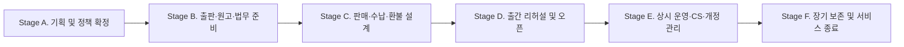
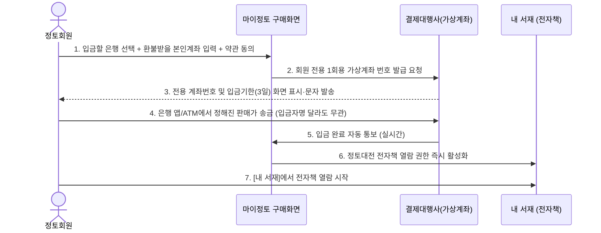
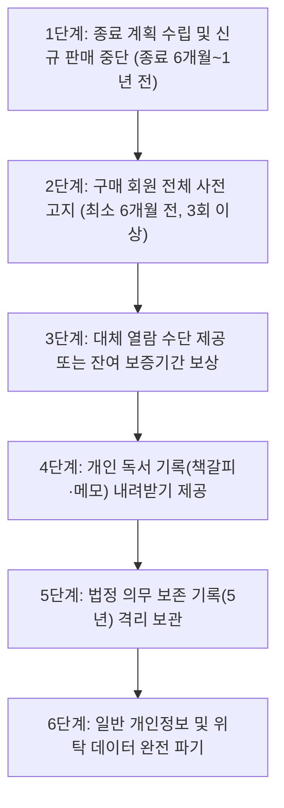

# 07. 『정토대전』 전자책 발간·보급·운영·서비스 종료(A to Z) 기획 및 현업 운영 종합 가이드

- **문서 성격**: 개발·기술 용어를 배제한 **기획자 및 현업 추진 부서(사료편찬위원회·출판·행정·재정·법무·CS) 전용 종합 실무 지침서**
- **작성 기준일**: 2026년 10월 25일
- **적용 범위**: 『정토대전』(100% 전자책 단독 발행)의 **최초 기획(A) → 출판·법무 준비 → 판매·수납 → 출간 운영·CS → 개정판 관리 → 향후 서비스 종료(Z)**에 이르는 전 생애주기(Full Lifecycle)
- **연관 문서**:
  - [08_현업부서_필수확인_및_의사결정_질문서_비기술전용.md](file:///Users/jeongseongchae/dev/jts/정토대전/docs/08_현업부서_필수확인_및_의사결정_질문서_비기술전용.md)
  - [09_재정회계팀_전용_세무_수납_정산_환불_검토서_초안.md](file:///Users/jeongseongchae/dev/jts/정토대전/docs/09_재정회계팀_전용_세무_수납_정산_환불_검토서_초안.md)
  - [10_법무개인정보팀_전용_저작권_약관_청약철회_법령_검토서_초안.md](file:///Users/jeongseongchae/dev/jts/정토대전/docs/10_법무개인정보팀_전용_저작권_약관_청약철회_법령_검토서_초안.md)

---

## 1. 왜 출판부터 서비스 종료(A to Z)까지 한 번에 검토해야 하는가?

종이책은 인쇄하여 독자에게 배송하면 출판사의 가장 큰 역할이 끝나지만, **전자책(eBook)은 출간 이후 독자가 책을 읽는 내내 '서비스'가 유지되어야 하는 살아있는 출판물**입니다.

특히 『정토대전』은 외부 서점(교보문고, 예스24 등)에 위탁하지 않고 **정토회가 자체적으로 정토회원에게만 보급·운영하는 핵심 사료**입니다. 따라서 시스템 개발 여부와 별개로, 현업 부서와 기획자는 반드시 아래 **6단계 생애주기(A to Z)** 전체를 사전에 설계하고 운영 주체를 확정해야 출간 후 혼란과 법적·재정적 문제를 예방할 수 있습니다.

### 한눈에 보는 『정토대전』 전자책 A to Z 핵심 과업 요약

| 단계 | 핵심 질문 (현업·기획 관점) | 현업 부서가 챙겨야 할 핵심 과업 | 주관 부서 |
| :--- | :--- | :--- | :--- |
| **Stage A. 기획 및 정책** | 누구에게, 어떤 상품 구성과 가격·원칙으로 보급할 것인가? | • 전자책 단독 발행 확정 및 판매가·상품 구성 확정 • 구매 가능 회원 자격 범위 및 무료 증정(법사·편찬위원 등) 기준 수립 • 1인당 이용 기기 대수 제한 및 무단 유출 시 공동체 대응 원칙 수립 | 사료편찬위원회 / 기획 |
| **Stage B. 출판 및 법무** | 합법적인 전자출판물로서 어떤 권리와 절차가 필요한가? | • 글·사진·지도·글꼴(폰트)의 '전자책 배포 권리' 계약 확인 • 화면 가독성·목차 이동·본문 검색이 가능한 전자책 원고 제작 및 전체 교정 • 전자책 전용 국제표준도서번호(E-ISBN) 발급(부가세 면세) 및 국립중앙도서관 납본 준비 • 이용약관 및 구매 전 필수 안내문(미리보기 샘플 포함) 확정 | 편집·출판 / 법무 |
| **Stage C. 판매 및 정산** | 판매 대금을 어떻게 받고, 환불과 세무는 어떻게 처리하는가? | • 주문별 1회용 가상계좌(송금) 입금 기한(예: 3일) 및 입금 안내 문자 기준 확정 • '열람 시작 전 7일 내 전액 환불 vs 1쪽이라도 열람 시 환불 불가' 기준 확립 • 기부금(보시)과 도서 판매 대금의 회계 분리 및 현금영수증 발행 기준 수립 | 재정·회계 / 운영 |
| **Stage D. 리허설 및 오픈** | 오픈 당일 어르신 회원들이 헤매지 않게 하려면 무엇을 준비할까? | • 시니어 대표 회원 사전 체험(글씨 확대, 입금, 열람) 및 불편 사항 개선 • 단톡방·법회 공지문 및 '따라 하기 쉬운 그림 안내서' 제작·배포 • CS 담당자 사전 모의 훈련 및 부문별 최종 출시 승인 서명 | 사료편찬위원회 / CS / 홍보 |
| **Stage E. 상시 운영·CS** | 출간 후 발생하는 문의, 정산, 오탈자, 유출은 어떻게 관리하는가? | • 일일/월간 입금·환불 내역 대조(정산 대사) • 6대 빈발 CS 문의(입금 확인, 기기 변경, 글씨 확대 등) 응대 창구 가동 • 출간 후 발견된 오탈자 정오표 공지 및 전자책 본문 판본 업데이트 • 화면 식별코드를 통한 외부 유출자 확인 및 소명·조치 | CS·회원지원 / 편집 / 재정 |
| **Stage F. 서비스 종료** | 먼 훗날 서비스를 닫거나 개편할 때 구매 회원을 어떻게 보호할까? | • 약관상 최소 열람 보장 기간(예: 5년) 및 회원 탈퇴·사망 시 열람권 처리 기준 적용 • 향후 서비스 종료 시 최소 6개월 전 사전 고지 및 대체 열람·보상 방안 실행 • 전자상거래법상 거래·결제 기록 5년 분리 보관 후 파기 | 사업책임자 / 법무 / 개인정보 |

---

## 2. [Stage A] 기획 및 보급 정책 수립 (무엇을 어떻게 보급할 것인가)

프로젝트의 첫 단추는 상품의 성격과 회원의 이용 규칙을 흔들림 없이 정의하는 것입니다.

### 2.1 발행 형태 및 가격·할인 정책
1. **100% 전자책 단독 발행**:
   - 종이책을 인쇄하지 않고 전자책으로만 발행하므로 우편번호·배송지 주소를 수집하지 않으며, 파본 교환·택배 분실·반품 배송비 문제가 원천적으로 발생하지 않습니다.
2. **상품 구성 및 판매 가격 확정**:
   - 단일 통합 상품으로만 보급할지, 여러 권으로 구성될 경우 개별 권 단위 판매 없이 전체 통합 세트로만 보급할지 확정합니다.
   - 통합 세트로 보급할 경우, 수록된 도서 중 어느 한 부분이라도 본문 열람을 시작하면 전체 상품의 열람이 개시된 것으로 간주하여 부분 환불이 되지 않는다는 점을 구매 화면에 명확히 안내해야 합니다.
3. **도서정가제 및 무료 보급(증정) 기준**:
   - 전자출판물 역시 출판문화산업진흥법상 **도서정가제** 적용 대상입니다. 임의의 특별 할인 판매를 진행할 경우 법령 위반 소지가 없는지 사전에 확인해야 합니다.
   - 편찬위원, 지도법사, 스님, 또는 사료 연구자 등에게 무료 열람 권한을 부여하는 경우, 대금 결제 없이 **사업 책임자의 공식 승인 공문(명단 및 사유 기록)**에 의해 권한을 부여하고 관리 대장에 기록합니다.

### 2.2 보급 대상(구매 자격) 및 시니어 회원 배려 정책
1. **구매 가능 회원 범위**:
   - 정토회 내부 사료이므로 외부 일반인에게는 판매하지 않으며, **『마이정토』에 가입된 정토회원**에게만 보급합니다.
   - 세부적으로 '마이정토 가입자 전원(일반회원 포함)'에게 열지, '발심행자·전법회원 이상' 또는 '정토불교대학 재학/졸업생 이상'으로 한정할지 현업 정책으로 확정해야 합니다.
2. **1인 1계정 본인 구매 원칙**:
   - 전자책은 실물 책과 달리 로그인한 계정(ID)에 열람 권한이 직접 부여됩니다. 따라서 한 사람이 여러 부를 사서 다른 사람에게 나눠주는 방식은 불가능하며 **1인 1계정 본인 구매**가 원칙입니다.
   - 다만 부모님이나 도반에게 선물하려는 수요가 있을 경우, **'대리 송금(신청은 읽으실 분의 계정으로 하고, 입금만 가족이 대신 송금)'** 방식으로 안내하면 별도의 복잡한 선물하기 절차 없이도 안전하게 해결됩니다.
3. **온라인 사용이 익숙하지 않은 고령(시니어) 회원 지원**:
   - 정토회원 중에는 60~70대 이상 어르신 비중이 높습니다. 스마트폰에서 로그인 계정을 잊어버리거나 화면 조작을 어려워하시는 분들을 위해 **지회/모둠 도반 안내 매뉴얼**과 **전화/온라인 CS 안내 창구**를 반드시 사전에 지정해야 합니다.

### 2.3 열람 환경 및 기기 제한 정책
1. **별도 앱 설치 없는 인터넷 창(웹) 바로 열람**:
   - 회원들이 앱스토어에서 별도 앱을 찾아 설치하느라 겪는 어려움을 없애기 위해, 마이정토에 로그인하여 **`[내 서재] → [열람하기]`** 버튼만 누르면 PC·태블릿·스마트폰 어디서든 즉시 책이 열리도록 운영합니다.
   - 인터넷이 연결된 상태에서 읽는 방식이므로 비행기 탑승 등 **인터넷이 완전히 끊긴 곳(오프라인)에서는 열람할 수 없음**을 구매 전에 안내합니다.
2. **1인당 등록 기기 대수 제한 (예: 최대 3대)**:
   - 한 회원이 구매한 뒤 수십 명에게 아이디와 비밀번호를 공유하는 행위를 막기 위해, **1인당 최대 3대 기기(예: 집 PC 1대 + 태블릿 1대 + 스마트폰 1대)**까지만 등록하여 열람할 수 있도록 제한합니다.
   - 휴대폰을 새로 바꾸거나 기존 기기를 초기화해야 할 때는 회원이 직접 `[내 서재]`에서 기존 기기를 해제하거나, CS 창구에 요청하여 기기 목록을 초기화할 수 있게 운영합니다.

---

## 3. [Stage B] 출판·원고 제작 및 법무·세무 준비 (출판사로서 준비할 사항)

전자책도 정식 출판물이므로 일반 도서 출판과 동일한 권리 확보, 서지 등록, 법정 납본 절차를 거쳐야 합니다.

### 3.1 전자책 전용 원고 제작 및 편집부 전체 검수
1. **전자책 원고 필수 품질 기준**:
   - 단순히 종이책 인쇄소용 파일을 그대로 올리면 용량이 너무 커서 스마트폰에서 열리지 않거나, 글자가 그림으로 처리되어 **단어 검색이 전혀 안 되는 문제**가 발생합니다.
   - 편집부는 원고를 최종 마감할 때 다음 4가지를 반드시 확인해야 합니다:
     - **본문 단어 검색 가능**: 본문의 한글과 한자가 그림이 아닌 '실제 글자 데이터'로 살아 있어 검색창에서 법문 구절을 찾을 수 있어야 합니다.
     - **클릭 이동 목차**: 대단원·중단원·소단원 목차와 실제 페이지 번호가 정확히 연결되어야 합니다.
     - **도판·표·각주 가독성**: 태블릿이나 스마트폰 화면에서 두 손가락으로 확대했을 때 사진, 지도, 도표, 세밀한 한자 획수가 흐려지지 않고 선명해야 합니다.
     - **표지 및 판권지 완비**: 마지막 페이지(판권지)에 발행일, 발행인, 발행처, 전자책 전용 ISBN(E-ISBN), 정가, 저작권 안내 문구가 정확히 기재되어야 합니다.
2. **출시 전 편집 책임자 전 페이지 육안 검수**:
   - 원고를 전자책 뷰어에 탑재한 뒤, 편집부에서 첫 페이지부터 마지막 페이지까지 **페이지 누락·순서 바뀜·깨진 한자·백지 여부**를 전수 대조하고 **『콘텐츠 검수 확인서』**에 서명해야 출시할 수 있습니다.

### 3.2 저작권 및 글꼴(폰트)의 '전자출판 권리' 확인 (필수)
1. **수록 저작물 및 사진·도판 권리**:
   - 본문 원고, 인용문, 외부 사진, 일러스트, 지도 등이 **'종이 인쇄용'으로만 허락된 것인지, '전자책(디지털 전송) 배포'까지 허락된 것인지** 전수 확인하여 권리 대장을 작성해야 합니다. 권리가 불분명한 외부 사진은 출시 전 교체하거나 삭제해야 합니다.
2. **글꼴(폰트) 전자책 임베딩 라이선스**:
   - 출판계에서 가장 빈번하게 발생하는 법적 분쟁이 **폰트 저작권 소송**입니다. 편집 프로그램에서 무료로 쓸 수 있는 폰트라도 **'전자책 파일 내부에 폰트를 포함시켜 유료 배포(임베딩)'할 때는 별도 라이선스 비용을 요구**하는 경우가 많습니다.
   - 사용된 모든 한글·한자·영문 폰트가 전자출판 상업적 배포에 문제가 없는지 폰트 제작사 약관을 반드시 확인하고 증빙을 보관해야 합니다.

### 3.3 전자출판물 전용 ISBN(E-ISBN) 발급 및 부가세 면세(0%) 적용
1. **전자책 전용 ISBN 발급**:
   - 국립중앙도서관 ISBN·ISSN 종합정보시스템을 통해 **전자출판물 전용 ISBN(E-ISBN)**을 발급받아야 합니다.
2. **부가가치세 면세(0%) 적용**:
   - 부가가치세법령상 국립중앙도서관으로부터 전자출판물 ISBN을 부여받은 정식 전자책은 도서와 동일하게 **부가가치세 면세(세율 0%)**가 적용됩니다.
   - 만약 ISBN 없이 단순 디지털 파일로 판매하면 과세(부가세 10% 부과) 대상이 되므로, **반드시 판매 개시 전에 E-ISBN 발급과 판권지 표기를 완료**해야 합니다.
3. **통신판매업 신고 및 판매자 정보 표시**:
   - 온라인으로 유료 도서를 판매하므로 판매 주체(법인/출판사) 명의의 **통신판매업 신고 번호, 사업자등록번호, 대표자명, 주소, 고객센터 연락처**를 구매 화면 하단에 의무 표시해야 합니다.

### 3.4 국립중앙도서관 온라인 납본 (출간 후 30일 이내)
- 도서관법 제20조에 따라 국내에서 발행된 전자출판물(ISBN 발급 자료)은 **발행일로부터 30일 이내에 국립중앙도서관에 디지털 파일을 온라인 납본**해야 합니다.
- 납본 시 정당한 보상을 청구하면 정가에 준하는 **납본 보상금**을 수령할 수 있으며, 일반 서점 유통 도서가 아니므로 도서관 납본 시 **'관외 이용 제한 및 저작권 보호 조치'** 옵션을 함께 체크하여 제출합니다.

### 3.5 구매 전 법정 필수 고지 및 미리보기(샘플) 제공
전자상거래법상 디지털 콘텐츠를 판매하고 '열람 후 환불 제한'을 인정받으려면 판매 화면에 다음 3가지가 반드시 준비되어야 합니다.
1. **무료 미리보기(샘플) 제공**: 구매자가 결제 전에 내 스마트폰이나 PC에서 글씨가 잘 보이는지, 어떤 구성인지 확인할 수 있도록 **표지·서문·목차·본문 일부(약 10~20쪽)를 무료 미리보기로 공개**해야 합니다.
2. **이용 조건의 명확한 표시**: 지원 기기(PC/태블릿/스마트폰 웹 브라우저), 인터넷 연결 필수 여부, 1인 등록 기기 대수 제한, 인쇄·파일 다운로드 불가 조건을 결제 버튼 바로 위에 굵은 글씨로 안내해야 합니다.
3. **구매 시 법정 3대 동의 체크**:
   - ① 전자책 이용약관 및 저작권 보호(무단 공유·유출 금지) 동의
   - ② **본문 첫 열람 개시 후 청약철회(단순 변심 환불) 불가 동의**
   - ③ 주문·결제 및 미열람 환불 처리를 위한 개인정보(환불 계좌번호 포함) 수집·이용 동의

---

## 4. [Stage C] 판매·결제·환불 및 회계 정산 설계 (돈과 권한의 흐름)

### 4.1 PG 1회용 가상계좌(송금) 단일 결제 운영 흐름
고액 도서 판매 시 발생하는 신용카드 수수료(결제액의 약 3%)를 건당 약 300원 수준으로 대폭 절감하고, 일반 통장으로 입금받을 때 발생하는 **'동명이인·입금자명 미기재 대란'을 원천 방지**하기 위해 **주문별 1회용 가상계좌 송금 방식**으로 운영합니다.

- **왜 1회용 가상계좌인가?**:
  - 회원마다 서로 다른 고유 계좌번호가 발급되므로, **배우자나 자녀 명의 통장에서 대신 입금하더라도 누구의 주문인지 100% 자동으로 확인**되어 입금 후 1분 이내에 전자책이 열립니다.
  - 정해진 판매 금액과 정확히 일치하지 않으면 입금 자체가 되지 않으므로 오입금 사고가 발생하지 않습니다.
- **미입금 자동 취소 기한**:
  - 가상계좌 발급 후 **72시간(3일) 이내에 입금하지 않으면 해당 주문과 계좌번호는 자동으로 취소(만료)**됩니다. 기한을 넘긴 회원은 다시 신청 버튼을 눌러 새 계좌번호를 발급받으면 됩니다.
- **환불 대비 반환 계좌번호 사전 입력**:
  - 가상계좌(현금 송금)는 카드 결제처럼 '승인 취소' 버튼 하나로 돈이 자동 반환되지 않고, **회원의 실제 계좌로 다시 송금해 주어야 환불이 완료**됩니다. 따라서 최초 신청 시 회원의 **환불 반환용 계좌(은행명·계좌번호·예금주)**를 미리 입력받아 두어야 환불 요청 시 CS가 일일이 전화해서 계좌번호를 물어보는 수고를 덜 수 있습니다.

### 4.2 청약철회(환불) 단계별 판정 기준
현업과 CS 창구에서 분쟁 없이 일관되게 적용할 **4단계 환불 기준표**입니다.

| 구분 | 회원 상태 | 환불 가능 여부 | 처리 방법 및 소요 기간 |
| :--- | :--- | :---: | :--- |
| **1단계** | **가상계좌 발급 후 입금 전** (`입금대기`) | **즉시 취소 가능** | 돈이 입금되지 않은 상태이므로 `[신청 취소]` 클릭 시 즉시 취소 처리 (입금 기한 3일 경과 시 자동 취소) |
| **2단계** | **입금 완료 후 단 한 번도 책을 열지 않은 상태** (`열람 전`) | **100% 전액 환불** | 결제일로부터 **7일 이내** 신청 시 조건 없이 결제액 전액 환불 (열람 권한 즉시 회수 후 사전 등록된 환불 계좌로 입금) |
| **3단계** | **『내 서재』에서 안내 동의 후 1페이지라도 본문을 연 상태** (`열람 개시 후`) | **단순 변심 환불 불가** | 전자책 시작 전 *"지금 열람을 시작하면 단순 변심 환불이 제한됩니다"* 팝업에 최종 동의하고 본문을 열람한 시점 기록이 남으므로 환불 불가 안내 |
| **4단계** | **예외적 환불 인정 사유** (`법정 예외`) | **심사 후 환불 가능** | • 회원의 기기 사양이 정상인데도 정토회 시스템 결함으로 72시간 이상 열람이 불가능한 경우 • 가족의 실수 중복 결제 등 현업 책임자가 특별 소명을 인정한 예외 건 |

### 4.3 세무·영수증 기준 및 일일·월간 정산 루틴
1. **기부금(보시금)과 도서 판매 대금의 엄격한 분리**:
   - 『정토대전』 구매 대금은 후원·보시금이 아니라 **출판물(재화) 판매 대금**입니다.
   - 따라서 **기부금영수증 발급 대상이 아니며**, 구매 화면과 영수증 안내에 *"본 대금은 도서 구매 대금이므로 기부금영수증이 발급되지 않으며, 현금영수증(소득공제/지출증빙)으로 발행됩니다"*라고 명확히 안내해야 연말정산 철에 민원이 발생하지 않습니다.
2. **일일·월간 정산 대사(맞춰보기) 절차**:
   - **일일 점검 (운영/CS)**: 매일 오전 전일 입금 완료 건수와 열람 권한 부여 건수가 정확히 일치하는지, 환불 요청 건이 정상 처리되었는지 관리자 화면에서 확인합니다.
   - **월간 정산 (재정/회계)**: 매월 초 결제대행사(PG)가 보내온 **월간 정산 명세서(입금 총액 - 환불 총액 - 가상계좌 수수료 = 실입금액)**와 정토회 관리자 화면에서 내려받은 **월간 판매 원장 엑셀 파일**을 대조하여 회계 전표를 마감합니다.

---

## 5. [Stage D] 출시 전 리허설 및 오픈 초기 운영 (출간 전후 준비)

### 5.1 출시 전 현업 카운트다운 체크리스트 (D-14 ~ D-Day)

| 시점 | 점검 항목 | 담당 부서 | 확인 결과물 |
| :---: | :--- | :--- | :--- |
| **D-14** | 저작권·글꼴 권리 확인 완료 및 전자책 전용 ISBN(E-ISBN) 발급 완료 | 편집 / 법무 | 권리 확인 대장, ISBN 번호 |
| **D-10** | 『정토대전』 전자책 최종 원고 확정 및 전 페이지 육안 교정 완료 | 사료편찬위 / 편집 | 콘텐츠 검수 확인서 |
| **D-7** | 판매 가격, 이용약관, 환불 기준, 개인정보 동의문, 판매자 표시 문구 최종 확정 | 법무 / 재정 / 기획 | 약관 및 고지문 최종본 |
| **D-5** | **시니어 대표 회원(60~70대 5~8명) 사전 체험 테스트** (신청·송금·열람·확대·검색) | 기획 / CS / 대표회원 | 체험 불편사항 수정 내역 |
| **D-3** | 전국 지회/모둠 공지문 및 **『어르신을 위한 큰 글씨 화면 안내서』** 제작 완료 | 홍보 / 회원지원 | 공지문 및 안내 이미지 |
| **D-2** | CS 담당자 실전 응대 리허설 (주문 조회, 환불 승인, 기기 초기화, 임시 권한 부여) | CS·회원지원 | CS 교육 완료 확인 |
| **D-1** | **부문별 책임자 최종 출시 승인 회의 (Go / No-Go 결정)** | 사업책임자 총괄 | 최종 출시 승인서 서명 |
| **D-Day** | 내부 소수 오픈(실결제 1건 최종 확인) → 대표 회원 오픈 → 전체 회원 공식 오픈 | 전체 합동 TF | 오픈 완료 공지 |

### 5.2 시니어 회원을 위한 핵심 안내 포인트 (오픈 공지 시 필수 포함)
오픈 당일 CS 문의의 80%를 줄여주는 **3가지 사전 안내 수칙**입니다.
1. **"카카오톡 채팅방 안에서 바로 열지 마시고, 인터넷 앱(사파리·크롬)으로 열어 주세요"**:
   - 단톡방에 올라온 주소(링크)를 카카오톡 안에서 그대로 누르면 스마트폰 메모리 제한으로 책장이 넘어가다 멈출 수 있습니다. *"카카오톡 우측 하단 점 세 개(⋮) → 다른 브라우저로 열기"* 그림 안내를 공지문에 함께 첨부합니다.
2. **"글씨가 작을 때는 스마트폰을 가로로 눕히거나 `[＋]` 버튼을 누르세요"**:
   - 시니어 회원들이 돋보기 없이도 편하게 읽으실 수 있도록 화면 상단 `[너비맞춤]`과 `[＋ 확대]` 버튼 위치, 그리고 두 손가락으로 화면을 벌려 확대하는 방법을 첫 화면에 안내합니다.
3. **"입금은 반드시 신청 화면에 적힌 '나만의 전용 계좌번호'로 정확한 금액을 보내주세요"**:
   - 도반의 계좌번호를 베껴서 입금하면 도반의 주문으로 처리되거나 입금 오류가 납니다. 반드시 **본인 아이디로 로그인하여 발급받은 전용 계좌번호**로 송금하도록 강조합니다.

---

## 6. [Stage E] 상시 운영·CS·개정판 및 저작권 보호 관리

### 6.1 현업 CS 창구 6대 빈발 문의 처리 기준 및 응대 문구

#### ① "가상계좌로 입금했는데 책이 안 열려요"
- **확인 절차**: 관리자 화면에서 회원의 법명/이름 또는 휴대폰 번호로 주문 상태를 조회합니다.
  - **사례 A (입금 대기 상태)**: 아직 입금이 안 되었거나 기한(3일)이 지나 취소된 경우 → 전용 계좌번호와 정확한 입금액을 다시 안내합니다.
  - **사례 B (다른 계정으로 로그인)**: 신청할 때는 '계정 A'로 해놓고, 책을 볼 때는 '다른 계정 B'로 들어오신 경우 → 구매하신 정확한 계정 안내 후 재로그인을 유도합니다.
  - **사례 C (은행 통보 일시 지연)**: 실제 입금증은 확인되나 시스템 반영이 늦어지는 경우 → CS 담당자가 **`[입금 내역 재확인]`** 버튼을 누르거나 **24시간 임시 열람 권한**을 먼저 열어드려 기다리지 않고 책을 보시게 한 뒤 재정팀과 확인합니다.

#### ② "책을 샀는데 취소(환불)하고 싶어요"
- **확인 절차**: 관리자 화면에서 해당 회원의 **`최초 열람 시각`** 기록 유무를 확인합니다.
  - **`최초 열람 시각`이 비어 있는 경우 (미열람)**: 결제일로부터 7일 이내이면 즉시 환불 승인 처리합니다. 열람 권한은 자동 회수되며, 신청 시 적어주신 환불 계좌로 결제 금액이 반환됩니다.
  - **`최초 열람 시각`이 기록되어 있는 경우 (열람 개시 후)**: *"도반님, ○월 ○일 ○시에 열람 시작 동의 후 본문을 열람하신 기록이 확인되어, 전자상거래법 및 사전 동의 기준에 따라 단순 변심에 의한 환불이 어렵습니다"*라고 정중히 안내합니다.

#### ③ "휴대폰을 새로 바꿨더니 '등록 기기 대수 초과'라고 나오면서 안 열려요"
- **확인 절차**:
  1. 회원 본인이 직접 `[내 서재] → [등록 기기 관리]`에서 예전 휴대폰 옆의 `[해제]` 버튼을 누르면 즉시 새 휴대폰에서 열립니다.
  2. 어르신이 직접 누르기 어려워하시면 CS 담당자가 본인 확인(이름·생년월일·연락처) 후 관리자 화면에서 **예전 기기 등록을 대신 해제**해 드립니다. (단, 잦은 기기 해제를 통한 타인 계정 대여를 막기 위해 월간 해제 횟수 기준을 둡니다.)

#### ④ "책 본문에 오탈자가 있어요 / 연도가 잘못 적혀 있어요"
- **확인 절차**: 제보받은 **해당 위치(쪽수), 기존 문구, 수정 의견**을 기록하여 사료편찬위원회(편집부)로 전달합니다.
- **주의사항**: CS 담당자나 운영자가 임의로 본문 수정을 약속하지 않으며, *"편집위원회에서 원전 대조 후 정오표 공지 및 다음 전자책 판본 업데이트 시 반영하겠습니다"*라고 안내합니다.

### 6.2 출간 후 오탈자 수정(정오표) 및 전자책 판본 업데이트 절차
종이책은 오탈자가 발견되어도 스티커를 붙이거나 재인쇄하기 전에는 고칠 수 없지만, **전자책은 중앙에서 판본을 업데이트하면 모든 독자가 교정된 바른 본문을 볼 수 있는 큰 장점**이 있습니다.

1. **정오표 상시 공지**:
   - 발견된 오탈자는 즉시 `[내 서재]` 및 뷰어 상단의 **`[정오표 확인]`** 창에 등록하여 독자들이 혼동하지 않게 안내합니다.
2. **전자책 본문 파일 정기 업데이트 (예: 분기별 또는 반기별)**:
   - 편집부에서 교정사항을 모아 수정된 원고(예: `1.0.1판`)를 확정하고 검수를 마칩니다.
   - 새 판본으로 업데이트하더라도 **기존 회원들이 표시해 둔 책갈피(북마크), 메모, 마지막 읽던 페이지는 그대로 유지**됩니다. (따라서 단순 오탈자 수정 시에는 전체 페이지 수가 밀리지 않도록 편집하는 것이 원칙입니다.)
3. **전면 개정판(제2판) 발행 시 원칙**:
   - 수년 뒤 내용이 대폭 추가되거나 전면 재편집된 '제2판'이 나올 경우, 기존 1판 구매자에게 무상으로 2판을 열어줄지, 1판은 그대로 유지하고 2판은 별도 보급할지 사료편찬위원회가 당시에 결정합니다.

### 6.3 저작권 보호 및 외부 무단 유출 발생 시 대응 절차
1. **사전 예방 장치**:
   - 전자책 화면에는 파일 다운로드·인쇄 버튼이 없으며, 화면 곳곳에 **구매 회원의 고유 열람 식별코드(예: `JT-7K4M`)와 열람 일시**가 은은하게 표시됩니다.
2. **무단 캡처·유출 발견 시 4단계 대응**:
   - **1단계 (유출 경로 확인)**: 외부 인터넷 카페나 단톡방에 『정토대전』 화면 캡처본이 올라온 경우, 이미지에 찍힌 식별코드(`JT-7K4M`)를 관리자 화면에 입력하여 **어느 회원의 계정에서 언제 촬영된 화면인지 즉시 확인**합니다.
   - **2단계 (사실 확인 및 소명 청취)**: 무조건 해당 회원을 처벌하기 전에, 가족이 몰래 찍었거나 계정이 도용된 것인지, 혹은 법문 나눔을 위해 선의로 한두 장 찍어 올린 것인지 당사자에게 먼저 연락하여 경위를 확인합니다.
   - **3단계 (삭제 조치 및 주의 안내)**: 단순 부주의나 소량 인용 초과인 경우 즉시 게시물을 삭제하도록 안내하고 재발 방지 서약을 받습니다.
   - **4단계 (고의·상습 유출 시 권한 회수)**: 정토회 외부로 본문을 대량 유출하거나 상업적으로 악용한 사실이 확인된 경우, 이용약관에 따라 **즉시 전자책 열람 권한을 영구 회수(환불 불가)**하고 정토회 내부 규정에 따라 조치합니다.

---

## 7. [Stage F] 장기 운영, 회원 자격 변동 및 서비스 종료(Sunset) 계획

전자책을 유료 보급할 때 독자들이 가장 궁금해하고 법적으로도 가장 중요한 영역이 **"이 책을 언제까지 볼 수 있는가?"**와 **"나중에 서비스가 없어지면 어떻게 되는가?"**입니다.

### 7.1 전자책 열람 보장 기간 약관 정의
- 약관이나 홍보 문구에 아무 조건 없이 **"평생 영구 소장"**이라고만 적으면, 10년·20년 뒤 정토회 홈페이지 시스템이 전면 개편되거나 서비스를 유지하기 어려워졌을 때 법적 분쟁이 발생할 수 있습니다.
- 따라서 국내 주요 전자책 서점 및 공정거래위원회 디지털 콘텐츠 표준약관 기준에 맞춰 다음과 같이 명확히 정의합니다:
  - **기본 원칙**: *"구매하신 『정토대전』 전자책은 정토회 전자책 서비스가 제공되는 기간 동안 횟수 제한 없이 계속 열람하실 수 있습니다."*
  - **최소 보장 기간 명시**: *"정토회는 구매일로부터 **최소 5년간(또는 정토회가 정한 보장 연수)** 안정적인 전자책 열람 서비스를 보증합니다."*

### 7.2 회원 탈퇴·자격 변동·사망 시 처리 기준
1. **회원 자진 탈퇴 시**:
   - 전자책 열람 권한은 『마이정토』 회원 계정에 귀속됩니다. 따라서 회원이 **마이정토를 자진 탈퇴할 경우 전자책 열람 권한도 함께 소멸**됩니다.
   - 탈퇴 신청 화면에서 반드시 *"현재 보유 중인 『정토대전』 전자책 열람 권한이 소멸되며, 탈퇴 후에는 재가입하더라도 복구되지 않습니다. 계속 탈퇴하시겠습니까?"*라는 경고 안내와 본인 확인 동의를 거치도록 운영합니다.
2. **일반 회원의 휴면 또는 모둠 활동 중단 시**:
   - 정토회 수행 모둠 활동을 잠시 쉬더라도 『마이정토』 계정 자체를 탈퇴하지 않는 한, **이미 구매한 『정토대전』 전자책은 변함없이 계속 열람**할 수 있도록 보장합니다.
3. **구매 회원 별세(사망) 시 가족 승계 여부**:
   - 디지털 콘텐츠 이용권은 일신전속적(구매자 본인 한정) 권리이므로 원칙적으로 **타인 양도나 상속·승계가 불가능**함을 약관에 명시합니다. (단, 직계 가족이 고인의 법명과 구매 사실을 증빙하여 특별 열람을 요청하는 경우에 한해 사료편찬위원회가 예외 지침을 둘지 사전에 결정합니다.)

### 7.3 향후 서비스 종료(플랫폼 폐지 또는 차세대 이전) 시 6단계 출구 전략 (Exit Plan)
먼 훗날 현재의 전자책 웹 뷰어 서비스를 종료하거나 새로운 차세대 시스템으로 완전히 전환해야 할 때는 아래 **6단계 안전 종료 절차**를 반드시 준수해야 합니다.

1. **1단계 — 신규 판매 중단 (종료 6개월~1년 전)**:
   - 서비스 종료 또는 전면 개편이 결정되면, 최소 6개월~1년 전에 신규 구매 신청을 먼저 마감하여 최근 구매자가 곧바로 서비스 종료를 겪는 일이 없도록 합니다.
2. **2단계 — 구매 회원 대상 다채널 사전 고지 (최소 6개월 전)**:
   - 서비스 종료일 최소 6개월 전부터 종료일까지 **홈페이지 공지사항, 문자메시지(SMS/알림톡), 이메일**을 통해 총 3회 이상 종료 일정과 대체 방안을 상세히 안내합니다.
3. **3단계 — 기존 구매자 보호 및 대체 제공 방안 실행**:
   - **방안 A (차세대 시스템 무상 이관 — 최우선 권장)**: 새로운 정토회 플랫폼이나 앱으로 개편하는 경우, 기존 구매 회원의 열람 권한과 독서 기록을 새 시스템으로 100% 무상 이전하여 추가 비용 없이 계속 읽으실 수 있게 합니다.
   - **방안 B (개인 소장용 보안 파일 제공)**: 만약 온라인 뷰어 서비스 자체를 완전히 폐지하는 경우, 종료 전 일정 기간 동안 기존 구매 회원 본인의 식별 워터마크가 각인된 **개인 소장용 전자책 파일(PDF)**을 내려받을 수 있도록 전환해 주어 독자의 소장 권리를 끝까지 보호합니다.
   - **방안 C (보장 기간 미달자 환불 보상)**: 최소 열람 보장 기간(예: 구매 후 5년)이 지나기 전에 대체 수단 없이 서비스를 종료하는 경우에는 공정거래위원회 소비자분쟁해결기준에 따라 잔여 기간에 비례한 금액을 환불합니다.
4. **4단계 — 개인 독서 기록(책갈피·메모) 반환**:
   - 회원들이 수년간 책을 읽으며 남겨둔 소중한 책갈피 위치와 개인 메모를 문서 파일 형태로 내려받을 수 있도록 종료 전 3개월간 내려받기 기능을 제공합니다.
5. **5단계 — 전자상거래법상 법정 의무 보존 기록(5년) 분리 보관**:
   - 회원이 탈퇴하거나 서비스가 종료되더라도, 법령(전자상거래법 시행령 제6조)에 따라 아래 기록은 **별도의 안전한 보관소에 법정 기간 동안 의무 보관한 뒤 기한 만료 시 파기**해야 합니다:
     - **계약 또는 청약철회(환불)에 관한 기록**: **5년 보관**
     - **대금결제 및 전자책 공급(최초 열람)에 관한 기록**: **5년 보관**
     - **소비자 불만 또는 분쟁 처리에 관한 기록**: **3년 보관**
     - **구매 당시 표시·광고 및 약관 기록**: **6개월 보관**
6. **6단계 — 일반 이용 기록 및 개인정보 완전 파기**:
   - 법정 의무 보관 대상을 제외한 일반 열람 기록, 기기 등록 정보, 환불 계좌번호(환불 완료분) 등 모든 개인정보를 복구 불가능한 방법으로 완전 파기하고 개인정보 보호 책임자의 확인 서명을 남깁니다.

---

## 8. 부록: 현업 부서별 역할 분담표 (누가 무엇을 책임지는가)

프로젝트가 원활히 굴러가기 위해 기획자와 현업 각 부서가 맡아야 할 명확한 역할 분담표입니다.

| 담당 부서 / 역할 | 출간 준비 단계 (Stage A ~ C) | 출시 및 상시 운영 단계 (Stage D ~ F) |
| :--- | :--- | :--- |
| **사료편찬위원회 (사업 총괄)** | • 가격·상품 구성·보급 대상·무료 증정 기준 등 핵심 정책 최종 결정 • 출시 최종 승인(Go/No-Go) 및 대외 홍보 방향 결정 | • 예외적 환불·특별 열람 권한 승인 • 향후 개정판 발행 및 장기 서비스 방향 결정 |
| **편집·출판 담당** | • 전자책 전용 원고 최종 제작 및 전 페이지 육안 교정·검수 • 전자책 전용 ISBN(E-ISBN) 발급 및 판권지 표기 | • 출간 후 30일 이내 국립중앙도서관 온라인 납본 • 독자 오탈자 제보 검토, 정오표 공지 및 수정 판본 제작 |
| **재정·회계 담당** | • 판매 법인 명의 확정, 통신판매업 신고, 결제대행사(PG) 계약 • 부가세 면세 설정 및 현금영수증·기부금 분리 기준 수립 | • 일일/월간 가상계좌 입금·환불 내역 정산 대사 • 환불 승인 건 계좌 반환 확인 및 회계 전표 마감 |
| **법무·개인정보 담당** | • 본문·도판·글꼴(폰트)의 전자출판 배포 권리 계약서 전수 확인 • 전자책 이용약관, 청약철회 고지문, 개인정보 동의문 심사 | • 외부 무단 유출 발생 시 법적·공동체적 대응 자문 • 탈퇴자 데이터 분리 보관(5년) 및 파기 적정성 정기 점검 |
| **CS·회원지원 담당** | • 시니어 회원 안내 매뉴얼 및 6대 문의별 표준 답변 숙지 • 관리자 화면(주문 조회·기기 초기화·임시 권한) 사전 실습 | • 일상 전화/온라인 문의 응대 및 미열람 환불 접수·처리 • 시니어 회원 기기 변경 초기화 및 인앱 브라우저 열람 안내 |
| **서비스 기획자 (PM)** | • 현업 부서 간 요구사항 조율 및 일정·체크리스트 총괄 관리 • 시니어 대표 회원 사전 체험단 운영 및 사용성 개선 | • 초기 오픈 72시간 상황실 운영 및 주요 문의 통계 분석 • 정오표 업데이트 일정 조율 및 서비스 개선 과제 관리 |
