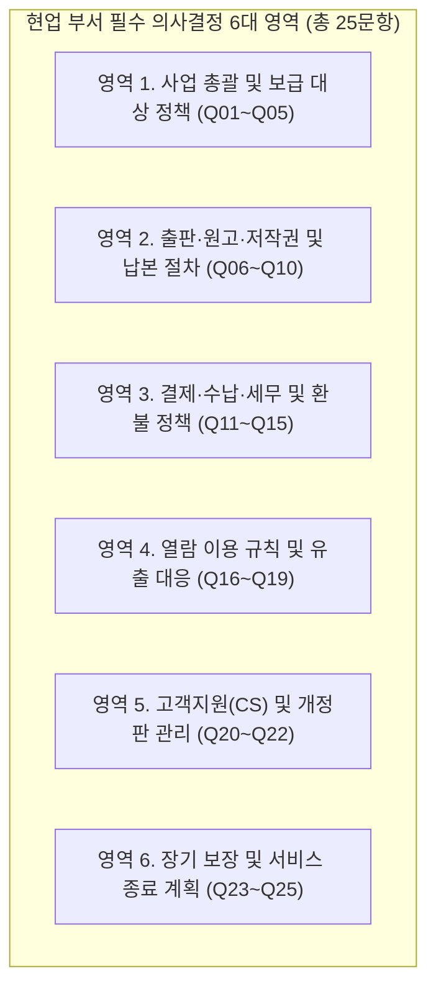

# 08. 『정토대전』 전자책 발간 프로젝트 — 현업 부서 필수 확인 및 의사결정 질문서 (비기술 전용)

- **문서 목적**: 『정토대전』 전자책 발간을 기획한 **사료편찬위원회 및 유관 현업 부서(출판·재정·법무·회원지원/CS)**가 출판 준비부터 판매·운영·향후 서비스 종료까지 반드시 확정해 주어야 할 **25대 정책 결정 사항**을 정리한 질문서입니다.
- **작성 기준**: 개발·기술 용어를 모두 제외하고, **순수하게 현업 운영·출판·회계·법무·회원 정책 관점**에서 결정이 필요한 항목만 담았습니다.
- **회신 방법**: 각 질문의 **`[ ]` 선택지에 체크(✔)**하시거나 의견을 기재해 주십시오. 고민이 되시는 항목은 함께 적어둔 **[기획팀 권장안]**을 그대로 채택하셔도 무방합니다.
- **연관 문서**:
  - [07_기획자_및_현업부서용_전자책_발간_운영_종료_AtoZ_가이드.md](file:///Users/jeongseongchae/dev/jts/정토대전/docs/07_기획자_및_현업부서용_전자책_발간_운영_종료_AtoZ_가이드.md)
  - [09_재정회계팀_전용_세무_수납_정산_환불_검토서_초안.md](file:///Users/jeongseongchae/dev/jts/정토대전/docs/09_재정회계팀_전용_세무_수납_정산_환불_검토서_초안.md)
  - [10_법무개인정보팀_전용_저작권_약관_청약철회_법령_검토서_초안.md](file:///Users/jeongseongchae/dev/jts/정토대전/docs/10_법무개인정보팀_전용_저작권_약관_청약철회_법령_검토서_초안.md)

---

## 1. 가장 먼저 결정해 주셔야 할 핵심 질문 7선 (Executive Top 7)

전체 25개 질문 가운데, 프로젝트 일정과 기본 틀을 확정하기 위해 **가장 먼저 답을 주셔야 하는 7가지 핵심 질문**입니다.

| 순번 | 질문 번호 및 핵심 주제 | 한 줄 질문 요약 | 결정 주체 |
| :---: | :--- | :--- | :--- |
| **1** | **Q01. 총괄 책임자 및 실무 창구** | 이 프로젝트의 최종 의사결정권자와 부문별(편집·재정·법무·CS) 담당자는 누구입니까? | 사료편찬위원회 |
| **2** | **Q02. 목표 출간일 및 판매 기간** | 언제부터 판매를 시작하며, 상시 판매입니까 아니면 특정 기간 집중 신청입니까? | 사료편찬위원회 |
| **3** | **Q03. 구매 가능 회원 자격 범위** | 『마이정토』 가입자 전체에게 판매합니까, 특정 회원 등급 이상에게만 판매합니까? | 사료편찬위 / 회원실 |
| **4** | **Q07. 저작권 및 글꼴(폰트) 권리** | 수록된 모든 글·사진·지도와 글꼴(폰트)이 '전자책 유료 배포'까지 계약되어 있습니까? | 편집·출판 / 법무 |
| **5** | **Q11. 판매 법인 명의 및 세무 구분** | 어느 법인(출판사) 명의로 판매하며, 전자책 전용 ISBN 발급(부가세 면세)을 진행합니까? | 재정·회계 / 출판 |
| **6** | **Q13. 환불(청약철회) 기준 확정** | '열람 시작 전 7일 내 전액 환불, 1쪽이라도 열람 시작 시 환불 불가' 원칙에 동의하십니까? | 사료편찬위 / 재정 |
| **7** | **Q23. 열람 보장 기간 및 서비스 종료** | 구매 회원에게 보장할 최소 열람 기간(예: 5년)과 향후 서비스 종료 시 보호 대책은 무엇입니까? | 사료편찬위 / 법무 |

---

## 2. 영역별 현업 필수 확인 질문 및 선택지 (전 6개 영역 · 25개 문항)

---

### [영역 1] 사업 총괄 및 보급 대상 정책 (Q01 ~ Q05)

#### Q01. 프로젝트 총괄 책임자 및 부문별 실무 의사결정 담당자 지정
- **왜 필요한가?**: 출간 준비 과정에서 약관 문구, 환불 예외 승인, 원고 교정, 정산 방식 등을 결정할 때 공식 창구가 없으면 일정이 계속 지연됩니다.
- **질문 및 기입란**:
  - **사업 총괄 책임자 (사료편찬위원회 대표 창구)**: 성명/법명 (________________) / 연락처 (________________)
  - **편집·원고 검수 책임자**: 성명/법명 (________________)
  - **재정·정산·세무 책임자**: 성명/법명 (________________)
  - **법무·약관·저작권 책임자**: 성명/법명 (________________)
  - **고객지원(CS)·회원안내 책임자**: 성명/법명 (________________)
- **필요 시점**: 프로젝트 착수 즉시

---

#### Q02. 희망 출간일(판매 개시일) 및 판매 운영 기간
- **왜 필요한가?**: 상시 판매인지, 혹은 '출간 기념 집중 신청' 방식인지에 따라 홍보 안내문, CS 인력 배치 기간, 정산 주기가 완전히 달라집니다.
- **질문 및 선택지**:
  - **희망 판매 개시일**: 2026년 (____)월 (____)일 / **희망 전자책 열람 개시일**: 2026년 (____)월 (____)일
  - **판매 기간 방식**:
    - `[ ]` **안 1 (기획팀 권장)**: 출간일 이후 상시 판매 (회원이면 언제든 구매 및 열람 가능)
    - `[ ]` **안 2**: 특정 기간(예: 신청 기간 __월 __일 ~ __월 __일)에만 한시적으로 신청·판매 후 마감
    - `[ ]` **안 3**: 사전 예약 접수를 먼저 받고, 정식 출간일에 일괄 열람 오픈
- **결정 주체 및 시점**: 사료편찬위원회 (착수 시)

---

#### Q03. 구매 가능 회원 자격 범위 (누구에게 판매할 것인가)
- **왜 필요한가?**: "정토회원에게만 판매한다"는 원칙을 실제 온라인 구매 화면에 적용하려면, 어떤 회원 자격까지 구매 버튼을 열어줄지 정확한 기준이 있어야 합니다.
- **질문 및 선택지**:
  - **마이정토 내 구매 허용 범위**:
    - `[ ]` **안 1 (기획팀 권장)**: 『마이정토』에 가입하여 로그인할 수 있는 모든 회원 (발심행자·전법회원·일반회원·정토불교대학/경전대학 학생 전체 포함)
    - `[ ]` **안 2**: 특정 자격 이상 회원으로만 엄격히 제한 (대상 자격 명시: ________________________)
  - **해외 거주 정토회원 구매 허용 여부**:
    - `[ ]` **허용 (권장)**: 한국 은행 계좌로 원화 송금이 가능한 해외 거주 회원은 동일하게 구매·열람 가능
    - `[ ]` **불허**: 국내 거주 회원으로만 한정
- **결정 주체 및 시점**: 사료편찬위원회 / 회원관리 담당 (착수 시)

---

#### Q04. 온라인 로그인이 어려운 고령(시니어) 회원 및 가족 대리 입금 기준
- **왜 필요한가?**: 60~70대 이상 고령 회원께서는 본인 계정 로그인이나 모바일 뱅킹 송금을 자녀나 도반의 도움으로 진행하시는 경우가 많습니다.
- **질문 및 선택지**:
  - `[ ]` **기획팀 권장안 채택**:
    1. **열람할 계정 신청 원칙**: 전자책은 실제로 책을 읽으실 어르신 본인의 『마이정토』 계정으로 로그인하여 신청해야 함 (그래야 어르신 스마트폰에서 열림)
    2. **가족/도반 대리 송금 허용**: 신청 후 발급된 '어르신 전용 1회용 가상계좌'로 자녀나 도반이 대신 송금하는 것은 100% 허용 (입금자명이 달라도 어르신 주문으로 자동 입금 확인됨)
  - `[ ]` **기타 별도 운영 의견**: (____________________________________________________)
- **결정 주체 및 시점**: 사료편찬위원회 / CS·회원지원 (착수 시)

---

#### Q05. 상품 구성·판매가 확정 및 무료 보급(증정)·할인 기준
- **왜 필요한가?**: 전자책도 도서정가제 대상이므로 임의 할인은 법적 검토가 필요하며, 편찬위원이나 스님·법사님께 무료로 열람 권한을 드릴 경우 누가 어떤 기준으로 명단을 승인할지 정해야 합니다.
- **질문 및 선택지**:
  - **상품 구성 및 판매 가격**:
    - `[ ]` **단일 통합 상품 보급 (권장)**: 개별 분할 판매 없이 전체 통합 상품(판매가: ____________원)으로 단일 보급 (할인 판매 없음)
    - `[ ]` **기타 상품 구성 의견**: (____________________________________________________)
  - **무료 열람권 부여(증정) 대상 및 승인 절차**:
    - `[ ]` **무료 증정 대상 있음** (대상 범위: 편찬위원, 지도법사, 스님 등 약 ____명 / 최종 명단 승인권자: ________________)
    - `[ ]` **무료 증정 없음** (예외 없이 전원 유료 구매 원칙)
- **결정 주체 및 시점**: 사료편찬위원회 / 재정·법무 (착수 시)

---

### [영역 2] 출판·원고·저작권 및 국가 법정 절차 (Q06 ~ Q10)

#### Q06. 전자책 전용 최종 원고 인계 일정 및 편집 사양 확인
- **왜 필요한가?**: 종이 인쇄용 파일과 달리 전자책은 **'단어 검색이 가능한 실제 글자 데이터'**, **'클릭 이동 목차'**, **'확대해도 깨지지 않는 사진/한자 해상도'**가 갖춰져야 합니다. 만약 글자가 통짜 그림(스캔본)으로 되어 있으면 본문 검색 기능을 쓸 수 없습니다.
- **질문 및 선택지**:
  - **최종 원고 인계 가능일**: 2026년 (____)월 (____)일 / **예상 총 쪽수(분량)**: 약 (________)쪽
  - **원고 제작 상태 확인**:
    - `[ ]` 편집 프로그램(인디자인 등)에서 글자가 살아있는 전자책용 고해상도 파일로 제작 가능하며, 목차 페이지 번호표를 함께 제공할 수 있음
    - `[ ]` 일부 원고나 도판이 스캔 이미지여서 편집부와 사전 점검이 필요함
- **결정 주체 및 시점**: 편집·출판 담당 (원고 마감 최소 4주 전)

---

#### Q07. 본문 글·사진·지도·도판 및 글꼴(폰트)의 '전자책 배포 권리' 확인
- **왜 필요한가?**: 과거에 '종이책 출판'만 허락받은 사진이나 글꼴(폰트)을 전자책에 그대로 넣어 유료 판매하면 저작권 침해 분쟁(특히 폰트 라이선스 소송)이 발생할 수 있습니다.
- **질문 및 선택지**:
  - **수록 저작물(글·사진·지도·표·일러스트) 권리 상태**:
    - `[ ]` 전체 수록물의 저작권이 정토회에 있거나, 전자책(디지털) 유료 보급 허락을 100% 확보함
    - `[ ]` 외부 인용 사진/도판 중 전자책 배포 권리를 추가로 확인하거나 교체해야 할 항목이 있음 (확인 완료 예정일: ____월 ____일)
  - **본문 및 표지 사용 글꼴(폰트) 라이선스 상태**:
    - `[ ]` 사용된 모든 한글·한자·영문 글꼴이 '전자책(eBook) 파일 내 포함(임베딩) 및 유료 배포'가 허용된 정품 라이선스임
    - `[ ]` 출판 편집 담당자가 폰트 제작사 약관을 재점검할 예정임 (확인 완료 예정일: ____월 ____일)
- **결정 주체 및 시점**: 편집·출판 / 법무 담당 (원고 인계 전 필수 완료)

---

#### Q08. 출시 전 전자책 전체 교정·검수 책임자 및 시니어 사전 체험단 운영
- **왜 필요한가?**: 전자책 뷰어에 원고를 올린 뒤 페이지 순서, 한자 표시, 목차 이동이 정확한지 최종 승인하는 일은 사료 내용을 아는 편집부가 직접 맡아주셔야 합니다. 또한 출시 전 60~70대 어르신 대표 회원 몇 분이 미리 써보셔야 실제 불편함을 잡을 수 있습니다.
- **질문 및 선택지**:
  - `[ ]` **동의 (권장)**: 출시 최소 7일 전까지 편집 책임자(성명: ____________)가 전자책 뷰어에 탑재된 전 페이지를 검수·서명하며, 시니어 대표 회원(5~8명) 사전 체험 테스트를 거쳐 오픈함
  - `[ ]` **기타 의견**: (____________________________________________________)
- **결정 주체 및 시점**: 사료편찬위원회 / 편집 담당 (출시 2주 전)

---

#### Q09. 전자출판물 전용 ISBN(E-ISBN) 발급 및 국립중앙도서관 온라인 납본
- **왜 필요한가?**:
  1. 국립중앙도서관에서 **전자출판물 전용 ISBN(E-ISBN)**을 발급받아야 도서로서 **부가가치세 10% 면세(0%)** 혜택을 합법적으로 적용받습니다.
  2. 도서관법에 따라 출간 후 **30일 이내에 국립중앙도서관에 온라인 납본**해야 하며, 납본 시 보상금 청구 여부와 도서관 내 열람 제한 설정을 선택할 수 있습니다.
- **질문 및 선택지**:
  - **전자책 전용 ISBN 발급 담당 부서**: (____________________ / 발급 예정일: ____월 ____일)
  - **국립중앙도서관 온라인 납본 방침 (출간 후 30일 이내)**:
    - `[ ]` **기획팀 권장안 채택**: 편집·출판 담당이 온라인 납본을 진행하되, 정토회원 한정 보급 사료이므로 도서관 납본 시스템에서 **'관외 이용 제한 및 저작권 보호 조치'를 최대로 설정**하여 제출함 (납본 보상금 청구 여부: `[ ]` 청구함 / `[ ]` 청구 안 함)
- **결정 주체 및 시점**: 편집·출판 / 재정 담당 (판매 오픈 전 ISBN 발급 필수)

---

#### Q10. 구매 전 '무료 미리보기(샘플)' 공개 범위 확정
- **왜 필요한가?**: 전자상거래법상 '열람 시작 후 환불 불가'를 적용하려면, 구매자가 결제하기 전에 책의 구성과 내 기기에서의 가독성을 미리 확인해 볼 수 있는 **무료 미리보기(시험 사용) 기회**를 반드시 제공해야 합니다.
- **질문 및 선택지**:
  - `[ ]` **안 1 (기획팀 권장)**: **표지 + 발간사/서문 + 전체 목차 + 본문 앞부분 10쪽 내외(총 15~20쪽 분량)**를 결제 전 누구든 미리 열어볼 수 있게 제공
  - `[ ]` **안 2**: 편집부가 별도로 지정한 샘플 페이지만 미리보기로 제공 (지정 페이지: ________________)
- **결정 주체 및 시점**: 편집·출판 / 사료편찬위원회 (원고 인계 시)

---

### [영역 3] 결제·수납·세무 및 청약철회(환불) 정책 (Q11 ~ Q15)

#### Q11. 판매 법인(발행처) 명의 및 통신판매업·결제대행사(PG) 계정 확인
- **왜 필요한가?**: 구매 화면 하단에 법정 판매자 정보를 표시해야 하며, 결제대행사(PG)로부터 가상계좌 입금액을 정산받을 정토회 법인 통장과 사업자 정보가 확정되어야 합니다.
- **질문 및 기입란**:
  - **판매 주체 법인명(발행처)**: (________________________) / **사업자등록번호**: (____________________)
  - **통신판매업 신고 여부**: `[ ]` 신고 완료 (신고번호: ________________) / `[ ]` 신규 신고 또는 면제 확인 필요
  - **결제대행사(PG) 가상계좌 가맹 계약**:
    - `[ ]` 기존 정토회(또는 출판법인) PG 계정에 '도서 판매(면세) 전용 상점 아이디'를 추가하여 사용
    - `[ ]` 도서 판매용으로 신규 PG 가맹 계약 진행 (심사 기간 약 1~2주 소요 감안)
- **결정 주체 및 시점**: 재정·회계 / 행정 담당 (착수 즉시)

---

#### Q12. 1회용 가상계좌(송금) 입금 기한 및 안내 문자 발송 기준
- **왜 필요한가?**: 회원이 구매 신청 후 며칠 안에 송금해야 하는지 기한을 정해야 하며, 스마트폰 화면을 닫더라도 계좌번호를 잊지 않도록 안내 메시지를 보내주어야 합니다.
- **질문 및 선택지**:
  - **가상계좌 입금 유효 기한**:
    - `[ ]` **안 1 (기획팀 권장)**: 계좌 발급 시점으로부터 **72시간(3일)** 이내 입금 (기한 경과 시 자동 취소되며, 필요시 언제든 재신청 가능)
    - `[ ]` **안 2**: 계좌 발급 시점으로부터 **7일** 이내 입금
  - **계좌번호 및 입금 완료 안내 발송 수단**:
    - `[ ]` 화면 즉시 표시 + 카카오 알림톡(또는 문자 SMS) + 이메일 동시 안내
    - `[ ]` 화면 즉시 표시 + 이메일 안내만 진행 (문자 발송 비용 절감)
- **결정 주체 및 시점**: 재정·회계 / CS·운영 (착수 시)

---

#### Q13. 전자책 청약철회(환불) 세부 기준 및 예외 환불 승인권자 확정
- **왜 필요한가?**: 고액 상품이므로 환불 기준이 조금이라도 모호하면 CS 창구에서 큰 실랑이가 벌어집니다. 칼같이 명확한 기준과 예외 승인권자를 정해 두어야 합니다.
- **질문 및 선택지**:
  - `[ ]` **기획팀 권장 4원칙 전면 채택**:
    1. **열람 전 환불 (100% 가능)**: 입금 완료 후 전자책 본문을 **단 한 번도 열지 않은 상태**에서는 결제일로부터 **7일 이내 요청 시 결제액 전액 환불** (신청 시 입력한 본인 환불 계좌로 송금 반환)
    2. **열람 시작 후 환불 (단순 변심 환불 불가)**: `[내 서재]`에서 '열람 시작 시 환불 제한' 안내에 동의하고 **본문 열람을 개시한 이후에는 단순 변심 환불 불가**
    3. **부분 환불 불가**: 단일 통합 상품이므로 일부만 읽었다는 사유에 의한 부분 환불 요청은 인정하지 않음 (구매 전 사전 고지)
    4. **예외 환불 승인**: 시스템 결함으로 열람이 불가능하거나 중대한 착오(가족 중복 결제 등)가 소명된 경우에 한해 **예외 환불 승인권자(직책/성명: ________________)**의 승인으로 환불 처리
  - `[ ]` **기타 수정 의견**: (____________________________________________________)
- **결정 주체 및 시점**: 사료편찬위원회 / 재정·법무 (착수 시)

---

#### Q14. 기부금영수증 발급 불가 고지 및 현금영수증 발행 기준
- **왜 필요한가?**: 정토회원들은 정토회에 입금한 내역이 연말정산 때 '종교단체 기부금'으로 처리될 것으로 오해하시는 경우가 많습니다. 도서 구매 대금은 기부금이 아니므로 사전에 명확히 안내해야 연말정산 민원을 막을 수 있습니다.
- **질문 및 선택지**:
  - `[ ]` **기획팀 권장안 채택**:
    1. 구매 화면 및 결제 완료 안내문에 ***"본 대금은 도서 구입 대금(부가세 면세)이므로 기부금영수증 발급 대상이 아닙니다"***를 붉은색 강조 문구로 명시
    2. 가상계좌 입금 완료 시 결제대행사(PG)를 통해 **현금영수증(소득공제용/지출증빙용, 도서 문화비 소득공제 포함 여부 세무 확인)** 자동 발행 지원
  - `[ ]` **기타 세무 처리 의견**: (____________________________________________________)
- **결정 주체 및 시점**: 재정·회계 담당 (판매 오픈 전)

---

#### Q15. 일일·월간 판매 정산 대사 담당 부서 및 보고 양식
- **왜 필요한가?**: 매일 들어오는 입금액과 환불액을 누가 확인하고 회계 장부에 반영할지 담당자가 지정되어야 합니다.
- **질문 및 기입란**:
  - **일일 입금·환불 확인 담당 부서**: (____________________)
  - **월간 결제대행사(PG) 정산 및 회계 마감 부서**: (____________________)
  - **정산용 엑셀 다운로드에 꼭 들어가야 할 항목**:
    - `[ ]` **기본 항목으로 충분 (권장)**: 주문번호, 신청일시, 입금일시, 회원 고유번호, 성명(법명), 연락처, 입금은행, 결제금액, 결제상태(입금완료/환불완료), 현금영수증 발행여부, 최초 열람일시
    - `[ ]` **추가 필요 항목**: (____________________________________________________)
- **결정 주체 및 시점**: 재정·회계 담당 (판매 오픈 2주 전)

---

### [영역 4] 열람 이용 규칙 및 저작권 보호·유출 대응 정책 (Q16 ~ Q19)

#### Q16. 1인당 등록 가능 기기 대수 제한 및 기기 변경 기준
- **왜 필요한가?**: 기기 대수 제한이 없으면 한 사람이 구매한 계정으로 수십 명이 동시에 돌아가며 보는 부작용이 생기고, 반대로 너무 빡빡하게 막으면 휴대폰과 태블릿을 번갈아 쓰시는 회원이 큰 불편을 겪습니다.
- **질문 및 선택지**:
  - `[ ]` **안 1 (기획팀 권장)**: **1인당 최대 3대 기기**까지 등록·열람 허용 (예: PC 1대 + 태블릿 1대 + 스마트폰 1대). 4번째 기기에서 접속 시 화면에서 기존 기기 1대를 직접 해제하고 바로 열람할 수 있도록 지원 (단, 계정 돌려쓰기 방지를 위해 기기 변경은 월 최대 __회로 제한)
  - `[ ]` **안 2**: 1인당 최대 (____)대 기기로 제한하며, 기기 변경은 CS 창구에 요청할 때만 초기화해 줌
- **결정 주체 및 시점**: 사료편찬위원회 / 기획·CS (착수 시)

---

#### Q17. 화면 내 구매자 식별 표시(워터마크) 노출 방식
- **왜 필요한가?**: 화면을 사진으로 찍거나 캡처하여 외부에 올리는 행위를 심리적으로 억제하고, 유출 시 누구의 화면인지 역추적하기 위해 본문 위에 구매자 식별 표시를 넣습니다.
- **질문 및 선택지**:
  - `[ ]` **안 1 (기획팀 권장)**: 개인정보 노출 부담을 줄이면서도 역추적이 완벽히 가능한 **'고유 열람 식별번호(예: `JT-7K4M`) + 열람 일시'**를 화면에 은은하게 표시 (관리자 화면에서 `JT-7K4M`을 검색하면 즉시 해당 회원 확인 가능)
  - `[ ]` **안 2**: 경각심을 더욱 높이기 위해 **'회원 성명(또는 법명) + 휴대폰 뒷자리 + 열람 일시'**를 화면에 직접 표시
- **결정 주체 및 시점**: 사료편찬위원회 / 법무 (착수 시)

---

#### Q18. 전자책 본문 문구 복사(스크랩) 및 인쇄 차단 정책
- **왜 필요한가?**: 독자들이 법문 구절을 메모장에 옮겨 적고 싶어 할 수 있으나, 복사와 인쇄를 열어두면 책 전체를 복사해 제본하거나 파일로 유출할 위험이 커집니다.
- **질문 및 선택지**:
  - `[ ]` **안 1 (기획팀 권장)**: 사료 원본 보호를 위해 **파일 다운로드·전체/부분 인쇄·본문 드래그 복사를 전면 차단**함 (단, 전자책 뷰어 안의 '내 메모장'과 '책갈피' 기능은 자유롭게 사용 가능)
  - `[ ]` **안 2**: 인쇄와 다운로드는 차단하되, 1회 100자 이내의 짧은 구절 복사(인용)는 허용함
- **결정 주체 및 시점**: 사료편찬위원회 / 편집 (착수 시)

---

#### Q19. 무단 캡처·외부 유출 적발 시 공동체 대응 및 처분 기준
- **왜 필요한가?**: 만일 단톡방이나 외부 인터넷 카페에 『정토대전』 캡처 사진이 올라왔을 때, 어떤 절차로 대응할지 현업 기준이 정해져 있어야 약관에 명시하고 일관되게 집행할 수 있습니다.
- **질문 및 선택지**:
  - `[ ]` **기획팀 권장 3단계 대응 원칙 채택**:
    1. **1차 확인 및 소명**: 화면 식별코드로 회원을 확인한 뒤, 계정 도용 피해인지 단순 부주의(1~2장 인용)인지 먼저 소명을 듣고 즉시 삭제 조치
    2. **고의·대량 유출 시 열람권 즉시 박탈**: 외부 유출이나 타인에게 계정을 대여·판매한 사실이 확인될 경우 **환불 없이 전자책 열람 권한을 영구 회수**
    3. **공동체 및 법적 조치**: 정토회 내부 규정(상벌/윤리 기준)에 따른 조치 및 심각한 상업적 침해 시 법적 대응 진행
  - `[ ]` **기타 의견**: (____________________________________________________)
- **결정 주체 및 시점**: 사료편찬위원회 / 법무 (판매 오픈 전 약관 반영)

---

### [영역 5] 고객지원(CS) 운영 및 사후 개정판 관리 정책 (Q20 ~ Q22)

#### Q20. 고객지원(CS) 전담 창구 지정 및 운영 시간 확정
- **왜 필요한가?**: 출간 직후에는 어르신 회원들의 "입금했는데 어떻게 보나요?", "글씨가 작아요", "환불해 주세요" 문의가 집중됩니다. 이를 누가 어떤 전화번호/창구로 받을지 반드시 정해야 합니다.
- **질문 및 기입란**:
  - **1차 일반 문의 창구 (입금 확인, 열람 방법, 기기 초기화, 미열람 환불 접수)**:
    - 담당 부서/팀: (____________________) / 담당 인원: (____)명
    - 안내 전화번호 또는 온라인 문의처: (____________________________________)
    - 응대 가능 요일 및 시간: (예: 평일 09:00 ~ 18:00 / 오픈 첫 주 주말 당번 운영 여부: `[ ]` 운영함 `[ ]` 미운영)
  - **2차 사료 내용·오탈자 제보 접수 창구**:
    - 담당 부서: 사료편찬위원회 편집팀 (담당자: ________________)
- **결정 주체 및 시점**: CS·회원지원 / 사료편찬위원회 (출시 최소 2주 전)

---

#### Q21. 입금 확인 지연 또는 장애 시 CS 담당자의 '임시 열람권' 부여 권한
- **왜 필요한가?**: 주말이나 저녁에 어르신이 분명히 송금하셨는데 은행 전산 점검 등으로 입금 통보가 늦어질 때, 월요일까지 기다리라고 하면 큰 불편을 겪으십니다.
- **질문 및 선택지**:
  - `[ ]` **기획팀 권장안 채택**: CS 담당자가 이체 확인증 등을 확인한 경우, 관리자 화면에서 사유를 기록하고 **'24시간(또는 48시간) 임시 열람 권한'을 직권으로 즉시 열어드릴 수 있도록 허용**함 (이후 평일에 재정팀이 최종 입금을 확인하면 정식 권한으로 전환)
  - `[ ]` **불허**: 어떠한 경우에도 재정팀의 최종 입금 확인 전에는 임시 열람 권한을 열어주지 않음
- **결정 주체 및 시점**: 사료편찬위원회 / CS·재정 (출시 전)

---

#### Q22. 출간 후 오탈자 수정(정오표) 주기 및 향후 전면 개정판(제2판) 정책
- **왜 필요한가?**: 출간 후 오탈자가 발견되었을 때 이를 얼마나 자주 전자책 본문에 반영할지, 그리고 훗날 '제2판(증보판)'이 나오면 기존 구매자에게 무료로 업데이트해 줄지 기준이 필요합니다.
- **질문 및 선택지**:
  - **단순 오탈자 수정 및 본문 업데이트 주기**:
    - `[ ]` **권장**: 상시 `[정오표]` 공지창에 먼저 등록하고, 실제 전자책 본문 파일 교정은 **반기별(또는 분기별)로 모아 편집 책임자 검수 후 일괄 업데이트** (단, 중대한 오류는 즉시 반영)
  - **향후 전면 개정판(제2판·증보판) 발간 시 기존 구매자 대우**:
    - `[ ]` **안 1**: 단순 오탈자·교정판(1.x판)은 기존 구매자에게 평생 무료로 자동 업데이트해 주되, 수년 뒤 완전히 새로 편찬되는 '전면 개정 증보판(제2판)'은 별도 정책으로 정함
    - `[ ]` **안 2**: 향후 전면 개정판(제2판)이 나오더라도 초기 1판 구매자에게 무상으로 제공함
- **결정 주체 및 시점**: 사료편찬위원회 / 편집 (출시 전)

---

### [영역 6] 장기 열람 보장 및 서비스 종료(Sunset) 정책 (Q23 ~ Q25)

#### Q23. 전자책 열람 보장 기간의 약관 명시 기준
- **왜 필요한가?**: 회원들은 유료로 구매한 책을 평생 볼 수 있다고 생각하시지만, 법적 약관에 '조건 없는 영구 보장'이라고 적으면 먼 훗날 정토회 홈페이지 구조가 바뀔 때 법적 발목이 잡힐 수 있습니다.
- **질문 및 선택지**:
  - `[ ]` **안 1 (기획팀 권장 — 공정위 표준약관 기준)**:
    - 기본 원칙: *"정토회 전자책 서비스가 제공되는 기간 동안 횟수 제한 없이 계속 열람 가능"*으로 안내
    - 최소 보증: *"정토회는 구매일로부터 **최소 5년간** 전자책 열람 서비스를 의무 보증하며, 불가피하게 서비스를 종료할 경우 최소 6개월 전 사전 고지 및 대체 열람 수단(개인 소장 파일 전환 등)을 제공한다"*고 약관에 명시
  - `[ ]` **안 2**: 최소 의무 보증 기간을 **(____)년**으로 변경하여 명시
- **결정 주체 및 시점**: 사료편찬위원회 / 법무 (약관 확정 전)

---

#### Q24. 구매 회원의 정토회 탈퇴·자격 상실·별세(사망) 시 열람권 처리 기준
- **왜 필요한가?**: 시간이 흐르면서 구매 회원이 『마이정토』를 탈퇴하거나 별세하시는 일이 생깁니다. 이때 전자책 권한과 가족 승계 요청을 어떻게 처리할지 원칙이 있어야 합니다.
- **질문 및 선택지**:
  - **『마이정토』 회원 자진 탈퇴 시**:
    - `[ ]` **권장**: 탈퇴 화면에서 *"탈퇴 시 보유 중인 『정토대전』 전자책 열람 권한이 소멸되며 복구되지 않는다"*고 명확히 사전 경고 후, 동의하고 탈퇴하면 열람 권한 즉시 소멸 (단, 전자상거래법에 따라 결제·환불 기록은 별도 금고에 5년간 분리 보관)
  - **모둠 활동 중단 / 일반 휴면 회원 전환 시**:
    - `[ ]` **권장**: 『마이정토』 계정을 탈퇴하지 않는 한, 활동 여부와 무관하게 이미 구매한 전자책은 계속 열람 보장
  - **구매 회원 별세(사망) 시 가족 승계 요청**:
    - `[ ]` **안 1 (법무 표준 권장)**: 전자책 이용권은 구매자 본인에게만 부여되는 권리이므로 타인 양도 및 가족 상속·승계 불가 원칙 명시
    - `[ ]` **안 2**: 원칙적으로 양도 불가하나, 직계 가족도 정토회원인 경우 가족관계 증명 확인 후 사료편찬위원회 승인으로 1회 열람권 이관 허용
- **결정 주체 및 시점**: 사료편찬위원회 / 법무 / 회원실 (약관 확정 전)

---

#### Q25. 향후 서비스 종료(플랫폼 폐지 또는 개편) 시 구매 회원 보호 대책 확정
- **왜 필요한가?**: 5년, 10년 뒤 현재의 웹 뷰어 시스템을 닫거나 새로운 시스템으로 바꿀 때 기존 구매자를 어떻게 보호할지 출구 전략(Exit Plan)을 처음부터 약속해 두어야 신뢰를 얻습니다.
- **질문 및 선택지**:
  - `[ ]` **기획팀 권장 3대 보호 원칙 채택**:
    1. **사전 고지**: 서비스 종료 또는 전면 전환 최소 **6개월 전**에 구매 회원 전원에게 문자·이메일·공지사항으로 3회 이상 안내
    2. **차세대 시스템 무상 이관**: 정토회 내부의 새로운 플랫폼이나 앱으로 개편하는 경우, 기존 구매 회원의 열람 권한과 책갈피·메모 기록을 **새 시스템으로 100% 무상 이전**
    3. **완전 종료 시 소장본 제공 또는 보상**: 만약 온라인 뷰어 서비스를 대체 없이 완전히 폐지하는 경우에는 기존 구매 회원에게 **본인 식별 표시가 각인된 개인 소장용 전자책 파일(PDF) 내려받기 기회를 제공**하거나, 최소 보장 기간(5년) 미경과 구매자에게 공정위 기준에 따라 잔여 기간 금액을 환불 보상함
  - `[ ]` **기타 의견**: (____________________________________________________)
- **결정 주체 및 시점**: 사료편찬위원회 / 법무 (약관 확정 전)

---

## 3. 현업 부서 회신 확인 서명란

위 25개 항목의 결정 사항을 바탕으로 『정토대전』 전자책 발간·보급·운영·서비스 종료(A to Z) 기준을 확정합니다.

- **확정 일자**: 2026년 ____월 ____일
- **사료편찬위원회 (사업 총괄)**: ________________ (서명)
- **편집·출판 부문 책임자**: ________________ (서명)
- **재정·회계 부문 책임자**: ________________ (서명)
- **법무·개인정보 부문 책임자**: ________________ (서명)
- **고객지원(CS)·회원 부문 책임자**: ________________ (서명)
