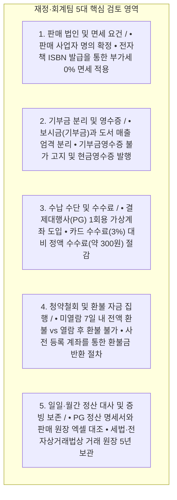

# 09. 『정토대전』 전자책 발간 프로젝트 — 재정·회계팀 전용 세무·수납·정산·환불 검토서 (초안)

- **문서 성격**: 개발·기술 용어를 배제하고 **재정·회계·세무 담당 부서**가 사전 검토 및 의사결정을 내릴 수 있도록 정리한 실무 검토서 초안
- **작성 기준일**: 2026년 10월 25일
- **검토 대상 사업**: 『정토대전』 전자책(100% 디지털 단독 발행)의 정토회원 대상 유료 보급 사업
- **연관 문서**:
  - [07_기획자_및_현업부서용_전자책_발간_운영_종료_AtoZ_가이드.md](file:///Users/jeongseongchae/dev/jts/정토대전/docs/07_기획자_및_현업부서용_전자책_발간_운영_종료_AtoZ_가이드.md)
  - [08_현업부서_필수확인_및_의사결정_질문서_비기술전용.md](file:///Users/jeongseongchae/dev/jts/정토대전/docs/08_현업부서_필수확인_및_의사결정_질문서_비기술전용.md)
  - [10_법무개인정보팀_전용_저작권_약관_청약철회_법령_검토서_초안.md](file:///Users/jeongseongchae/dev/jts/정토대전/docs/10_법무개인정보팀_전용_저작권_약관_청약철회_법령_검토서_초안.md)

---

## 1. 재정·회계팀 검토 배경 및 5대 핵심 쟁점 요약

『정토대전』 전자책 유료 보급은 기존의 일반 기도비·보시금(종교단체 기부금) 수납과 달리 **'전자출판물(재화/용역)의 유상 판매'**에 해당합니다. 따라서 출간 전에 아래 **5대 재정·세무 기준**을 확립하지 않으면 부가가치세 과세 위험, 연말정산 기부금영수증 발급 민원, 입금자 확인 대란, 환불 정산 불일치 등의 문제가 발생할 수 있습니다.

### 재정·회계 핵심 검토 요약표

| 검토 영역 | 핵심 위험 요인 (미비 시 문제점) | 기획팀 제안 표준 기준 (검토 요청안) | 재정팀 확인 사항 |
| :--- | :--- | :--- | :--- |
| **1. 부가가치세 면세** | ISBN 없이 디지털 파일만 판매할 경우 일반 전자적 용역으로 분류되어 **부가가치세 10% 과세** 대상이 됨 | 국립중앙도서관에서 **전자출판물 전용 ISBN(E-ISBN)**을 정식 발급·표기하여 **부가가치세 면세(0%)** 적용 | 판매 법인 명의 및 면세 사업자/겸영 사업자 세무 확인 |
| **2. 기부금 vs 도서매출** | 회원이 도서 구매 대금을 '종교단체 기부금'으로 오인하여 연말정산 시 **기부금영수증 발급 요구 민원** 발생 | • 보시금 계좌와 도서 판매 결제 계정을 완전 분리 • 구매 화면에 **"기부금영수증 발급 불가 / 현금영수증 발행"** 명시 | 현금영수증(문화비 도서 소득공제 포함 여부) 발행 설정 확인 |
| **3. 수납 방식 및 수수료** | • 일반 통장 입금 시 동명이인·타인 명의 입금으로 수기 대조 불능 • 신용카드 결제 시 약 3% 고액 수수료 차감 | 주문마다 고유 계좌가 열리는 **결제대행사(PG) 1회용 가상계좌 송금** 단일 운영 (건당 정액 수수료 약 300원) | PG사 도서 판매용 상점 아이디(MID) 개설 및 정산 계좌 지정 |
| **4. 환불 자금 반환** | 가상계좌 현금 입금 후 환불 요청 시 반환 계좌 파악 지연 및 중복 이체 위험 | 신청 시 **환불 반환용 본인 계좌**를 미리 입력받고, **열람 개시 전(7일 내) 요청 건만** 환불 집행 | PG사 환불 대행 이체 서비스 이용 여부 vs 재정팀 직접 이체 결정 |
| **5. 정산 대사 및 증빙** | 입금 건수와 열람 권한 부여 건수 불일치, 무상 증정분 회계 근거 누락 | • 일일 입금·환불 자동 대조 • 월간 PG 정산서 vs 내부 판매 원장 엑셀 대사 • 무료 증정분 내부 결재 공문 보관 | 월간 회계 전표 처리 기준 및 정산 엑셀 필수 항목 확정 |

---

## 2. [쟁점 1] 판매 주체(법인) 확정 및 부가가치세 면세(0%) 요건 검토

### 2.1 판매 주체 법인 및 업종 요건 확인
1. **판매 법인 명의 선택**:
   - 『정토대전』 전자책을 판매하고 대금을 수납할 법인 주체(예: 정토회 내 출판 등록 법인 또는 지정 사업자)를 확정해야 합니다.
   - 확정된 법인은 **출판사 신고** 및 온라인 판매를 위한 **통신판매업 신고**가 완료되어 있어야 하며, 구매 화면 하단에 법인명, 대표자, 사업자등록번호, 통신판매업 신고번호를 의무 표기해야 합니다.
2. **부가가치세 면세(0%) 적용 필수 조건**:
   - 부가가치세법 제26조 및 동법 시행령 제38조, 문화체육관광부 고시에 따라 전자출판물이 부가가치세 면세를 적용받으려면 **국립중앙도서관에서 부여받은 전자출판물 전용 국제표준도서번호(E-ISBN)**가 있어야 합니다.
   - 만약 E-ISBN 발급 없이 파일을 유료 보급하면 부가가치세 10%가 부과되어 판매 수입의 약 9.1%(예: 20만 원 기준 18,181원)를 세금으로 납부해야 하므로, **판매 오픈 전 E-ISBN 발급 완료를 재정팀의 판매 승인 필수 조건**으로 둡니다.

### 2.2 국립중앙도서관 납본 보상금 회계 처리
- 도서관법 제20조에 따라 출간 후 30일 이내에 국립중앙도서관에 디지털 파일을 온라인 납본할 때, '납본 보상금'을 청구하면 정가에 준하는 보상금이 법인 계좌로 입금됩니다.
- 납본 보상금을 청구할지(청구 시 도서 매출 또는 잡수익 처리), 무상 기증 납본으로 처리할지 재정팀 기준을 정합니다.

---

## 3. [쟁점 2] 기부금(보시금)과 도서 판매 대금의 분리 및 영수증 발행

### 3.1 기부금영수증 발급 절대 불가 원칙 및 사전 안내
- 세법상 도서(전자책)라는 반대급부(대가)를 제공받고 지급하는 금액은 **후원금·기부금(보시금)이 아니라 재화 구매 대금**입니다.
- 따라서 정토회원이 『정토대전』 전자책을 구매하고 입금한 금액에 대해서는 **어떠한 경우에도 종교단체 기부금영수증을 발급할 수 없습니다.**
- 연말정산 시기에 회원들의 오해와 민원을 원천 차단하기 위해 아래 3곳에 **"도서 구매 대금은 기부금영수증 발급 대상이 아닙니다"**라는 문구를 의무 표시합니다:
  1. 마이정토 전자책 구매 신청 화면 (약관 동의란 바로 위)
  2. 가상계좌 발급 및 입금 완료 안내 문자/이메일
  3. 구매 영수증 및 내 서재 결제 내역 화면

### 3.2 현금영수증 및 문화비(도서) 소득공제 적용 검토
1. **현금영수증 자동 발행**:
   - 가상계좌(현금 송금) 입금이 완료되는 즉시, 회원이 입력한 휴대폰 번호(소득공제용) 또는 사업자번호(지출증빙용)로 결제대행사(PG)를 통해 **현금영수증이 자동 발행**되도록 설정합니다.
   - 회원이 현금영수증 번호를 입력하지 않은 경우에도 국세청 지정코드(`010-000-1234`)로 자진발급 처리하여 현금영수증 미발행 가산세 위험을 예방합니다.
2. **도서·공연비(문화비) 소득공제 적용 여부**:
   - ISBN이 발급된 전자책은 조세특례제한법상 근로소득자의 **'도서·공연비 등 문화비 소득공제(추가 공제율 적용)'** 대상이 될 수 있습니다.
   - 판매 법인이 한국문화정보원에 '문화비 소득공제 제공 사업자'로 등록되어 있는지(또는 등록할 것인지), 결제대행사(PG) 가상계좌를 도서 문화비 전용 가맹점 번호로 개설할지 세무 대리인과 함께 확인합니다.

---

## 4. [쟁점 3] 수납 방식(PG 1회용 가상계좌) 및 수수료·정산 계좌 설계

### 4.1 왜 일반 법인통장 무통장 입금이 아닌 'PG 1회용 가상계좌'인가?
재정팀의 수납 관리 업무 부담과 수수료 비용을 비교한 표입니다.

| 비교 항목 | 일반 법인통장 무통장 입금 | 신용카드 결제 | **PG 1회용 가상계좌 송금 (채택안)** |
| :--- | :--- | :--- | :--- |
| **결제 수수료** | 0원 | 결제액의 **약 2.8% ~ 3.3%** (고액 차감) | **건당 정액 약 250원 ~ 300원** (95% 이상 절감) |
| **동명이인·타인 입금** | 입금자명이 주문자와 다르거나 동명이인이면 **수기 통장 대조 불가능 (CS 대란)** | 자동 확인 | 회원마다 고유 계좌번호가 달라 **자녀/배우자가 대신 입금해도 100% 자동 확인** |
| **오입금(금액 실수) 방지** | 2만 원이나 200만 원을 잘못 넣는 사고 발생 | 없음 | **정확한 판매 금액이 아니면 입금 자체가 차단됨** |
| **열람 권한 부여** | 재정팀이 통장 확인 후 수동으로 열어주어야 함 (주말/야간 대기 발생) | 즉시 자동 부여 | **송금 후 1분 이내 24시간 무인 자동 부여** |

### 4.2 도서 판매 전용 PG 상점 아이디(MID) 및 정산 계좌 분리
- 기존 『마이정토』에서 사용하는 보시금/수련비 수납 계좌와 도서 판매 매출이 섞이지 않도록, 결제대행사(PG)에 **『정토대전』 도서 판매(부가세 면세) 전용 상점 아이디(MID)**를 별도로 개설(또는 구분)합니다.
- PG사로부터 정산 대금이 입금될 **도서 매출 전용 법인 은행 계좌**를 지정하고, PG 정산 주기(통상 입금일 + 1~5영업일)를 확인합니다.

---

## 5. [쟁점 4] 청약철회(환불) 기준 및 환불 자금 집행 절차

### 5.1 재정팀 환불 승인 및 지급 기준
- **환불 가능 조건 (100% 전액 환불)**:
  - 가상계좌 입금 완료일로부터 **7일 이내**이면서, 해당 회원이 전자책 본문을 **단 한 번도 열람하지 않은(`최초 열람 일시` 기록이 없는) 경우**에 한해 전액 환불합니다.
- **환불 불가 조건**:
  - 회원이 `[내 서재]`에서 '열람 개시 시 환불 제한' 안내에 동의하고 **본문을 1페이지라도 열람한 기록이 남았을 경우**에는 단순 변심에 의한 환불이 불가합니다.
- **예외 환불**:
  - 시스템 장애나 가족 중복 입금 등 부득이한 사유로 사료편찬위원회 책임자 및 재정 책임자가 공식 승인한 예외 건에 한해 환불을 집행합니다.

### 5.2 가상계좌 환불금 반환 방식 (2가지 방안 중 재정팀 선택)
가상계좌(현금 입금)는 신용카드처럼 단순 승인 취소가 되지 않고, 회원이 신청 시 등록한 **환불 반환 계좌**로 현금을 다시 이체해 주어야 합니다.

- **방안 A (PG사 환불 대행 계좌이체 기능 사용 — 권장)**:
  - 관리자 화면에서 `[환불 승인]`을 누르면, 결제대행사(PG)가 정토회에 정산해 줄 대금에서 해당 금액을 차감하여 회원의 환불 계좌로 직접 송금하고 현금영수증을 자동 취소합니다.
  - **장점**: 재정팀이 인터넷 뱅킹에 들어가 일일이 수동 이체할 필요가 없으며, 현금영수증 취소 누락이 없습니다. (단, PG사 환불 이체 수수료 건당 약 300~500원 발생)
- **방안 B (재정팀 법인 계좌에서 주 1~2회 직접 수동 이체)**:
  - CS팀이 미열람 요건을 확인해 환불 요청 명단을 올리면, 재정팀이 법인 통장에서 회원 환불 계좌로 직접 이체한 뒤 관리자 화면에서 `[환불 완료 및 현금영수증 취소]`를 누릅니다.
  - **장점**: 별도 PG 환불 대행 계약이 필요 없으나, 재정팀의 수동 이체 실무가 수반됩니다.

---

## 6. [쟁점 5] 일일·월간 정산 대사(Reconciliation) 및 회계 증빙 보존

### 6.1 정기 정산 대사 루틴
1. **일일 대사 (운영/CS + 재정 확인)**:
   - 전일 `00:00 ~ 23:59` 기준 **[PG사 가상계좌 입금 완료 건수·금액] = [마이정토 전자책 열람권 신규 부여 건수·금액]**이 일치하는지 확인합니다.
2. **월간 회계 마감 (재정·회계팀)**:
   - 매월 초 **[PG사 월간 정산 내역서(총 입금액 - 환불액 - PG 수수료 = 실입금액)]**와 관리자 화면에서 내려받은 **[월간 판매·환불 원장 엑셀]** 및 **[법인 통장 실제 입금액]** 3가지를 대조하여 월간 매출 전표를 확정합니다.
   - PG 수수료에 대해서는 PG사가 발행하는 **전자세금계산서(매입)**를 수취하여 비용 처리합니다.

### 6.2 무상 보급분(무료 증정) 및 5년 의무 보존 관리
- **무료 열람권 부여 증빙**: 편찬위원·지도법사·스님 등 대금 수납 없이 무료 열람권을 부여한 건은 관리자 원장에 **`무상보급(사유 및 승인문서번호)`**으로 별도 구분 표기하여 유료 매출 원장과 섞이지 않게 관리합니다.
- **세법 및 전자상거래법상 5년 보존**: 도서 판매 계약·입금·환불·현금영수증 발행 원장은 회원이 탈퇴하더라도 국세기본법 및 전자상거래법에 따라 **5년간 별도 보관**합니다.

---

## 7. [회신 양식] 재정·회계팀 확인 및 의사결정 체크리스트

재정·회계팀에서 아래 6개 항목을 검토하신 후 체크(`[✔]`) 또는 기입하여 회신해 주시면 시스템 및 운영 절차에 즉시 반영하겠습니다.

| 번호 | 재정·회계팀 확인 항목 | 결정 및 기입란 |
| :---: | :--- | :--- |
| **F-01** | **판매 주체 법인 및 사업자 정보** | • 법인명(발행처): ________________________ • 사업자번호: ________________ • 통신판매업 신고번호: ________________________ |
| **F-02** | **부가세 면세 및 문화비 소득공제** | • 전자책 전용 ISBN(E-ISBN) 발급을 통한 **부가세 면세(0%)** 적용 확인: `[ ]` 확인 • 문화비(도서) 소득공제 사업자 적용 여부: `[ ]` 적용 `[ ]` 일반 현금영수증만 적용 |
| **F-03** | **기부금 분리 및 영수증 고지** | • 도서 판매 대금의 **기부금영수증 발급 불가** 사전 명시 및 **현금영수증 자동 발행** 원칙에 동의합니까? `[ ]` 동의 `[ ]` 별도 의견 있음 |
| **F-04** | **PG 계약 및 정산 입금 계좌** | • 사용할 PG사 명칭: ________________ (`[ ]` 기존 PG에 면세 상점ID 추가 `[ ]` 신규 계약) • PG 정산금 입금 법인 계좌(은행/계좌번호): ________________________ |
| **F-05** | **가상계좌 환불금 반환 방식** | • 미열람(7일 내) 환불 시 계좌 반환 방식 선택: `[ ]` **방안 A**: PG사 환불 대행 자동 이체 기능 사용 `[ ]` **방안 B**: 재정팀에서 법인 통장으로 직접 계좌 이체 • 단순 변심 미열람 환불 시 이체 수수료(약 300~500원) 부담: `[ ]` 정토회 부담(전액 반환) `[ ]` 수수료 차감 후 반환 |
| **F-06** | **정산 담당자 및 엑셀 추가 항목** | • 재정·회계 정산 담당자 성명/연락처: ________________________ • 기본 정산 항목 외 엑셀에 추가할 필수 컬럼: ________________________ |

- **검토 일자**: 2026년 ____월 ____일 / **재정·회계팀 검토 책임자**: ________________ (서명)
