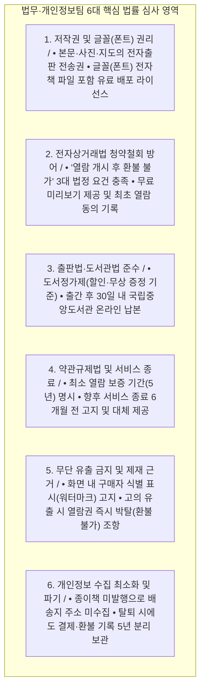

# 10. 『정토대전』 전자책 발간 프로젝트 — 법무·개인정보팀 전용 저작권·약관·청약철회·법령 검토서 (초안)

- **문서 성격**: 개발·기술 용어를 배제하고 **법무·저작권·개인정보 보호 담당 부서**가 사전 법령 준수 여부와 약관·동의문 문구를 심사할 수 있도록 정리한 실무 검토서 초안
- **작성 기준일**: 2026년 10월 25일
- **검토 대상 사업**: 『정토대전』 전자책(100% 디지털 단독 발행)의 정토회원 한정 유료 보급 및 열람 서비스(출판부터 서비스 종료까지 전 과정)
- **연관 문서**:
  - [07_기획자_및_현업부서용_전자책_발간_운영_종료_AtoZ_가이드.md](file:///Users/jeongseongchae/dev/jts/정토대전/docs/07_기획자_및_현업부서용_전자책_발간_운영_종료_AtoZ_가이드.md)
  - [08_현업부서_필수확인_및_의사결정_질문서_비기술전용.md](file:///Users/jeongseongchae/dev/jts/정토대전/docs/08_현업부서_필수확인_및_의사결정_질문서_비기술전용.md)
  - [09_재정회계팀_전용_세무_수납_정산_환불_검토서_초안.md](file:///Users/jeongseongchae/dev/jts/정토대전/docs/09_재정회계팀_전용_세무_수납_정산_환불_검토서_초안.md)

---

## 1. 법무·개인정보팀 검토 배경 및 6대 핵심 법률 점검 요약

『정토대전』 전자책 유료 보급 사업은 **① 저작권법(출판·폰트 권리 및 유출 대응), ② 전자상거래법(청약철회 제한 및 거래 기록 보존), ③ 출판문화산업진흥법·도서관법(도서정가제·납본), ④ 약관규제법(열람 보장 기간 및 서비스 종료 조항), ⑤ 개인정보보호법(환불 계좌 수집 및 탈퇴자 분리 보관)** 등 5대 법령이 직접 적용됩니다.

출간 이후 법적 분쟁이나 과태료 위험을 원천 차단하기 위해 아래 **6대 법률 검토 영역**과 **구매자 약관·동의문 초안(부록 1)**에 대한 법무 심사를 요청합니다.

---

## 2. [법률 검토 1] 저작권법 — 원고·사진·도판 및 글꼴(폰트)의 전자출판 권리

### 2.1 인쇄출판권과 전자출판권(디지털 복제·전송권)의 구분
- 저작권법상 종이책을 인쇄하여 발행할 권리(출판권)와 이를 디지털 파일로 만들어 인터넷을 통해 전송·열람하게 할 권리(전자출판권 및 공중송신권/전송권)는 별개의 권리입니다.
- 따라서 『정토대전』에 수록되는 모든 법문, 해제, 번역문, 외부 사진, 시대별 지도, 도표, 일러스트에 대해 **1) 정토회가 원저작권을 보유하고 있는지, 2) 외부 저작물인 경우 '전자책 유료 서비스 수록 및 전송'까지 서면 허락을 받았는지** 편집부와 함께 권리 확인 대장을 전수 점검해야 합니다.

### 2.2 글꼴(폰트) 전자책 임베딩(파일 내 포함 배포) 라이선스 점검 (최우선 주의)
- 국내 전자출판 실무에서 가장 빈번하게 저작권 침해 내용증명 및 손해배상 청구가 발생하는 영역이 **글꼴(폰트) 라이선스**입니다.
- 편집 디자이너가 인쇄용으로 정품 구매한 유료 폰트나 무료 배포 폰트라고 하더라도, 약관에 **'전자출판물(eBook/PDF) 내부에 폰트 파일을 포함(임베딩)하여 유료로 배포하는 행위'를 별도 유료 계약 대상으로 제한**하는 경우가 많습니다.
- **법무 필수 조치**: 편집부로부터 『정토대전』 본문·표지·제목·한자에 사용된 모든 글꼴 목록을 제출받아, 각 글꼴 제작사의 라이선스 약관상 **'전자책(eBook) 상업적 임베딩 배포'가 허용되어 있는지 출간 전 100% 검증**해야 합니다.

---

## 3. [법률 검토 2] 전자상거래법 — '열람 개시 후 환불 불가'의 적법성 확보

### 3.1 디지털 콘텐츠 청약철회 제한의 3대 법정 필수 요건
전자상거래 등에서의 소비자보호에 관한 법률(전자상거래법) 제17조 제2항 제5호 및 동법 시행령 제21조에 따라, 디지털 콘텐츠(전자책)에 대해 **'열람을 시작한 이후에는 단순 변심에 의한 환불(청약철회)이 불가능하다'**는 기준이 법적 효력을 인정받으려면 사업자가 반드시 아래 **3가지 요건을 모두 충족**해야 합니다. 하나라도 누락되면 열람 후에도 소비자가 법적으로 환불을 요구할 수 있습니다.

| 법정 필수 요건 | 관련 법령 근거 | 『정토대전』 전자책 서비스 반영 방안 |
| :--- | :--- | :--- |
| **요건 1. 구매 전 명확한 표시 및 개별 동의** | 전자상거래법 제17조 제2항 본문 및 제6항 | 구매 신청 화면에서 **"전자책 본문 열람을 개시한 이후에는 청약철회(환불)가 불가능합니다"**라는 문구를 굵은 글씨로 명확히 표시하고, 결제 전 회원이 직접 체크박스(`[✔]`)에 개별 동의하도록 구현 |
| **요건 2. 시험 사용 상품(무료 미리보기) 제공** | 전자상거래법 시행령 제21조 (한시적 또는 일부 이용 등의 방법으로 청약철회 권리 행사가 방해받지 않도록 조치) | 결제하기 전에 모든 회원이 『정토대전』의 **표지·서문·목차·본문 앞부분 일부(약 15~20쪽 분량)를 무료 미리보기(샘플)**로 직접 열어보고 자신의 기기에서 잘 보이는지 확인할 수 있도록 제공 |
| **요건 3. 실제 열람 개시 시점의 재고지 및 객관적 기록 보존** | 전자상거래법 제17조 제2항 제5호 (디지털콘텐츠의 제공이 개시된 경우) | 입금 완료 후 회원이 `[내 서재]`에서 최초로 `[열람하기]`를 누를 때, **"지금 열람을 시작하시면 단순 변심에 의한 환불이 제한됩니다. 열람을 시작하시겠습니까?"** 확인 창을 띄워 최종 동의를 받고 **'최초 열람 일시' 기록을 5년간 보존** |

### 3.2 판매자 신원정보 표시 및 계약서면 교부 의무
- 전자상거래법 제10조 및 제13조에 따라 구매 화면 하단에 **상호(법인명), 대표자 성명, 주소, 전화번호, 전자우편주소, 사업자등록번호, 통신판매업 신고번호, 이용약관, 개인정보처리방침**을 명확히 표시합니다.
- 회원이 가상계좌 발급을 신청하고 입금을 완료하면, 구매 내역·결제 금액·청약철회 기한 및 제한 조건이 담긴 **계약 확인 안내문(이메일 및 알림톡/문자)**을 회원에게 자동 발송하여 법정 계약서면 교부 의무를 이행합니다.

---

## 4. [법률 검토 3] 출판문화산업진흥법 및 도서관법 — 도서정가제 및 온라인 납본

### 4.1 전자출판물 도서정가제 준수 검토
- 출판문화산업진흥법 제22조에 따라 전자출판물(E-ISBN이 발급되어 판매되는 전자책) 역시 도서정가제 적용 대상입니다.
- 정토회원에게 정가로 단일 판매하는 것은 적법하며, 만약 향후 특정 행사나 그룹을 대상으로 **할인 판매**를 기획할 경우에는 법정 할인 한도(최대 10% 가격할인 + 5% 경제상 이익 이내)를 초과하지 않는지 법무 사전 검토를 거쳐야 합니다.
- 사료편찬위원, 지도법사, 스님 등 내부 관계자에게 업무·연구·포교 목적으로 대금 없이 열람 권한을 부여하는 건은 판매가 아닌 **내부 무상 증정(업무용 비매품 제공)**으로 구분하여 승인 결재 문서와 함께 관리합니다.

### 4.2 국립중앙도서관 디지털 파일 온라인 납본 의무
- 도서관법 제20조 및 제21조에 따라 전자출판물(ISBN 발급 도서)을 발행한 때에는 **발행일로부터 30일 이내에 국립중앙도서관에 디지털 파일을 온라인 납본**해야 합니다 (미이행 시 과태료 부과 대상).
- 다만 『정토대전』은 외부 서점에 유통하지 않고 정토회원에게만 한정 보급하는 사료이므로, 국립중앙도서관 온라인 납본 시스템 제출 시 **'저작권 보호를 위한 관외 전송 제한 및 도서관 내 지정 단말기 열람 제한'** 옵션을 설정하여 납본하도록 편집부에 가이드합니다.

---

## 5. [법률 검토 4] 약관규제법 — 열람 보장 기간, 회원 탈퇴 및 서비스 종료(Sunset) 조항

### 5.1 '조건 없는 영구 열람' 표현 금지 및 최소 보증 기간 명시
- 약관규제법 및 공정거래위원회 디지털 콘텐츠 표준약관 기준상, 사업자가 **"평생 영구 소장 보장"**이라고만 약정할 경우 향후 기술 환경 변화나 정토회 시스템 개편으로 웹 뷰어 서비스를 종료할 때 중대한 채무불이행 책임이 발생할 수 있습니다.
- **약관 명문화 기준**:
  1. *"회원이 구매한 『정토대전』 전자책의 열람 기간은 정토회가 본 전자책 열람 서비스를 제공하는 기간 동안으로 합니다."*
  2. *"정토회는 구매일로부터 **최소 5년간(보증 기간)** 전자책 열람 서비스를 안정적으로 제공할 의무를 부담합니다."*

### 5.2 회원 탈퇴 및 별세(사망) 시 열람권의 일신전속성
1. **회원 자진 탈퇴 시**:
   - 전자책 열람 권한은 『마이정토』 회원 계정에 부여되는 일신전속적 이용권이므로, **마이정토 회원 탈퇴 시 전자책 열람 권한도 함께 소멸**됨을 약관에 명시합니다.
   - 부당한 권리 상실 분쟁을 막기 위해, 회원 탈퇴 신청 화면에서 **"현재 보유 중인 『정토대전』 전자책 열람 권한이 즉시 소멸되며 재가입 시에도 복구되지 않습니다"**라는 사실을 별도 경고하고 회원의 명시적 확인 동의를 받습니다.
2. **양도·대여 및 상속 제한**:
   - 전자책 열람 권한은 구매 회원 본인에게만 부여되는 비독점적 이용 허락(License)이므로, 제3자에게 계정을 대여·양도·매매하거나 담보로 제공할 수 없으며 상속·승계 대상이 아님을 약관에 명시합니다.

### 5.3 향후 서비스 종료(Exit) 시 구매자 보호 절차의 약관 반영
- 공정거래위원회 소비자분쟁해결기준에 부합하도록 서비스 종료 절차를 약관에 미리 규정합니다:
  - **사전 고지 의무**: 서비스 종료일 최소 **6개월 전**부터 홈페이지 공지 및 개별 통지(문자·이메일 등 3회 이상) 실시
  - **대체 수단 제공 또는 보상**: 차세대 플랫폼으로 열람 권한을 무상 이관하거나, 개인 소장용 전자책 파일(식별 워터마크 포함) 내려받기 기회를 제공하며, 만약 최소 보증 기간(5년) 이내에 아무런 대체 수단 없이 서비스를 폐지하는 경우에는 잔여 보증 기간에 비례하여 구매 대금을 환불 보상함

---

## 6. [법률 검토 5] 저작권 보호 장치 및 무단 유출 시 제재 근거

### 6.1 기기 대수 제한 및 구매자 식별 표시(워터마크)의 약관 고지
- 사료의 불법 복제·유출을 방지하기 위해 다음 두 가지 기술적·관리적 보호조치를 적용함을 구매 전 이용약관에 명시하여 동의를 받습니다:
  1. **1인당 등록 기기 제한**: 회원 1인당 최대 3대 기기까지만 등록하여 열람 가능
  2. **구매자 식별 표시(워터마크)**: 전자책 열람 화면에 구매 회원을 식별할 수 있는 고유 열람코드(예: `JT-7K4M`) 및 열람 일시가 표시되며, 이는 무단 캡처·유출 시 경로 확인 목적으로만 사용됨

### 6.2 무단 유출 적발 시 이용권 박탈 및 손해배상 조항
- 회원이 약관을 위반하여 ① 타인에게 계정을 공유·대여하거나, ② 화면을 무단 캡처·복제하여 외부 인터넷 카페, SNS, 단체 대화방 등에 유포하거나, ③ 상업적 목적으로 이용한 사실이 확인된 경우:
  - **1차 소명 기회 부여**: 사실관계 확인 및 계정 도용 여부 소명 청취
  - **이용권 즉시 회수**: 고의 또는 중대한 과실에 의한 유출 확인 시 **사전 통보 후 전자책 열람 권한을 즉시 영구 제한하며, 이미 지불한 구매 대금은 환불하지 않음**
  - **법적 책임**: 저작권법에 따른 민·형사상 법적 책임이 발생할 수 있음을 약관에 명시

---

## 7. [법률 검토 6] 개인정보보호법 — 개인정보 수집 최소화 및 5년 분리 보관

### 7.1 종이책 미발행에 따른 개인정보 수집 최소화 달성
- 100% 전자책 단독 발행 정책에 따라 실물 배송이 없으므로 **우편번호, 자택/직장 도로명 주소, 공동현관 비밀번호 등 배송지 개인정보를 일절 수집하지 않습니다.** (개인정보보호법 제16조 최소 수집 원칙 완벽 충족)

### 7.2 수집하는 개인정보 항목 및 보유·이용 기간
주문·결제·열람·환불을 위해 필수적으로 처리하는 개인정보와 법정 보존 기간입니다.

| 수집·처리 항목 | 처리 목적 | 보유 및 이용 기간 (파기 기준) | 법적 근거 |
| :--- | :--- | :--- | :--- |
| **회원 식별정보 (회원번호, 성명/법명, 이메일, 휴대폰번호)** | 구매 자격 확인, 가상계좌 안내, 열람권 부여, CS 응대 | 회원 탈퇴 시까지 (단, 아래 전자상거래법상 거래 기록에 해당하는 정보는 **5년간 분리 보관 후 파기**) | 개인정보보호법 제15조 제1항 제4호 (계약 이행) |
| **결제 및 환불 계좌 정보 (입금은행, 환불은행, 계좌번호, 예금주)** | 가상계좌 수납 확인 및 미열람 청약철회 시 환불금 송금 반환 | • 환불 미발생 건: 열람 개시 확정 후 지체 없이 파기 또는 법정 대금결제 기록으로 **5년 분리 보관** • 환불 완료 건: 전자상거래법상 대금결제 및 환불 기록으로 **5년 보관 후 파기** | 전자상거래법 시행령 제6조 |
| **열람 기기 식별값 및 최초 열람 일시 기록** | 1인 3대 기기 제한 관리 및 청약철회(환불) 제한 여부의 법적 증빙 | 계약 및 재화 공급 기록으로서 **5년 보관 후 파기** | 전자상거래법 시행령 제6조 |
| **소비자 불만 및 분쟁 처리 기록 (CS 상담 이력)** | 환불·열람 민원 및 분쟁 해결 | **3년 보관 후 파기** | 전자상거래법 시행령 제6조 |

> **탈퇴 회원 개인정보의 물리적·논리적 분리 보관 원칙**:
> 회원이 『마이정토』를 탈퇴하더라도 위 전자상거래법 시행령 제6조에 따른 5년 의무 보존 대상 기록(주문번호, 결제금액, 최초 열람일시, 환불내역)은 일반 운영 명단에서 즉시 삭제하되, **일반 직원이 접근할 수 없는 별도의 법정 보존 전용 보관소로 분리 이관하여 5년간 보관한 뒤 자동 파기**합니다.

---

## 8. [부록 1] 구매 신청 화면 '회원 필수 동의문(3종)' 초안 (법무 심사 대상)

회원이 『정토대전』 전자책 구매 신청 시 체크(`[✔]`)해야 하는 법정 필수 동의 문구 초안입니다. 법무팀의 문구 감수를 요청합니다.

### [필수 동의 1] 『정토대전』 전자책 이용약관 및 저작권 보호 동의
> 1. **제공 형태 및 기기 제한**: 본 상품은 실물 종이책이 배송되지 않는 **100% 디지털 전자책(웹 뷰어 열람 방식)**이며, 인터넷이 연결된 환경에서 구매 회원 본인 계정으로 최대 3대 기기(PC·태블릿·스마트폰)까지 등록하여 열람할 수 있습니다.
> 2. **열람 보장 기간 및 서비스 종료**: 구매하신 전자책은 정토회 전자책 서비스 제공 기간 동안 열람하실 수 있으며, 정토회는 구매일로부터 **최소 5년간** 서비스 제공을 보증합니다. 향후 서비스 종료 또는 차세대 플랫폼 전환 시 최소 6개월 전에 사전 고지하며, 차세대 플랫폼 무상 이관 또는 개인 소장용 파일 제공 등의 보호 조치를 시행합니다.
> 3. **회원 탈퇴 시 주의사항**: 본 전자책 열람 권한은 『마이정토』 회원 계정에 귀속되므로, **마이정토 회원 자진 탈퇴 시 전자책 열람 권한도 함께 소멸**되며 복구되지 않습니다.
> 4. **저작권 보호 및 유출 금지**: 전자책 화면에는 구매 회원을 식별하는 고유 열람코드가 표시됩니다. 타인에게 계정을 대여·양도하거나 화면을 무단 캡처·복제하여 외부에 유출할 경우, **사전 통보 후 환불 없이 전자책 열람 권한이 즉시 영구 회수**되며 관련 법령에 따른 법적 책임을 질 수 있습니다.

### [필수 동의 2] 전자책 열람 개시 후 청약철회(환불) 제한 및 세무 안내 동의
> 1. **열람 전 환불**: 가상계좌 입금 완료 후 전자책 본문을 **단 한 번도 열람하지 않은 상태**에서는 결제일로부터 **7일 이내**에 언제든 신청 취소 및 **전액 환불**이 가능합니다.
> 2. **열람 개시 후 환불 불가 (전자상거래법 제17조 제2항 제5호)**: 결제 전 제공되는 무료 미리보기(샘플)를 통해 기기 호환성과 구성을 확인하실 수 있으며, 입금 후 **`[내 서재]`에서 전자책 본문 열람을 1페이지라도 개시하신 이후에는 단순 변심에 의한 청약철회(환불) 및 부분 환불이 불가능**합니다.
> 3. **기부금영수증 발급 불가 안내**: 본 결제 대금은 출판물(도서, 부가세 면세) 구입 대금이므로 **종교단체 기부금영수증 발급 대상이 아니며**, 현금영수증으로 발행됩니다.

### [필수 동의 3] 개인정보 수집 및 이용 동의 (환불 반환 계좌 포함)
> - **수집 목적**: 『정토대전』 전자책 구매 자격 확인, 1회용 가상계좌 발급 및 입금 안내, 전자책 열람 권한 부여, 미열람 청약철회 시 환불금 반환, 고객 상담 응대
> - **수집 항목**: 성명(법명), 회원 고유번호, 연락처(휴대폰번호), 이메일 주소, 입금 은행명, **미열람 환불 반환용 계좌정보(은행명, 계좌번호, 예금주명)**, 등록 기기 식별정보 및 최초 열람 일시
> - **보유 및 이용 기간**: 회원 탈퇴 시까지 보유·이용하며, 단 관계 법령(전자상거래 등에서의 소비자보호에 관한 법률 시행령 제6조)에 따라 **계약·청약철회·대금결제 및 전자책 공급에 관한 기록은 5년**, **소비자 불만 및 분쟁 처리에 관한 기록은 3년**간 별도 분리 보관 후 파기합니다.
> - **동의 거부 권리**: 귀하는 개인정보 수집·이용에 동의를 거부할 권리가 있으나, 필수 항목 동의를 거부하실 경우 전자책 구매 및 열람 서비스 이용이 제한됩니다.

---

## 9. [부록 2] 법무·개인정보팀 확인 및 회신 체크리스트

법무·개인정보팀에서 아래 6개 항목을 검토하신 후 체크(`[✔]`) 또는 수정 의견을 기입하여 회신해 주십시오.

| 번호 | 법무·개인정보팀 심사 항목 | 심사 결과 및 수정 의견 |
| :---: | :--- | :--- |
| **L-01** | **본문·도판·글꼴(폰트) 전자출판 권리** | • 편집부 권리 대장 및 **글꼴(폰트) 전자책 임베딩 라이선스** 적법성 확인: `[ ]` 이상 없음 `[ ]` 추가 보완 필요 (의견: ________________) |
| **L-02** | **청약철회(환불) 제한 3대 법정 요건** | • 구매 전 고지·동의 + 무료 미리보기 제공 + 첫 열람 시 재동의 절차의 전자상거래법 적합성: `[ ]` 적법 승인 `[ ]` 수정 필요 |
| **L-03** | **도서정가제 및 국립중앙도서관 납본** | • 정가 단일 보급, 내부 관계자 무상 증정 구분, 출간 후 30일 내 온라인 납본(관외 제한 설정) 기준: `[ ]` 적법 승인 `[ ]` 수정 필요 |
| **L-04** | **열람 보증 기간(5년) 및 서비스 종료 조항** | • 약관상 최소 열람 보증 기간(5년), 탈퇴 시 권한 소멸 고지, 종료 6개월 전 고지 및 대체 제공 조항: `[ ]` 적법 승인 `[ ]` 보증 기간/문구 수정 필요 |
| **L-05** | **무단 유출 시 권한 박탈 및 제재 조항** | • 화면 내 식별코드(워터마크) 표시 및 고의 유출 적발 시 환불 없는 영구 열람권 회수 조항: `[ ]` 적법 승인 `[ ]` 수정 필요 |
| **L-06** | **개인정보 동의문 및 5년 분리 보관** | • [부록 1]의 필수 동의문 3종 문구 및 탈퇴자 거래기록 5년 분리 보관 절차 승인 여부: `[ ]` 원안 승인 `[ ]` 문구 수정 의견 있음 |

- **심사 일자**: 2026년 ____월 ____일 / **법무·개인정보팀 심사 책임자**: ________________ (서명)
