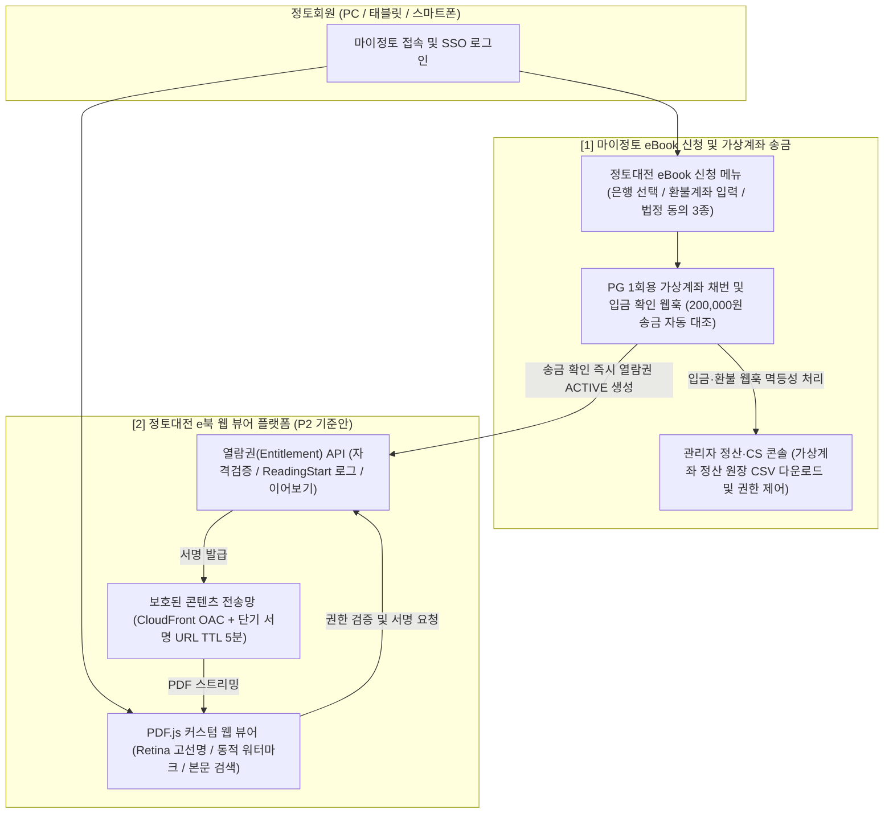

# 『정토대전』 e북 및 판매 시스템 종합 실행 허브 (Master Hub)

- **문서 버전**: v2.2 (100% 전자책 단독 발행 + 가상계좌 송금 단일 결제 확정본)
- **최종 업데이트**: 2026년 10월 23일
- **작성 및 주관**: 정토회 시스템국 / 사료편찬위원회 합동 TF
- **프로덕션 PoC 실시간 검수 URL (PC/Mac)**: `http://localhost:8123/jungto_ebook_viewer_poc.html`
- **프로덕션 PoC 실시간 검수 URL (태블릿/모바일 동일 Wi-Fi)**: `http://10.100.10.70:8123/jungto_ebook_viewer_poc.html`
- **대상 독자**: 사업 책임자(사료편찬위원회), 시스템국 개발 책임자, 개발봉사자(프론트엔드/백엔드/인프라), 편집 담당자, 법무·회계 담당자, 운영·CS 담당자

---

## 1. 프로젝트 큰 그림 (Executive Summary)

오랜 준비 끝에 출간되는 **『정토대전』(총 4권 세트, 책정가 20만 원)**은 종이책을 발행하지 않고 **100% 디지털 전자책(eBook)으로만 단독 발행**하며, 외부 일반 서점에 유통하지 않고 **정토회원에게만 한정 보급(가상계좌 송금 단일 결제)**하는 핵심 사료 프로젝트입니다. 본 문서 허브는 사료편찬위원회의 요청사항 분석부터 기획, 기술 아키텍처, 개발 공수 산정, 출시 및 CS 운영, 그리고 **정토회 공식 디자인(`jungto.org`)을 적용한 프로덕션 수준 통합 PoC 구축 및 검수**까지의 전 과정을 하나로 통합한 **단일 기준 문서(Single Source of Truth)**입니다.

### 🎯 확정된 2대 핵심 사업·기술 정책

| 핵심 결정 영역 | 확정 정책 | 핵심 실행 방안 및 기대 효과 | 소요 기간 / 공수 |
| :--- | :---: | :--- | :---: |
| **1. 발행 형태 및 결제 방식** | **전자책 단독 발행 + 가상계좌(송금) 단일 결제** | • **종이책 미발행(100% eBook)**: 배송지 주소 수집·보관 및 물류 발송 절차 완전 제거 (전자출판물 전용 E-ISBN 발급으로 부가세 면세 0% 적용) • **PG 1회용 가상계좌(송금) 단일화**: 20만 원 고액 카드 수수료(약 3%)를 건당 정액(약 300원)으로 95% 절감하고, 송금 즉시 PG 웹훅으로 입금을 자동 대조하여 동명이인 CS 대란 원천 차단 (미열람 환불 대비 환불 반환 계좌 함께 수집) | **판매·결제 연동 약 2주 (8~14인일)** |
| **2. 자체 e북 뷰어 플랫폼** | **모질라 `PDF.js` 커스텀 웹 뷰어 (기준안 P2)** | • 모질라 오픈소스 `PDF.js` 기반 무설치 HTML5 고해상도(Retina HiDPI) 웹 뷰어 자체 구축 (솔루션 라이선스 비용 0원, `jungto.org` 룩앤필 적용 PoC 완료) • 다운로드·인쇄 원천 제거 + 화면 동적 워터마크(`JT-7K4M`) + 포커스 이탈 블러 + 최초 열람(`ReadingStart`) 청약철회 제한 동의 모달 탑재 | **통합 구축 약 8~10주 (전담 TF 필수)** |

> [!IMPORTANT]
> **종이책 미발행 · 가상계좌(송금) 단일화에 따른 아키텍처 단순화 효과**
> 1. **개인정보 및 물류 리스크 제로화**: 우편번호·도로명 주소 등 배송지 개인정보를 수집하지 않으며, 출판국 송장 출력·택배 파손·반품 물류 업무가 완전히 사라집니다.
> 2. **단일 결제 상태 머신 집중**: 신용카드 취소/부분취소 분기 없이 **`1회용 가상계좌 채번(PAYMENT_PENDING) → 송금 입금완료 웹훅(PAID_VERIFIED) → 열람권 자동 부여(ACTIVE)`**의 단일 파이프라인으로 구축되어 결제·정산 안정성이 극대화됩니다.

---

## 2. 전체 시스템 및 비즈니스 아키텍처 (Big Picture)

---

## 3. 카테고리별 상세 문서 내비게이션 (Documentation Hub)

본 프로젝트의 모든 문서는 역할과 단계에 따라 **6개의 핵심 카테고리 문서**로 구조화되어 있습니다. 담당 역할에 맞춰 아래 문서를 순서대로 확인하십시오.

| 카테고리 | 문서 링크 | 핵심 수록 내용 | 주요 대상 독자 |
| :--- | :--- | :--- | :--- |
| **01. 요구사항 및 현업협의** | **[01_요구사항_및_현업협의.md](file:///Users/jeongseongchae/dev/jts/정토대전/docs/01_%EC%9A%94%EA%B5%AC%EC%82%AC%ED%95%AD_%EB%B0%8F_%ED%98%84%EC%97%85%ED%98%91%EC%9D%98.md)** | 사료편찬위원회 24개 확인 항목 (B-1~B-6) • 원고 인수 규격 및 CLI 사전 검증 절차 • 저작권·폰트 권리대장, 전자상거래법 환불, 전자출판물 단독 E-ISBN 면세 기준 • 요구사항 확정서 (D1~D9) | 사료편찬위원회, 사업 책임자, 편집자, 법무·회계팀 |
| **02. 기획 및 솔루션비교** | **[02_기획_및_솔루션비교.md](file:///Users/jeongseongchae/dev/jts/정토대전/docs/02_%EA%B8%B0%ED%9A%8D_%EB%B0%8F_%EC%86%94%EB%A3%A8%EC%85%98%EB%B9%84%EA%B5%90.md)** | 전자책 단독 발행 로드맵 • 마이정토 구매 메뉴 기획 및 **PG 1회용 가상계좌(송금) 단일 결제 설계** • 오픈소스(`PDF.js`) vs 상용 솔루션 비교 • 시니어/디바이스별 UX 설계 | 서비스 기획자, 사업 책임자, 시스템국 리더 |
| **03. 개발 및 기술아키텍처** | **[03_개발_및_기술아키텍처.md](file:///Users/jeongseongchae/dev/jts/정토대전/docs/03_%EA%B0%9C%EB%B0%9C_%EB%B0%8F_%EA%B8%B0%EC%88%A0%EC%95%84%ED%82%A4%ED%85%8D%EC%B2%98.md)** | 마이정토(Vue 3/Vite) 연계 및 AWS 클라우드 아키텍처 • `PDF.js` Retina 선명도(`devicePixelRatio`) 패치, 워터마크/보안 커스텀 코드 • CloudFront OAC + S3 비공개 서명 • DB ERD 및 REST API 명세 • QA 케이스 및 작업지시서 | 시니어 아키텍트, 프론트/백엔드 개발봉사자, QA 담당자 |
| **04. 운영 및 CS매뉴얼** | **[04_운영_및_CS매뉴얼.md](file:///Users/jeongseongchae/dev/jts/정토대전/docs/04_%EC%9A%B4%EC%98%81_%EB%B0%8F_CS%EB%A7%A4%EB%89%B4%EC%96%BC.md)** | 출시 리허설(D-7~D-1), 당일 배포 순서 • 정토대전 e북 5대 핵심 운영 포인트 (시니어 가상계좌 송금 CS, 인앱 브라우저 대응 등) • 오탈자 수정 및 개정판 불변 버전(`manifest.json`) 운영 • 비상 장애 대응 및 5년 보존 | 운영 책임자, 고객지원(CS)팀, 인프라 당번, 편집팀 |
| **05. 프로덕션 PoC 검수 및 최종 보고서** | **[05_프로덕션_PoC_검수_및_최종보고서.md](file:///Users/jeongseongchae/dev/jts/정토대전/docs/05_%ED%94%84%EB%A1%9C%EB%8D%95%EC%85%98_PoC_%EA%B2%80%EC%88%98_%EB%B0%8F_%EC%B5%9C%EC%A2%85%EB%B3%B4%EA%B3%A0%EC%84%9C.md)** | 프로덕션 수준 통합 PoC 아키텍처 및 구현 명세 • 『정토대전』 전 4권 벡터 한글·한자 PDF 에셋 명세 • 스토어(가상계좌 채번/송금) → 내 서재(`ReadingStart`/정오표) → eBook 뷰어 → 운영 콘솔(`/ops`) 단계별 실전 검수 가이드 | 전체 의사결정권자, 검수 위원, 시스템국 리더 |
| **06. PoC 아키텍처 및 직군별 해설서** | **[06_PoC_아키텍처_및_직군별_기획_운영_개발_해설서.md](file:///Users/jeongseongchae/dev/jts/정토대전/docs/06_PoC_%EC%95%84%ED%82%A4%ED%85%8D%EC%B2%98_%EB%B0%8F_%EC%A7%81%EA%B5%B0%EB%B3%84_%EA%B8%B0%ED%9A%8D_%EC%9A%B4%EC%98%81_%EA%B0%9C%EB%B0%9C_%ED%95%B4%EC%84%A4%EC%84%9C.md)** | 4-Tier 통합 아키텍처 및 마이정토 실서비스 1:1 매핑 • 가상계좌 주문·열람권(`Entitlement`) 상태 머신 • **[기획자 관점]** 전자책 전용 청약철회 방어·가상계좌 단일화·시니어 UX • **[운영자 관점]** 송금 웹훅 멱등성·CS 권한 제어·워터마크 역추적·정산 원장 CSV • **[개발자 관점]** Retina 수식·`TextLayer`·보안 코드 해설 • `jungto.org` 디자인 토큰 규격 | 기획자, 운영·CS 담당자, 프론트·백엔드·인프라 개발자 |

### 🔗 부속 참고 자료, 엔지니어링 명세(Specs) 및 실시간 프로토타입
- **PostgreSQL 16 프로덕션 6-Table 스키마 DDL (`.sql`)**: [specs/schema_v1_jungto_ebook.sql](file:///Users/jeongseongchae/dev/jts/정토대전/docs/specs/schema_v1_jungto_ebook.sql)
- **OpenAPI 3.1.0 REST API 표준 계약서 (`.yaml`)**: [specs/openapi_v1_jungto_ebook.yaml](file:///Users/jeongseongchae/dev/jts/정토대전/docs/specs/openapi_v1_jungto_ebook.yaml)
- **S3 불변 릴리즈 번들러 & 매니페스트 (`v1.0.0`)**: [temp/build_release_bundle.py](file:///Users/jeongseongchae/dev/jts/temp/build_release_bundle.py) / [temp/releases/v1.0.0/manifest.json](file:///Users/jeongseongchae/dev/jts/temp/releases/v1.0.0/manifest.json) (`http://localhost:8123/releases/v1.0.0/manifest.json`)
- **전체 시스템 구성도 Excalidraw 원본 (`.excalidraw` JSON)**: [jungto_ebook_system_architecture.excalidraw](file:///Users/jeongseongchae/dev/jts/정토대전/docs/jungto_ebook_system_architecture.excalidraw) (`http://localhost:8123/jungto_ebook_system_architecture.excalidraw`)
- **전체 시스템 구성도 고해상도 렌더링 이미지 (`.png`)**: [jungto_ebook_system_architecture.png](file:///Users/jeongseongchae/dev/jts/정토대전/docs/jungto_ebook_system_architecture.png) (`http://localhost:8123/jungto_ebook_system_architecture.png`)
- **전체 시스템 아키텍처 에디토리얼 4-Layer 도면 (SVG/HTML)**: [jungto_ebook_architecture_diagram.html](file:///Users/jeongseongchae/dev/jts/정토대전/docs/jungto_ebook_architecture_diagram.html) (`http://localhost:8123/jungto_ebook_architecture_diagram.html`)
- **프로덕션 수준 통합 PoC 웹 시스템 (`jungto.org` 디자인 적용)**: [temp/jungto_ebook_viewer_poc.html](file:///Users/jeongseongchae/dev/jts/temp/jungto_ebook_viewer_poc.html) (`http://localhost:8123/jungto_ebook_viewer_poc.html`)
- **프로덕션 PoC 비즈니스 엔진**: [temp/jungto_ebook_app.js](file:///Users/jeongseongchae/dev/jts/temp/jungto_ebook_app.js)
- **전 4권 벡터 한글·한자 PDF 생성기**: [temp/generate_jungto_pdfs.py](file:///Users/jeongseongchae/dev/jts/temp/generate_jungto_pdfs.py)

---

## 4. 단계별 게이트(Gate) 및 통과 조건 (G0 ~ G7)

